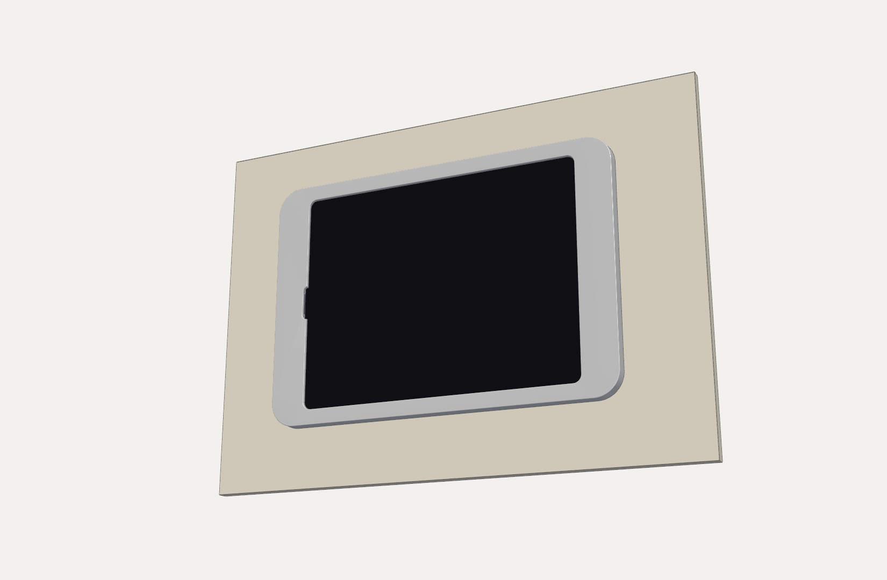

# iPad Pro 12.9″ PoE Wall Mount

A premium wall mount that turns an **iPad Pro 12.9″ (3rd gen: A1876, A1895, A2014, A1983)** into a permanently powered HomeKit / Home Assistant panel over a single Cat6 cable (PoE+). It has a machined 6061 aluminium face and 3D-printed hidden parts, with the cable fully concealed.

There are two versions:

| | [**Float v4.1**](float-v4.1/) (surface mount) | [**Flush v5.1**](flush-v5.1/) (in-wall) |
|---|---|---|
| |  |  |
| Look | Floats 14 mm off the wall on a shadow gap | Glass 1.2 mm off the wall, trim 4.5 mm proud |
| Aluminium part | 344.1 × 238.9 × 11.7 mm shell, about 223 g | 355.1 × 233.6 × 3 mm trim, about 188 g |
| Wall work | One small cut-out behind the panel for the cable | 343.1 × 221.6 mm cut-out between studs (10 mm plasterboard, 70 mm studs at 450 c/c) |
| Fixing | Bracket + hook + one hidden M3 lock screw | 4 dog-ear arms clamp the plasterboard; magnetic trim |
| Build manual (PDF) | [Float_Mount_v4.1_Build_Manual.pdf](float-v4.1/Float_Mount_v4.1_Build_Manual.pdf) | [Float_Mount_v5.1_Flush_Build_Manual.pdf](flush-v5.1/Float_Mount_v5.1_Flush_Build_Manual.pdf) |
| Build manual (web) | [BUILD_MANUAL.md](float-v4.1/BUILD_MANUAL.md) | [BUILD_MANUAL.md](flush-v5.1/BUILD_MANUAL.md) |

**No CNC?** Both mounts also come in a [**fully printed**](fully-printed/) version. The aluminium face becomes a two-piece printed face joined with dovetails, and each version has a ready-to-slice Bambu Studio 3MF (also suitable for MakerWorld).

Both versions use a **standard straight USB-C cable** (the plug and its bend hide inside the frame ends), a PoE+ to USB-C adapter (e.g. PoE Texas / Heckler T515), and print with **no supports** on a 256 mm bed (Bambu P1S / X1C class) in PETG or ASA.

## Repository layout

```
float-v4.1/                 surface-mount version
  README.md                 build notes: parts, machining, hardware, assembly
  Float_Mount_v4.1_Build_Manual.pdf  build manual, one step per page
  BUILD_MANUAL.md           the same manual as a GitHub page
  hybrid.py                 parametric CadQuery source (regenerates every file)
  overhang_audit.py         checks each part for unsupported overhangs
  assembly_hybrid_v4_1.step whole stack
  machine/shell_6061.step   the aluminium part, for CAM
  print/                    STL + STEP for every printed part
  images/                   manual renders and schematics

flush-v5.1/                 flush in-wall version
  README.md, Float_Mount_v5.1_Flush_Build_Manual.pdf, BUILD_MANUAL.md, flush51.py
  CUTOUT_TEMPLATE_A3.pdf    print at 100% on A3 (100 mm check bar)
  assembly_flush_v5_1.step, machine/trim_6061.step, print/, images/

fully-printed/              no-machining versions: printed face halves + Bambu Studio 3MF projects
  float-v4.1-printed/       Float_Mount_v4.1_Printed.3mf, print/
  flush-v5.1-printed/       Float_Mount_v5.1_Flush_Printed.3mf, print/
  printed.py, make3mf.py    regenerate the printed faces and the 3MFs

tools/manual/               scripts that render the manual images (VTK + matplotlib)
```

## Customising

Every dimension comes from the parameters at the top of `hybrid.py` / `flush51.py`. Measure your USB-C plug (`PLUG_L`, `PLUG_W`, `PLUG_H`), cable (`CABLE_D`, `BEND_R`) or wall (`PLASTER`), change the numbers and re-run:

```bash
pip install cadquery
cd float-v4.1 && python hybrid.py out      # writes print/, machine/ and STEP files to ./out
cd flush-v5.1 && python flush51.py out
```

To regenerate the manual images: `cd tools/manual && python render_v41.py && python render_v51.py && python schematics.py && python sections.py` (needs `vtk`, `matplotlib`). Run `sections.py` last; it draws the final cross-sections.

## Notes

- Button, camera, speaker and microphone positions on the iPad are close approximations. Print a test fit (v4.1 includes a printable copy of the aluminium shell) before you machine metal or cut a wall.
- The physical buttons end up covered. Use AssistiveTouch, Siri or Settings › Shut Down.
- The build manuals follow the style of the free [Flightory](https://flightory.com) RC plane manuals.

## Licence

[GPL-3.0](LICENSE)
