# Float Mount v4.1 · Build Manual

> **PDF version (print-ready, one step per page): [Float_Mount_v4.1_Build_Manual.pdf](Float_Mount_v4.1_Build_Manual.pdf)**

PoE wall mount for iPad Pro 12.9″ (3rd gen)

Machined 6061 aluminium shell with a 3D-printed carrier. Surface-mounted, floating on a 14 mm shadow gap.

*Colour code in every step: **orange** = the part you are working on now, **blue** = screws, inserts, magnets and other hardware, grey = parts already fitted.*

## Contents

  - [GENERAL DATA](#general-data)
  - [DESIGN FEATURES](#design-features)
  - [EXPLODED VIEW](#exploded-view)
  - [HOW IT FITS TOGETHER](#how-it-fits-together)
  - [POWER AND DATA PATH](#power-and-data-path)
  - [RECOMMENDED EQUIPMENT](#recommended-equipment)
  - [REQUIRED HARDWARE](#required-hardware)
  - [TOOLS](#tools)
  - [PRINT SETTINGS](#print-settings)
  - [PARTS LIST](#parts-list)
  - [FILES](#files)
  - [CARRIER QUARTERS](#carrier-quarters)
  - [HANGER, LOCK BOSS, CATCH RAIL](#hanger-lock-boss-catch-rail)
  - [WALL BRACKET](#wall-bracket)
  - [SHELL PROTOTYPE](#shell-prototype)
  - [SHELL: BACK SIDE UP](#shell-back-side-up)
  - [SHELL: FRONT SIDE UP](#shell-front-side-up)
- [01 · BENCH ASSEMBLY](#01--bench-assembly)
  - [HEAT-SET INSERTS](#heat-set-inserts)
  - [CATCH RAIL TO THE BRACKET](#catch-rail-to-the-bracket)
  - [HANGER TO THE TOP QUARTERS](#hanger-to-the-top-quarters)
  - [LOCK BOSS TO THE BOTTOM QUARTERS](#lock-boss-to-the-bottom-quarters)
  - [PORON TAPE ON THE LIP](#poron-tape-on-the-lip)
  - [iPAD INTO THE SHELL](#ipad-into-the-shell)
  - [CARRIER INTO THE SHELL](#carrier-into-the-shell)
  - [SCREW THE CARRIER TO THE SHELL](#screw-the-carrier-to-the-shell)
  - [CHECK THE BACK](#check-the-back)
- [02 · WALL INSTALLATION](#02--wall-installation)
  - [PLAN THE POSITION](#plan-the-position)
  - [FIX THE BRACKET](#fix-the-bracket)
  - [CONNECT THE PoE ADAPTER](#connect-the-poe-adapter)
  - [HANG THE PANEL](#hang-the-panel)
  - [FIT THE LOCK SCREW](#fit-the-lock-screw)
  - [iPAD SETUP FOR A WALL PANEL](#ipad-setup-for-a-wall-panel)
  - [FINAL CHECKLIST](#final-checklist)
- [ENJOY YOUR FLOAT MOUNT](#enjoy-your-float-mount)

---

### GENERAL DATA

OVERVIEW

| Item | Value |
| --- | --- |
| Overall size | 344.1 × 238.9 mm |
| Depth off the wall | 25.7 mm (14 mm shadow gap) |
| Frame width | ends 31.8 mm · top/bottom 12.0 mm |
| Shell | 6061 aluminium, about 223 g |
| Fits | iPad Pro 12.9″ 3rd gen (A1876, A1895, A2014, A1983) |
| Power + data | PoE+ (802.3at) over one Cat6 |
| Cable | standard straight USB-C, hidden |
| Fixing | bracket + hook + one hidden M3 lock screw |
| Printer | 256 × 256 mm bed (P1S / X1C class) |

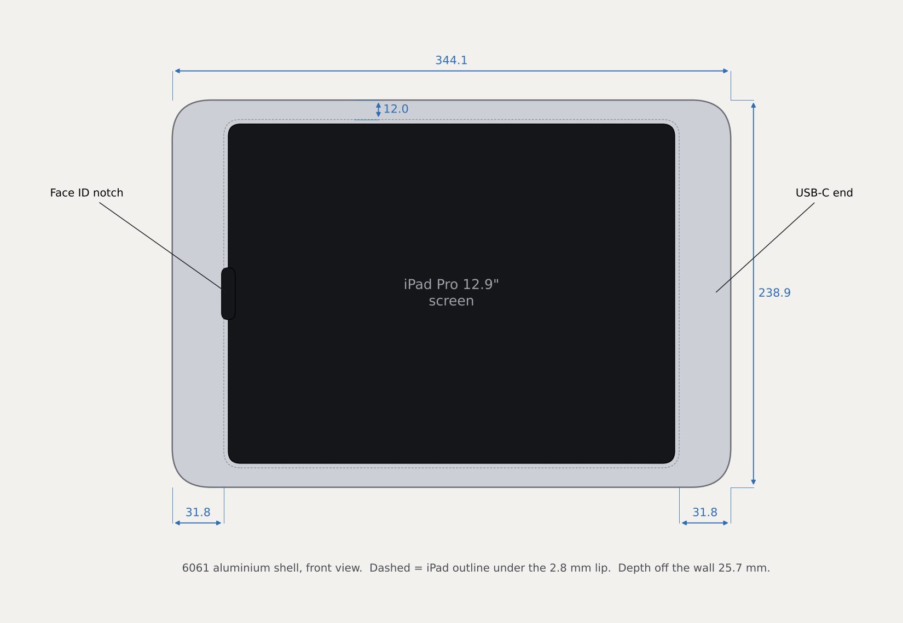

---

### DESIGN FEATURES

OVERVIEW

#### FLOATING LOOK

The panel stands 14 mm off the wall. Nothing that holds it can be seen.

#### NO VISIBLE SCREWS

The carrier screws into 16 blind bosses in the shell from behind.

#### HIDDEN CABLE

A normal straight USB-C plug and its bend live inside the frame end.

#### SOUND STILL WORKS

Speakers and mics fire into open chambers that vent into the shadow gap.

#### PRINT THE HIDDEN PARTS

Only the shell is aluminium. Every printed part prints with no supports.

#### ONE-SCREW LOCK

It hangs on a rail. One M3 screw from below stops it lifting off.

---

### EXPLODED VIEW

OVERVIEW

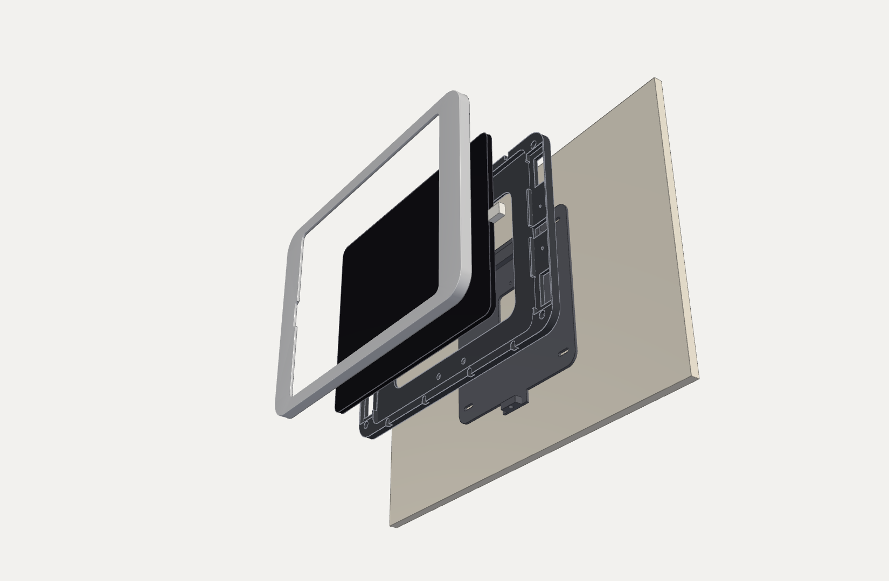

1

**Wall bracket** with the catch rail and lock block

2

**Printed carrier**, four quarters, with the hanger and lock boss

3

**iPad Pro 12.9″** and its straight USB-C plug

4

**6061 aluminium shell**, the only part you see

---

### HOW IT FITS TOGETHER

OVERVIEW

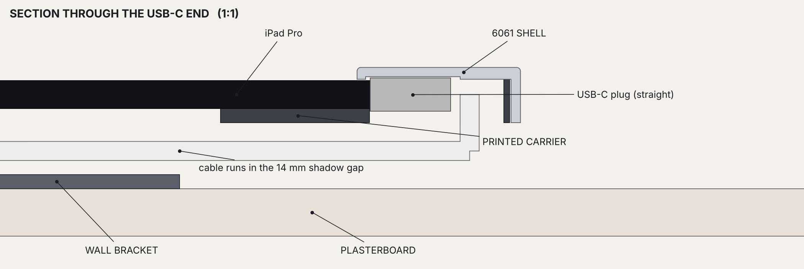

A true 1:1 cut through the USB-C end. The aluminium lip retains the glass, the plug sits in a pocket inside the frame end, and the cable turns straight back into the 14 mm shadow gap and runs to the bracket cut-out.

---

### POWER AND DATA PATH

OVERVIEW

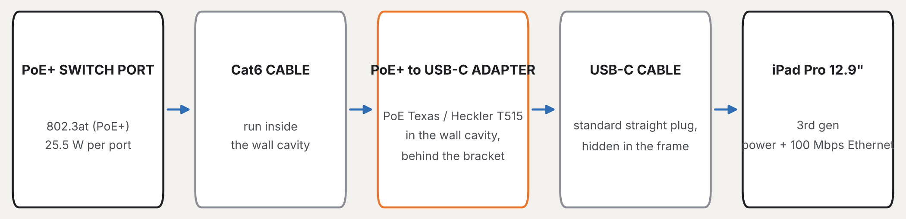

> [!WARNING]
> **Use a PoE+ (802.3at) port.** Plain 802.3af PoE cannot supply the 25 W adapter.

> [!TIP]
> **Run the Cat6 first.** It ends behind the bracket, where the adapter lives in the wall cavity.

---

### RECOMMENDED EQUIPMENT

BEFORE YOU START

| Item | Notes |
| --- | --- |
| PoE+ switch port | 802.3at (PoE+). One port per panel. |
| PoE+ to USB-C adapter | PoE Texas / Heckler T515, 25 W, power + 100 Mbps Ethernet |
| USB-C cable | Standard straight plug. Frame sized for a 17 × 12.5 × 7 mm overmold. |
| Cat6 cable | From the switch to the bracket position, inside the wall |
| Filament | PETG or ASA. Not PLA: a charging iPad on a warm wall softens it. |
| Aluminium | 6061 plate, 12 mm thick, at least 360 × 255 mm |
| PORON tape | 0.3 mm thick, about 1 m, for the lip that touches the glass |
| Mounting bracket (optional) | AU plasterboard wall-plate bracket, 84 mm screw centres |

---

### REQUIRED HARDWARE

BEFORE YOU START

| Item | Qty | Where it goes |
| --- | ---: | --- |
| M3 × 6 cap screw | 8 | Carrier to shell, end bosses |
| M2.5 × 6 cap screw | 8 | Carrier to shell, top and bottom bosses |
| M3 × 8 countersunk screw | 10 | Hanger 4 · lock boss 2 · catch rail 4 |
| M3 heat-set insert | 9 | Hanger 4 · lock boss 1 · catch rail 4 |
| M3 nut | 2 | Lock boss hex pockets |
| M3 × 12 screw | 1 | Lock screw, driven up from below |
| Wall anchors (5 mm slot) | 4 | Bracket slots, or 2 screws into a wall-plate bracket |
| PORON tape 0.3 mm | 1 m | Underside of the shell lip |

---

### TOOLS

BEFORE YOU START

#### BENCH

- Soldering iron + heat-set tip
- Hex keys 2 and 2.5 mm
- Flat screwdriver
- Isopropyl alcohol + cloth
- Soft towel

#### MACHINING

- CNC router (StrongHold)
- 6 mm and 2 mm end mills
- 2.05 and 2.5 mm drills
- M2.5 and M3 taps
- Deburring tool

#### WALL

- Stud finder
- Spirit level
- Plasterboard saw
- Drill / driver
- Pencil + tape measure

---

### PRINT SETTINGS

PRINTING

| Setting | Value |
| --- | --- |
| Material | PETG or ASA |
| Layer height | 0.2 mm (0.4 mm nozzle) |
| Walls | 4 (5 on hanger, lock boss, rail) |
| Infill: carrier | 15% gyroid |
| Infill: wall bracket | 25% gyroid |
| Infill: hanger, lock boss, rail | 40% gyroid |
| Supports | None needed |
| Bed | Textured PEI |

> [!WARNING]
> **No supports.** Every v4.1 part was checked for overhangs in its print orientation. Sound chambers are open-top; the hanger is solid down to its foot.

> [!TIP]
> **Small bridges are fine.** The only unsupported surfaces left are the rings inside the screw recesses.

> [!TIP]
> **Corners lifting?** Add a brim to the carrier quarters.

---

### PARTS LIST

PRINTING

| Part | Material | Qty | Size (mm) |
| --- | --- | ---: | --- |
| CARRIER TL / TR / BL / BR | PETG / ASA | 1 each | 169.8 × 117.2 |
| HANGER | PETG / ASA | 1 | 110.0 × 21.4 |
| LOCK BOSS | PETG / ASA | 1 | 60.0 × 17.5 |
| CATCH RAIL | PETG / ASA | 1 | 120.0 × 16.0 |
| WALL BRACKET | PETG / ASA | 1 | 200.0 × 214.5 |
| SHELL | 6061 aluminium | 1 | 344.1 × 238.9 × 11.7 |
| SHELL PROTO TL / TR / BL / BR | PETG (optional) | 1 each | 172.1 × 119.5 |

The printed shell prototype is a plastic copy of the aluminium shell. Print it first and test the whole stack on your iPad before you cut metal.

---

### FILES

PRINTING

#### print/ (STL for the slicer)

- carrier_TL · carrier_TR
- carrier_BL · carrier_BR
- hanger · lock_boss
- catch_rail · wall_bracket
- optional_shell_prototype/shell_print_TL … BR

#### machine/ and CAD

- machine/shell_6061.step for CAM
- assembly_hybrid_v4_1.step (whole stack)
- carrier_full_reference.step
- hybrid.py: the parametric source
- BUILD_NOTES.md

Every size in this manual comes from hybrid.py. Change a parameter there (plug size, frame width, clearance) and re-run it to regenerate every file.

---

### CARRIER QUARTERS

PARTS ORIENTATION · 1 OF 4

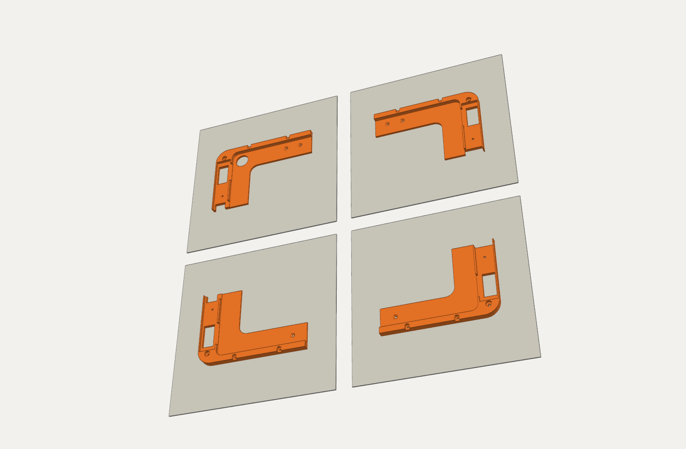

Print each quarter **back face down**, exactly as exported. One quarter per plate.

CARRIER 1–4 · 15% gyroid · 4 walls · no supports

> [!TIP]
> Mark each quarter TL, TR, BL or BR with a pen as it comes off the plate. They look alike.

---

### HANGER, LOCK BOSS, CATCH RAIL

PARTS ORIENTATION · 2 OF 4

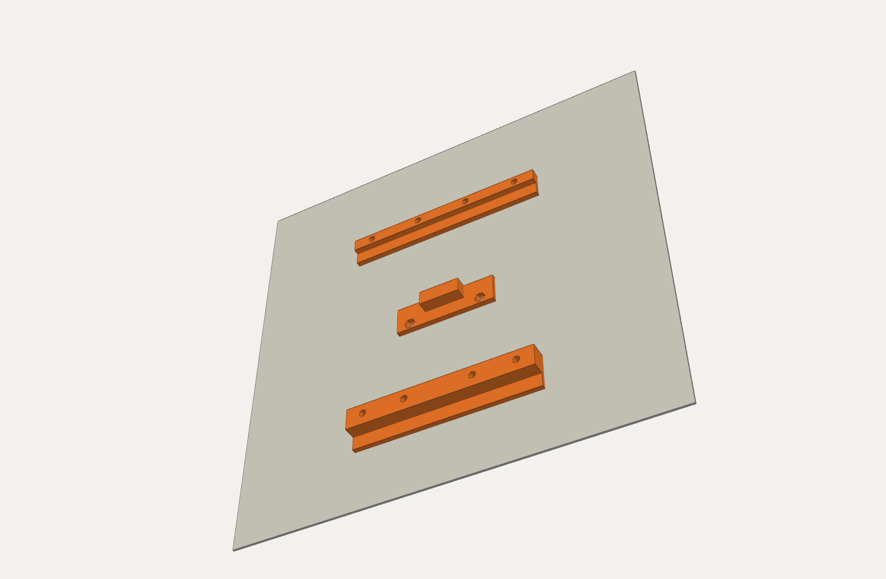

All three fit on one plate.

- **HANGER:** foot down
- **LOCK BOSS:** pad down
- **CATCH RAIL:** flange down

40% gyroid · 5 walls · no supports. These carry the weight, so don’t go lighter.

---

### WALL BRACKET

PARTS ORIENTATION · 3 OF 4

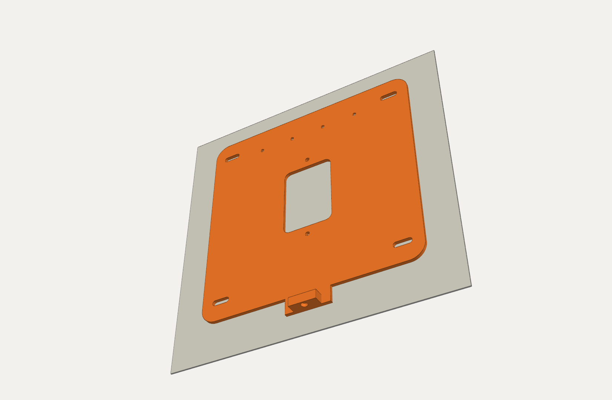

Print the plate **flat side down**. The lock block stands up at the bottom edge.

25% gyroid · 4 walls · no supports

> [!TIP]
> The bed side becomes the wall side, so the countersinks for the rail screws come out on the face that touches the wall.

---

### SHELL PROTOTYPE

PARTS ORIENTATION · 4 OF 4 · OPTIONAL

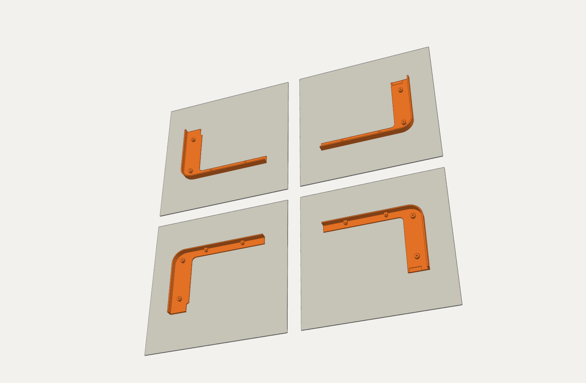

A plastic stand-in for the aluminium shell. Print the four quarters **face down** (already flipped).

Use a different colour from the carrier so you can see what touches what.

> [!WARNING]
> **Do this before machining.** Build the whole panel with it and check the iPad fit, Face ID, plug and sound.

---

### SHELL: BACK SIDE UP

MACHINING · OP 1 OF 2

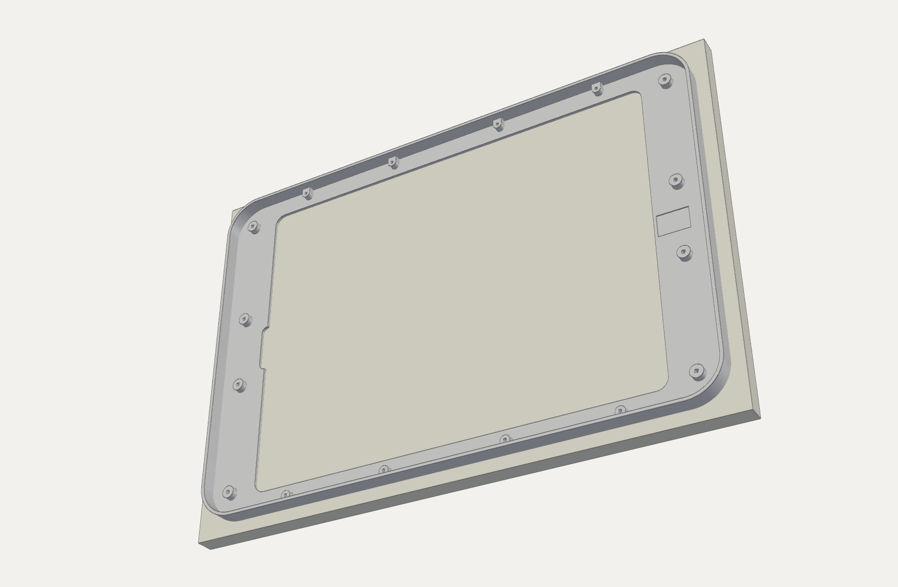

1. Face 12 mm 6061 to 11.7 mm.
2. Pocket 9.2 mm deep with a 6 mm flat end mill. Leave the bosses 4.2 mm proud: 8 × Ø8 on the ends, 8 × Ø6 top/bottom, merged into the skirt.
3. Cut the 0.55 mm plug relief at the USB-C end.
4. From each boss tip, drill 5.5 mm deep: Ø2.5 and tap M3 on the ends, Ø2.05 and tap M2.5 top/bottom.

> [!WARNING]
> **5.5 mm is the limit.** It leaves a 1.2 mm skin under the front face.

---

### SHELL: FRONT SIDE UP

MACHINING · OP 2 OF 2

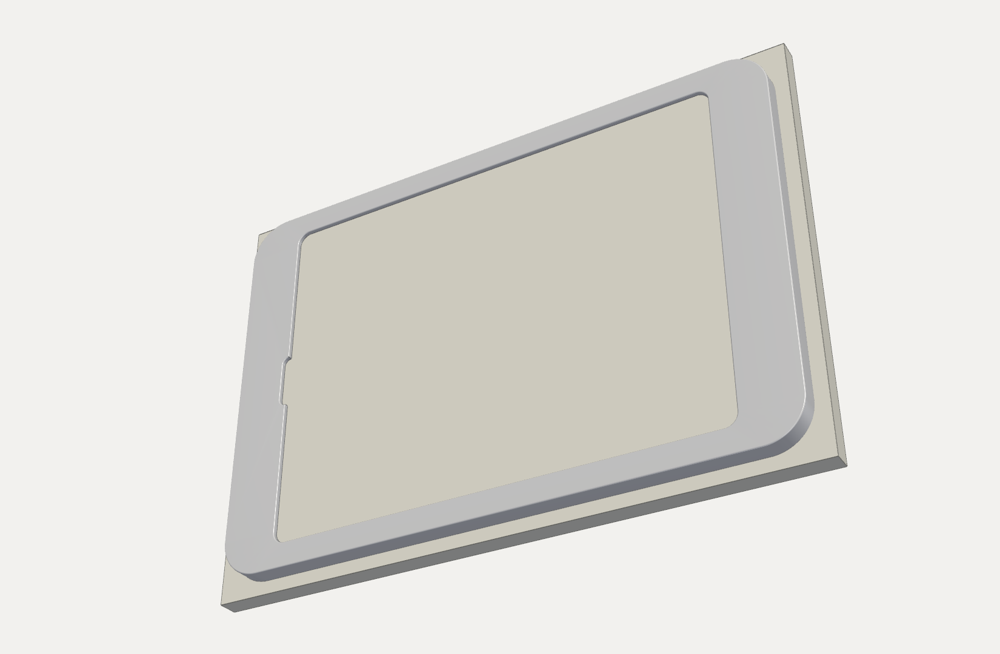

1. Locate off the pocket walls, or soft pins in two boss holes.
2. Cut the window through. Inner corners are R7.5; the Face ID notch is a stadium with R4.2 ends.
3. Profile the outside with tabs.
4. Put a 0.8 mm radius on the front outer edge. Deburr the window.

> [!TIP]
> **Finish:** fine glass bead blast, then clear or black anodise.

---

## 01 · BENCH ASSEMBLY

Nine steps on the bench. You finish with a complete panel: shell, iPad and carrier, ready to hang.

---

### HEAT-SET INSERTS

BENCH ASSEMBLY · STEP 1 OF 9

**You need:** 9 × M3 heat-set inserts · soldering iron with insert tip

---

### CATCH RAIL TO THE BRACKET

BENCH ASSEMBLY · STEP 2 OF 9

**You need:** 4 × M3 × 8 countersunk screws

---

### HANGER TO THE TOP QUARTERS

BENCH ASSEMBLY · STEP 3 OF 9

**You need:** CARRIER TL + TR · HANGER · 4 × M3 × 8 countersunk

---

### LOCK BOSS TO THE BOTTOM QUARTERS

BENCH ASSEMBLY · STEP 4 OF 9

**You need:** CARRIER BL + BR · LOCK BOSS · 2 × M3 × 8 countersunk · 2 × M3 nuts

---

### PORON TAPE ON THE LIP

BENCH ASSEMBLY · STEP 5 OF 9

**You need:** SHELL · about 1 m of 0.3 mm PORON tape · isopropyl alcohol

---

### iPAD INTO THE SHELL

BENCH ASSEMBLY · STEP 6 OF 9

**You need:** iPad Pro 12.9″ · straight USB-C cable

---

### CARRIER INTO THE SHELL

BENCH ASSEMBLY · STEP 7 OF 9

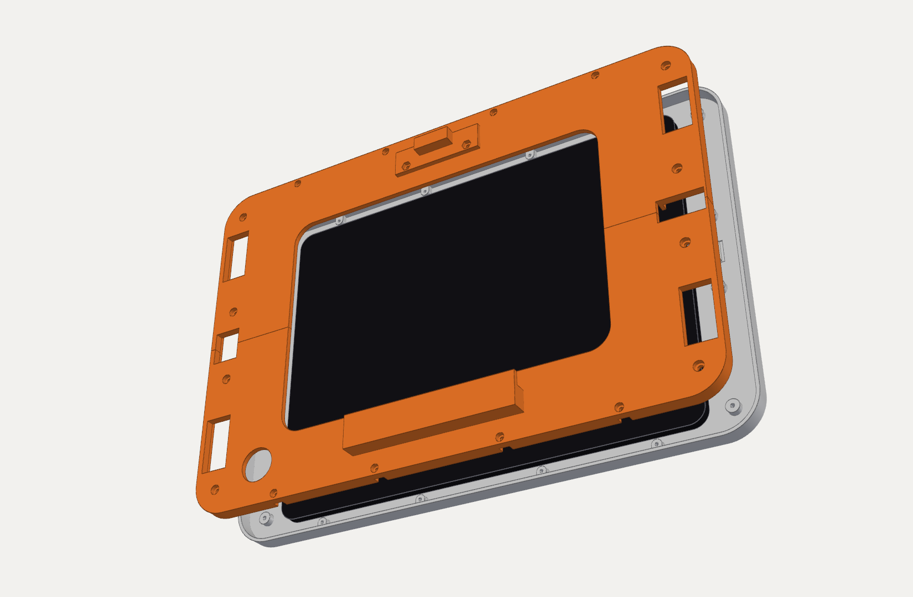

Lower both carrier pairs over the iPad. The **HANGER goes to the panel’s top edge**, the LOCK BOSS to the bottom.

Guide the plug into its pocket at the USB-C end and feed the cable out through the opening in the back. The shell’s skirt lines the quarters up for you.

> [!WARNING]
> Don’t force it. If a quarter won’t sit flat, the cable is trapped.

---

### SCREW THE CARRIER TO THE SHELL

BENCH ASSEMBLY · STEP 8 OF 9

**You need:** 8 × M3 × 6 cap · 8 × M2.5 × 6 cap · 2 and 2.5 mm hex keys

---

### CHECK THE BACK

BENCH ASSEMBLY · STEP 9 OF 9

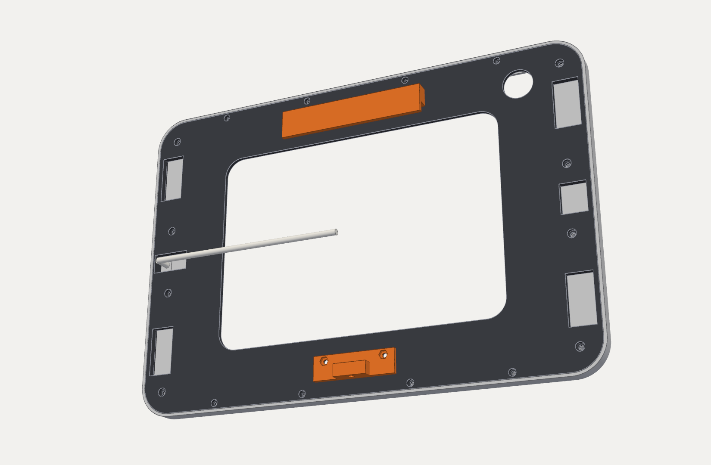

Turn the panel over and check:

- The cable leaves the USB-C end cleanly and isn’t pinched.
- The sound vents at both ends are open.
- The HANGER is at the top, the LOCK BOSS at the bottom.
- No screw heads stand proud.

> [!TIP]
> Leave enough cable to reach the bracket’s cut-out with slack to plug in.

---

## 02 · WALL INSTALLATION

Five steps: plan the position, fix the bracket, connect power, hang the panel, lock it.

---

### PLAN THE POSITION

WALL INSTALLATION · STEP 1 OF 5

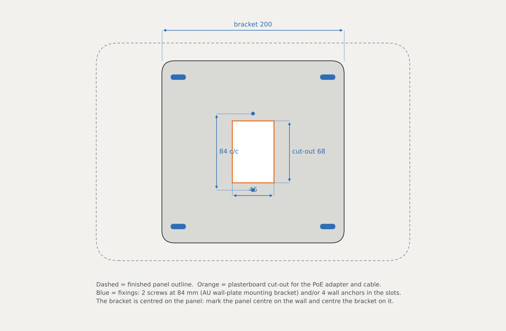

Mark the panel’s centre on the wall. The bracket centres on the same point.

- A screen centre around 1400–1500 mm from the floor is a common choice.
- Check for cables and pipes before you cut.
- The Cat6 must reach the cut-out.

> [!TIP]
> A stud under a bracket slot? Use a wood screw there instead of an anchor.

---

### FIX THE BRACKET

WALL INSTALLATION · STEP 2 OF 5

**You need:** WALL BRACKET · 4 anchors · spirit level · plasterboard saw

---

### CONNECT THE PoE ADAPTER

WALL INSTALLATION · STEP 3 OF 5

Pull the Cat6 out through the cut-out and plug it into the adapter.

Hold the panel near the wall and plug its USB-C cable into the adapter. Push the adapter back into the cavity and leave the slack loose behind the bracket.

> [!WARNING]
> Check the iPad charges before you hang it.

---

### HANG THE PANEL

WALL INSTALLATION · STEP 4 OF 5

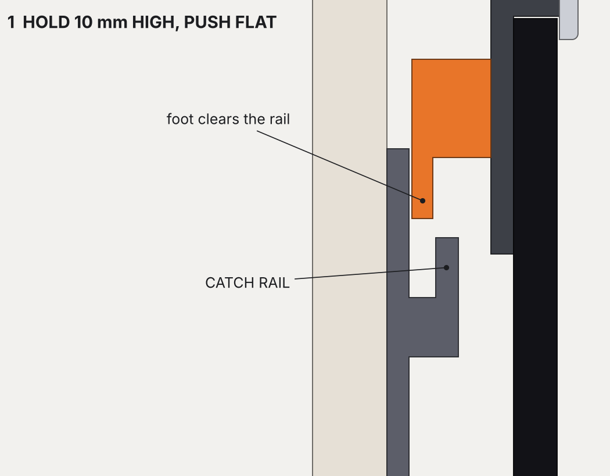

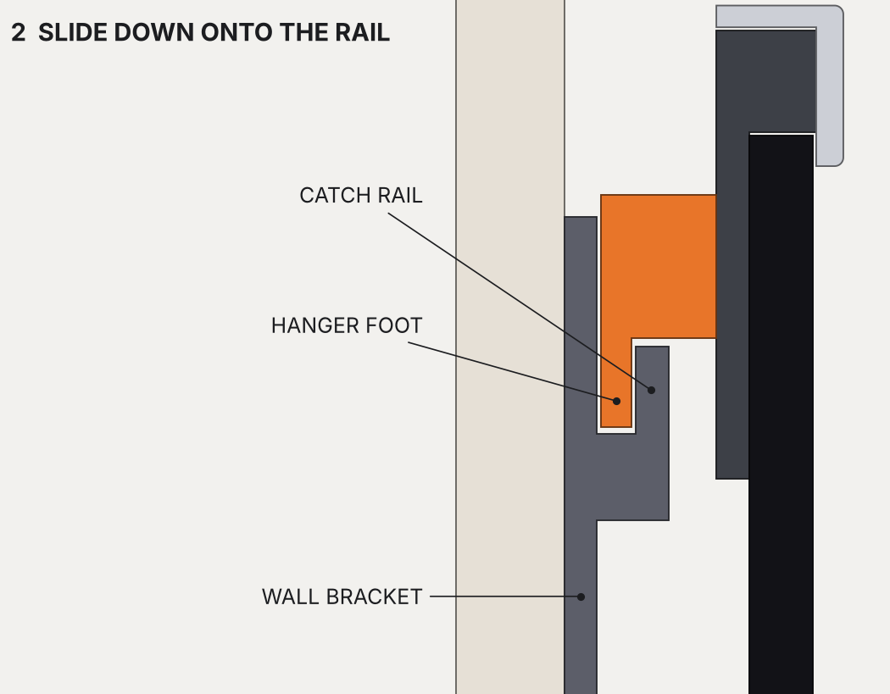

Hold the panel about **10 mm higher** than its final position and push it flat to the bracket.

Slide it straight down. The HANGER foot drops under the CATCH RAIL lip and stops.

> [!TIP]
> Feed the slack cable into the cavity as it goes down.

---

### FIT THE LOCK SCREW

WALL INSTALLATION · STEP 5 OF 5

**You need:** 1 × M3 × 12 screw · hex key

---

### iPAD SETUP FOR A WALL PANEL

SETUP

#### KEEP THE SCREEN ON

Settings › Display & Brightness › Auto-Lock › Never. Dim it at night with a Shortcut or Home Assistant automation.

#### LOCK TO ONE APP

Settings › Accessibility › Guided Access. Start it in Home or your dashboard app.

#### BUTTONS ARE COVERED

Turn on Settings › Accessibility › Touch › AssistiveTouch for lock, volume and restart. Siri works too.

#### CHECK ETHERNET

With the adapter connected, an Ethernet entry appears in Settings. Wi-Fi can stay on as a backup.

---

### FINAL CHECKLIST

FINISHING BUILD

- [ ] Panel sits level and doesn’t rattle
- [ ] iPad shows it is charging
- [ ] Screen edges clear of the lip all round
- [ ] Ethernet appears in Settings
- [ ] Face ID unlocks first time
- [ ] Lock screw in; panel can’t lift off
- [ ] Speakers clear; Siri hears you
- [ ] Guided Access and Auto-Lock set

> [!WARNING]
> **Something off?** Every size lives in hybrid.py. Measure the problem, change the parameter, re-run it, and reprint only the part that changed.

---

## ENJOY YOUR FLOAT MOUNT

Feature positions on the iPad (buttons, cameras, speakers) are close approximations. Build the printed shell prototype first and adjust before you machine.

Also available: Float Mount v5.1, the flush in-wall version.

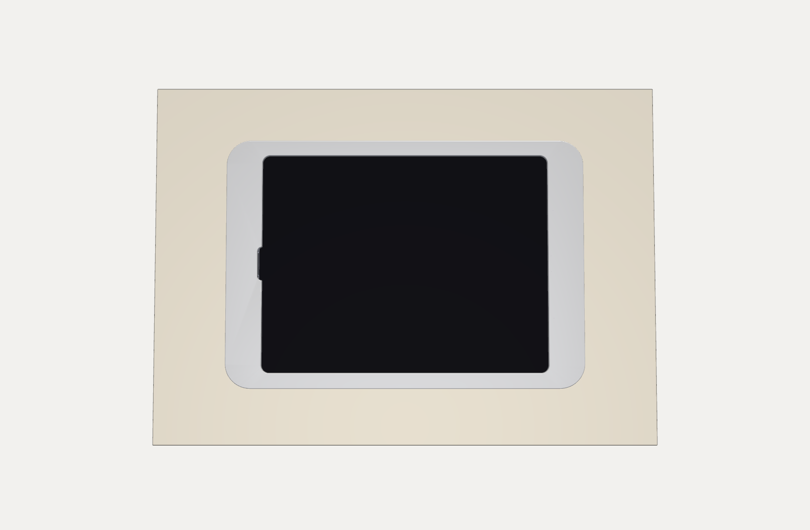
