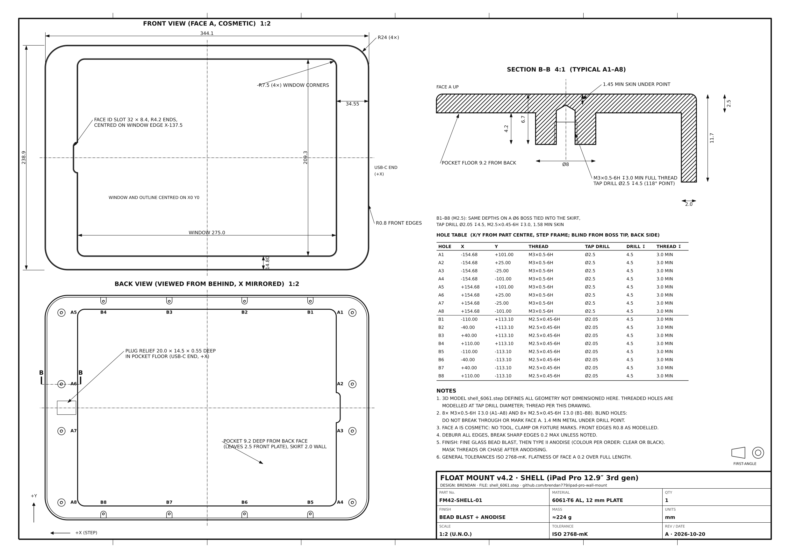

# Float Mount v4.2

Same mount as [v4.1](../float-v4.1/), with two changes:

1. **The aluminium shell is ready to order from a CNC service (JLCCNC or similar).** It now comes with a manufacturing drawing that specifies the threaded holes, and the holes are redesigned for a real drill.
2. **One-piece versions of the split printed parts**, for anyone with a big enough bed.

The [v4.1 build manual](../float-v4.1/Float_Mount_v4.1_Build_Manual.pdf) still applies; see [changes from v4.1](#changes-from-v41) below.

---

## Ordering the shell (JLCCNC)

Upload these two files together:

| File | What it is |
|---|---|
| [`machine/shell_6061.step`](machine/shell_6061.step) | 3D model. Threaded holes are modelled at **tap-drill size** (the usual convention) |
| [`machine/shell_6061_drawing.pdf`](machine/shell_6061_drawing.pdf) | A3 drawing: thread callouts, hole table, a 4:1 section through a boss, finish and tolerances |

[](machine/shell_6061_drawing.pdf)

**Threads, in JLCCNC's callout format:**

| Holes | Thread | Tap drill | Drill depth | Thread depth | Skin left under the drill point |
|---|---|---|---|---|---|
| A1–A8 (ends) | M3×0.5-6H | Ø2.5 | 4.5 | 3.0 min | 1.45 mm |
| B1–B8 (top/bottom) | M2.5×0.45-6H | Ø2.05 | 4.5 | 3.0 min | 1.58 mm |

Depths are measured from the boss tip, on the back side. Both meet JLCCNC's guidance: thread depth no more than 3× the diameter, and at least half a diameter of unthreaded hole below the thread.

**When ordering:**

- **Material:** 6061-T6.
- **Threads:** select threaded holes / tapping, and tell them the drawing defines the threads.
- **Finish:** bead blast, then anodise in clear or black. Ask for the threads to be masked during anodising or chased afterwards.
- **M2.5:** JLCCNC's guideline doesn't list the sizes it taps. If the quote rejects M2.5, ask before changing anything. M3 in the top/bottom bosses is possible, but it leaves a thinner wall (Ø6 boss), so it's a design change, not a substitution.
- **The drawing marks face A (the front) as cosmetic.** That means no tool or clamp marks, and the threads must not break through.

## One-piece printed parts

| Part | Size | Fits |
|---|---|---|
| [`print/one_piece/carrier_full`](print/one_piece/) | 339.6 × 234.4 mm | Bambu **H2S** (340 × 320, with only 0.4 mm to spare), Creality K2 Plus, Prusa XL, Sovol SV08, 350 mm Vorons |
| Fully printed shell, [`shell_print_full`](../fully-printed/float-v4.2-printed/print/one_piece/) | 344.1 × 238.9 mm | K2 Plus, Prusa XL, SV08, 350 mm Vorons (**not** the H2S or H2D) |

The split versions are still there for 256 mm beds: carrier quarters in [`print/`](print/), and shell halves in [`fully-printed/float-v4.2-printed/`](../fully-printed/float-v4.2-printed/). The one-piece parts use the same orientation and settings as their split equivalents.

## Changes from v4.1

| | v4.1 | v4.2 |
|---|---|---|
| Shell holes | Flat-bottom Ø2.5 / Ø2.05 × 5.5 deep | Tap drill × **4.5** deep with a 118° point, thread 3.0 min |
| Skin under the holes | 1.2 mm nominal, but a real drill's point left only **0.45 mm** | **1.45 / 1.58 mm** under the drill point |
| Carrier screws | M3 × 6 and M2.5 × 6 | **M3 × 5 and M2.5 × 5** (3.0 mm of thread engagement; a × 6 would bottom out) |
| Drawing | None | `machine/shell_6061_drawing.pdf` |
| One-piece carrier / shell | No | Yes |
| Shell prototype quarters | `print/optional_shell_prototype/` | Replaced by the fully printed halves and one-piece shell |

Everything else (carrier, hanger, lock boss, bracket, catch rail, and every clearance) is unchanged from v4.1. The model's clash checks all read 0.

**In the v4.1 manual, read:**

- **Machining op 1, step 4:** "drill Ø2.5 / Ø2.05 to **4.5 mm** from the boss tip, tap 3.0 mm" (or let the CNC shop do it from the drawing).
- **Bench assembly step 8:** "**8 × M3 × 5** and **8 × M2.5 × 5**".
- **Required hardware:** the same change.

## Files

```
machine/shell_6061.step             CNC model (holes at tap-drill size)
machine/shell_6061_drawing.pdf      A3 manufacturing drawing (+ .png preview)
print/                              printed parts, carrier split into quarters (256 mm beds)
print/one_piece/carrier_full        one-piece carrier (340 mm class beds)
assembly_hybrid_v4_2.step           whole stack
hybrid42.py                         parametric source (python hybrid42.py out)
drawing42.py                        regenerates the drawing from hybrid42.py
```

The fully printed v4.2 (printed shell halves or one-piece shell, plus a Bambu Studio 3MF) is in [`../fully-printed/float-v4.2-printed/`](../fully-printed/float-v4.2-printed/).
