# Float Mount v5.1 (Flush) · Build Manual

In-wall PoE mount for iPad Pro 12.9″ (3rd gen)

A 3D-printed box set into the plasterboard, finished with a 3 mm machined 6061 trim. The glass sits almost flush with the wall.

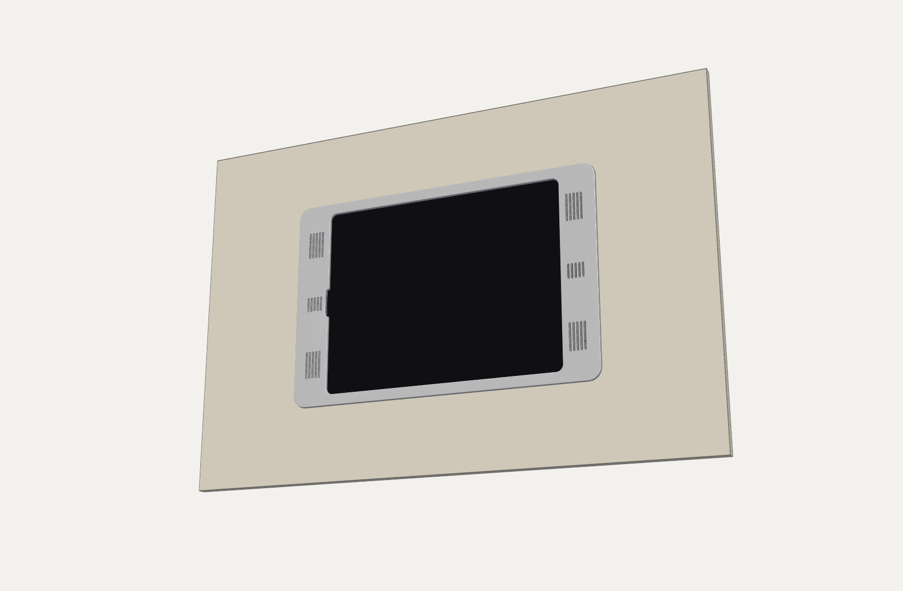

*Colour code in every step: **orange** = the part you are working on now, **blue** = screws, inserts, magnets and other hardware, grey = parts already fitted.*

## Contents

  - [GENERAL DATA](#general-data)
  - [DESIGN FEATURES](#design-features)
  - [EXPLODED VIEW](#exploded-view)
  - [HOW IT SITS IN THE WALL](#how-it-sits-in-the-wall)
  - [HOW IT CLAMPS](#how-it-clamps)
  - [RECOMMENDED EQUIPMENT](#recommended-equipment)
  - [REQUIRED HARDWARE](#required-hardware)
  - [TOOLS](#tools)
  - [PRINT SETTINGS](#print-settings)
  - [PARTS LIST](#parts-list)
  - [FILES](#files)
  - [SLEEVE HALVES](#sleeve-halves)
  - [DECK HALVES](#deck-halves)
  - [BACK PLATE AND DOG-EAR ARMS](#back-plate-and-dog-ear-arms)
  - [TRIM: BACK SIDE UP](#trim-back-side-up)
  - [TRIM: FRONT SIDE UP](#trim-front-side-up)
- [01 · BENCH ASSEMBLY](#01--bench-assembly)
  - [ARM INSERTS](#arm-inserts)
  - [SLEEVE INSERTS](#sleeve-inserts)
  - [GLUE THE SLEEVE](#glue-the-sleeve)
  - [GLUE THE DECK](#glue-the-deck)
  - [SORT THE MAGNET POLARITY](#sort-the-magnet-polarity)
  - [DECK MAGNETS](#deck-magnets)
  - [TRIM MAGNETS, PINS AND TAPE](#trim-magnets-pins-and-tape)
  - [PoE ADAPTER ON THE BACK PLATE](#poe-adapter-on-the-back-plate)
  - [FIT THE BACK PLATE](#fit-the-back-plate)
  - [DECK AND ARMS IN](#deck-and-arms-in)
- [02 · WALL INSTALLATION](#02--wall-installation)
  - [FIND THE STUDS, PLACE THE TEMPLATE](#find-the-studs-place-the-template)
  - [CUT THE HOLE](#cut-the-hole)
  - [CONNECT THE CAT6](#connect-the-cat6)
  - [PUT THE UNIT IN THE WALL](#put-the-unit-in-the-wall)
  - [CLAMP IT](#clamp-it)
  - [FIT THE iPAD](#fit-the-ipad)
  - [FIT THE TRIM](#fit-the-trim)
  - [REMOVING THE iPAD](#removing-the-ipad)
  - [iPAD SETUP FOR A WALL PANEL](#ipad-setup-for-a-wall-panel)
  - [FINAL CHECKLIST](#final-checklist)
- [ENJOY YOUR FLUSH MOUNT](#enjoy-your-flush-mount)

---

### GENERAL DATA

OVERVIEW

| Item | Value |
| --- | --- |
| Trim size | 355.1 × 233.6 × 3 mm, 6061, about 188 g |
| Trim width | ends 37.2 mm · top/bottom 9.3 mm |
| Off the wall | trim 4.5 mm · glass 1.2 mm |
| Wall cut-out | 343.1 × 221.6 mm, R7 corners |
| Depth in the wall | 57.5 mm from the wall face |
| Wall | 10 mm plasterboard, 70 mm studs at 450 c/c |
| Fits | iPad Pro 12.9″ 3rd gen (A1876, A1895, A2014, A1983) |
| Power + data | PoE+ (802.3at) over one Cat6 |
| Fixing | 4 dog-ear arms clamp the plasterboard |
| Printer | 256 × 256 mm bed (P1S / X1C class) |

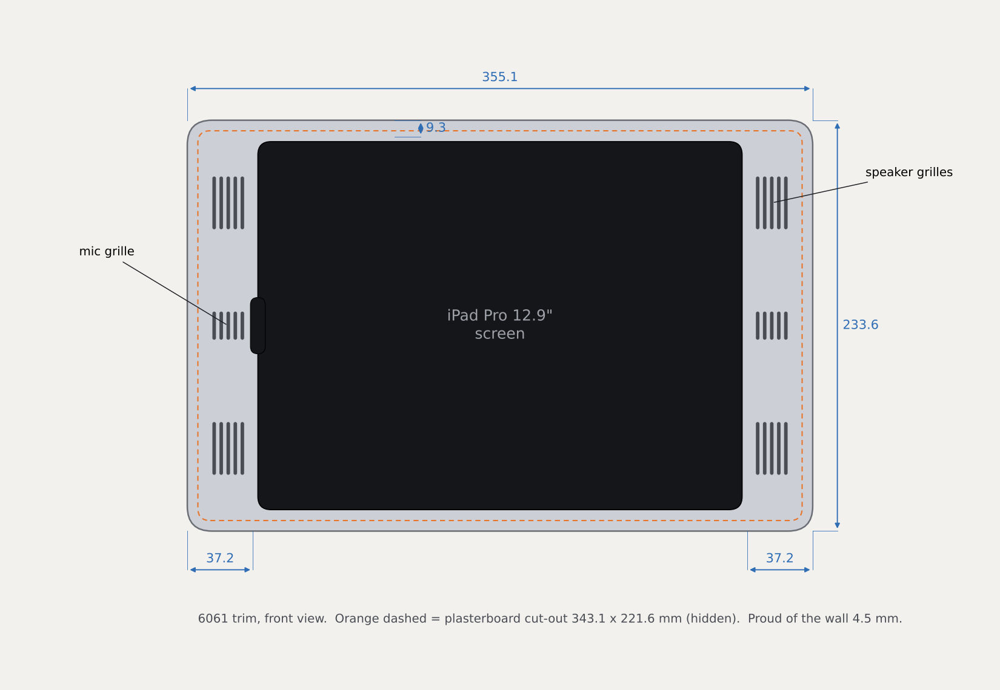

---

### DESIGN FEATURES

OVERVIEW

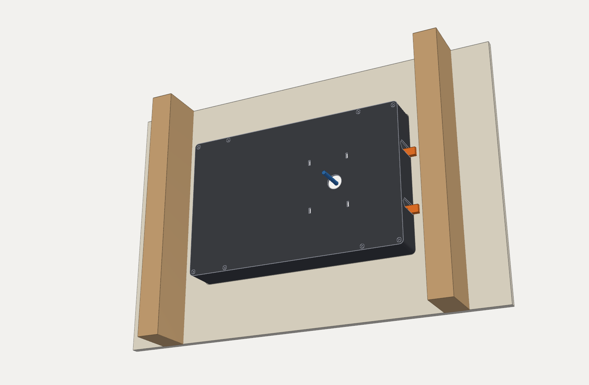

#### FLUSH GLASS

Only the 3 mm trim stands proud. The glass is 1.2 mm off the wall.

#### NO STUD WORK

Fits between studs in existing plasterboard. No noggings, no patching.

#### MAGNETIC TRIM

8 magnet pairs and 2 pins. No screws on the face at all.

#### DOG-EAR CLAMP

4 arms swing out behind the board. The screws also lock the deck.

#### PoE IN THE BOX

The adapter rides on the back plate. One Cat6 in, nothing else.

#### NO SUPPORTS

Every printed part prints flat, with 45° ledges instead of overhangs.

---

### EXPLODED VIEW

OVERVIEW

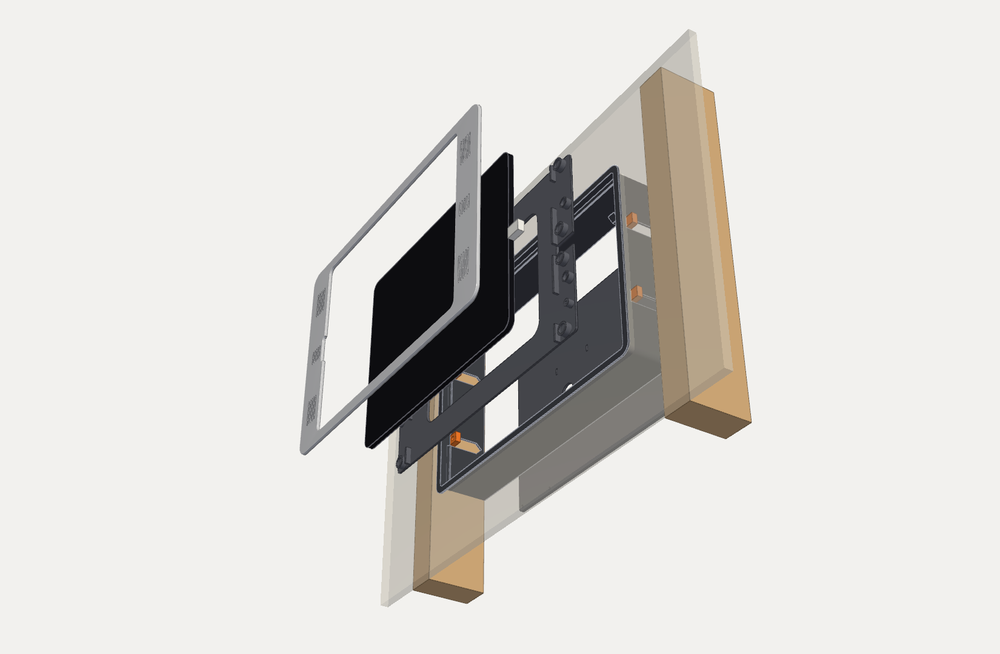

1. **TRIM** · 6061, magnets + pins

2. **iPAD PRO** + straight USB-C

3. **DECK** L + R · carries the iPad

4. **SLEEVE** L + R · box and flange

5. **DOG-EAR ARMS** × 4

6. **PoE ADAPTER**

7. **BACK PLATE** L + R

---

### HOW IT SITS IN THE WALL

OVERVIEW

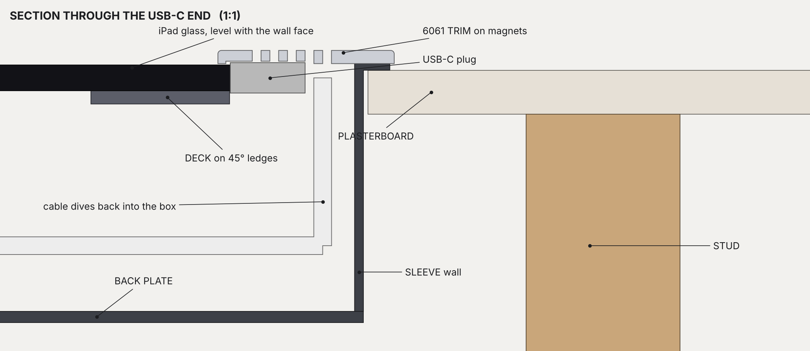

A true 1:1 cut through the USB-C end. The trim lip holds the glass through 0.3 mm PORON tape. The plug and its bend live inside the box end, under the wide part of the trim, and the cable drops to the PoE adapter on the back plate.

---

### HOW IT CLAMPS

OVERVIEW

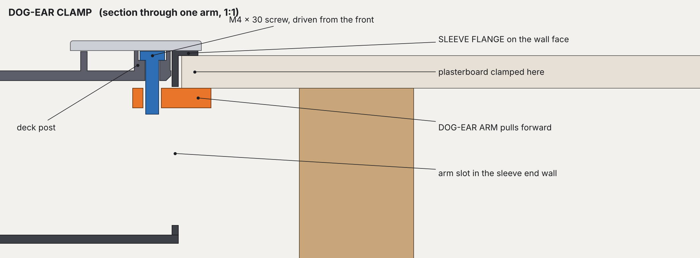

Each **M4 × 30** runs from the DECK POST down the inside of the sleeve wall into an insert in a DOG-EAR ARM, which reaches out through a slot in the wall. Tighten it and the arm pulls up behind the plasterboard, squeezing the board between the arm and the 6 mm FLANGE. The screw head also holds the deck down on its ledges.

---

### RECOMMENDED EQUIPMENT

BEFORE YOU START

| Item | Notes |
| --- | --- |
| PoE+ switch port | 802.3at (PoE+). One port per panel. |
| PoE+ to USB-C adapter | PoE Texas / Heckler T515, 25 W. Lives inside the box. |
| USB-C cable | Standard straight plug, short. Box end sized for a 17 × 12.5 × 7 mm overmold. |
| Cat6 cable | From the switch into the stud bay, with about 300 mm spare at the hole |
| Filament | PETG or ASA. Not PLA: the iPad warms a closed box. |
| Aluminium | 6061 plate, 3 mm (or 4 mm faced down), at least 360 × 240 mm |
| Magnets | N52 discs, 10 × 1.5 mm, 16 off |
| PORON tape | 0.3 mm thick, about 1 m, for the trim lip that touches the glass |

---

### REQUIRED HARDWARE

BEFORE YOU START

| Item | Qty | Where it goes |
| --- | ---: | --- |
| N52 magnet 10 × 1.5 mm | 16 | 8 in the trim pockets · 8 in the deck posts |
| Dowel pin Ø3 × 6 mm | 2 | Pressed into the trim, locate in the deck |
| M4 × 30 pan-head screw | 4 | Deck posts down to the dog-ear arms |
| M4 heat-set insert | 4 | One in each dog-ear arm |
| M3 × 8 countersunk screw | 8 | Back plate to the sleeve |
| M3 heat-set insert | 8 | Bosses on the sleeve’s back edge |
| 2-part epoxy | 1 | Sleeve seam, deck seam and magnets |
| Zip ties, small | 2 | PoE adapter to the back plate |
| PORON tape 0.3 mm | 1 m | Underside of the trim lip |

---

### TOOLS

BEFORE YOU START

#### BENCH

- Soldering iron + M3/M4 heat-set tips
- Flat surface (glass or MDF)
- Spring clamps, masking tape
- Screwdriver for the M4 pan heads
- 2 mm hex key (M3 countersunk)
- Isopropyl alcohol + cloth

#### MACHINING

- CNC router (StrongHold)
- 6 mm and 2 mm end mills
- 3 mm drill
- Vacuum table or double-sided tape on a spoilboard
- Deburring tool

#### WALL

- Stud finder + spirit level
- A3 cut-out template
- 14 mm drill bit
- Plasterboard saw
- Torch + inspection mirror
- Draw wire for the Cat6

---

### PRINT SETTINGS

PRINTING

| Setting | Value |
| --- | --- |
| Material | PETG or ASA |
| Layer height | 0.2 mm (0.4 mm nozzle) |
| Walls | 4 (6 on the dog-ear arms) |
| Infill: sleeve | 15% gyroid |
| Infill: deck, back plate | 20% gyroid |
| Infill: dog-ear arms | 100% |
| Supports | None needed |
| Bed | Textured PEI |

> [!WARNING]
> **No supports.** Overhang audit in print orientation: sleeve 0 mm², deck 3 mm², back plate 21 mm², arms 0 mm².

> [!TIP]
> **The 21 mm² is harmless.** It is the countersinks on the back plate’s first layer.

> [!TIP]
> **The arms take the clamp load.** Print them solid.

---

### PARTS LIST

PRINTING

| Part | Qty | Material | Size |
| --- | ---: | --- | --- |
| TRIM | 1 | 6061 aluminium | 355.1 × 233.6 × 3 mm |
| SLEEVE L, R | 2 | PETG / ASA | 176.6 × 231.6 × 56.5 mm each |
| DECK L, R | 2 | PETG / ASA | 168.3 × 215 × 9.2 mm each |
| BACK PLATE L | 1 | PETG / ASA | 230.6 × 219.6 × 2.5 mm |
| BACK PLATE R | 1 | PETG / ASA | 110.6 × 219.6 × 2.5 mm |
| DOG-EAR ARM | 4 | PETG / ASA | 24 × 12 × 6 mm |

The back plate is split off-centre on purpose: its joint sits 60 mm from the sleeve seam, so the plate bridges and stiffens that seam.

---

### FILES

PRINTING

#### print/ (STL + STEP)

- sleeve_L · sleeve_R
- deck_L · deck_R
- back_plate_L · back_plate_R
- dog_ear_arm_x4 (all four on one plate)

#### machine/, CAD and wall

- machine/trim_6061.step for CAM
- assembly_flush_v5_1.step (whole stack)
- CUTOUT_TEMPLATE_A3.pdf (print at 100%)
- flush51.py: the parametric source
- BUILD_NOTES.md

Every size in this manual comes from flush51.py. Change a parameter there (plug size, plasterboard thickness, clearance) and re-run it to regenerate the model files. If the cut-out size changes, make a new template too.

---

### SLEEVE HALVES

PARTS ORIENTATION · 1 OF 3

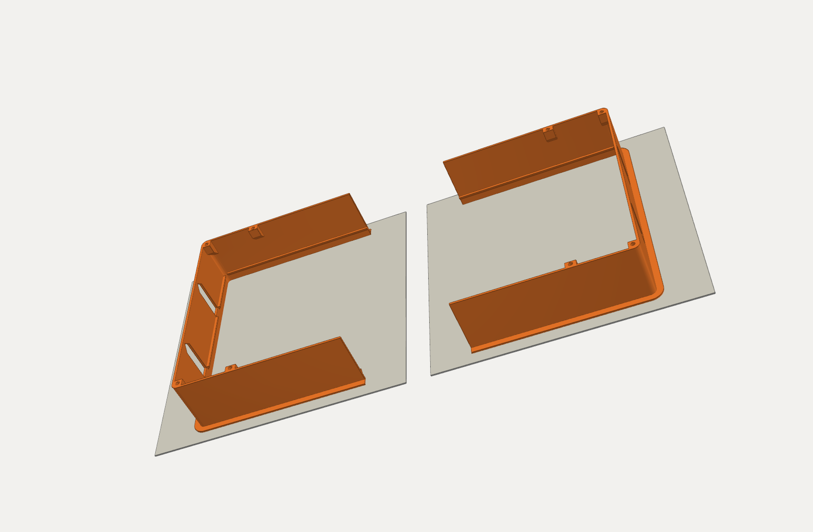

**Face down**, as exported. One half per plate.

The flange face goes on the bed, so the surface that sits against the wall comes out dead flat.

The ledges inside are 45°, and the arm slots have 45° roofs, so nothing needs support.

> [!TIP]
> 176.6 × 231.6 × 56.5 mm. Fits a 256 mm bed with room for a brim.

---

### DECK HALVES

PARTS ORIENTATION · 2 OF 3

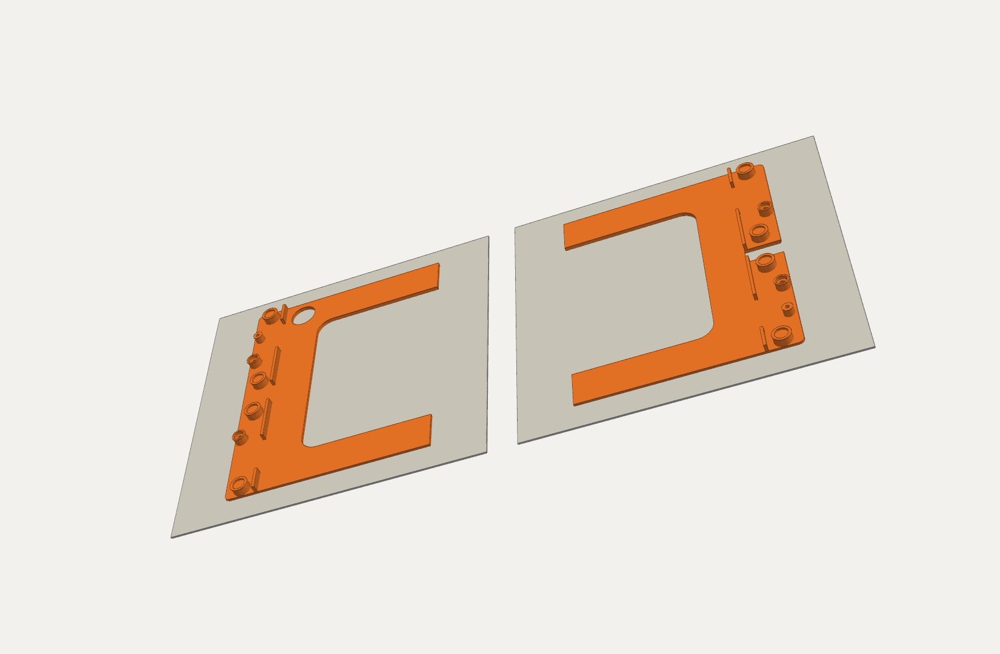

**Bottom down**, as exported. Both halves fit on one plate.

The bevelled back edges print as 45° chamfers. Those are what seat on the sleeve ledges and centre the deck.

> [!WARNING]
> Keep elephant’s foot down on these edges. A fat first layer stops the deck seating fully.

---

### BACK PLATE AND DOG-EAR ARMS

PARTS ORIENTATION · 3 OF 3

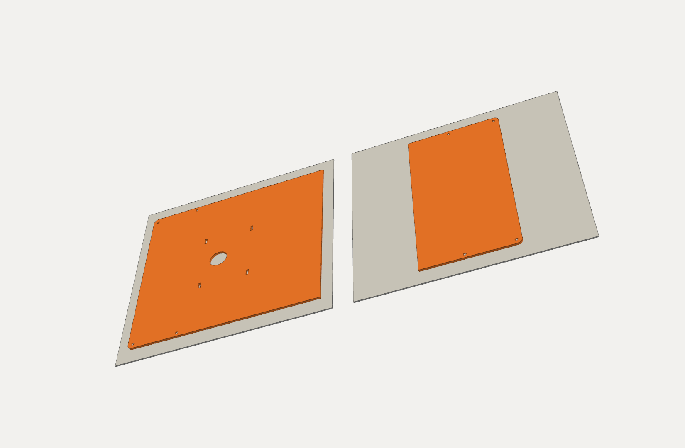

**BACK PLATE L + R:** flat, countersinks down. 20% gyroid.

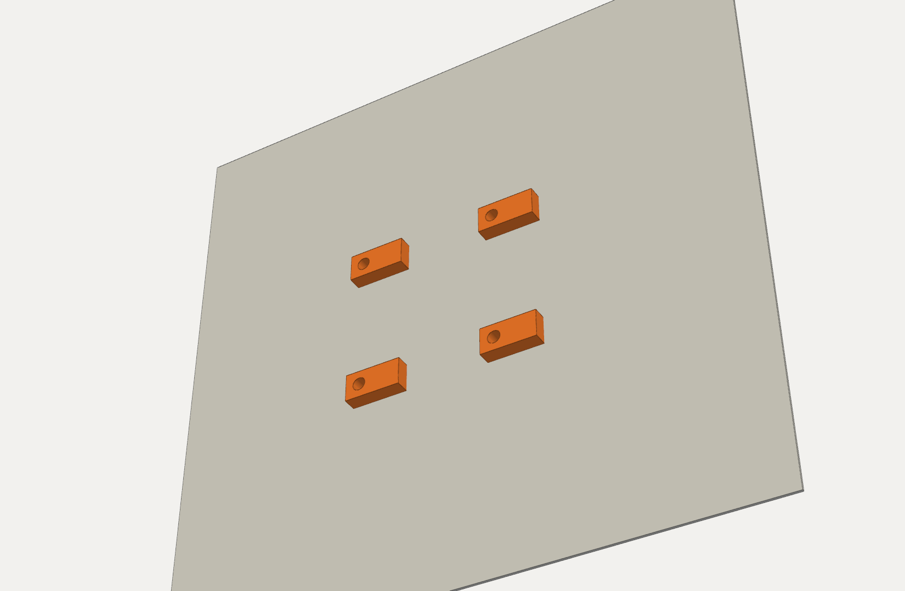

**DOG-EAR ARMS × 4:** flat. Solid infill, 6 walls.

---

### TRIM: BACK SIDE UP

MACHINING · OP 1 OF 2

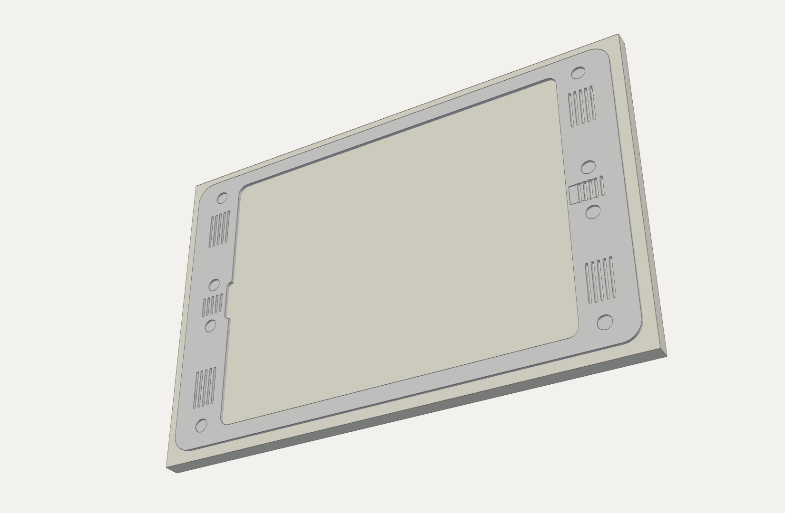

1. Hold 3 mm 6061 flat on a vacuum table or double-sided tape on a spoilboard.
2. Pocket 8 × Ø10.2 magnet seats, 1.6 mm deep, with a 6 mm end mill.
3. Drill 2 × Ø3 pin holes, 2 mm deep.
4. Cut the 0.55 mm plug relief at the USB-C end.

> [!WARNING]
> **1.6 mm is the limit.** It leaves a 1.4 mm skin under the front face. Any deeper and the pocket can show through after blasting.

---

### TRIM: FRONT SIDE UP

MACHINING · OP 2 OF 2

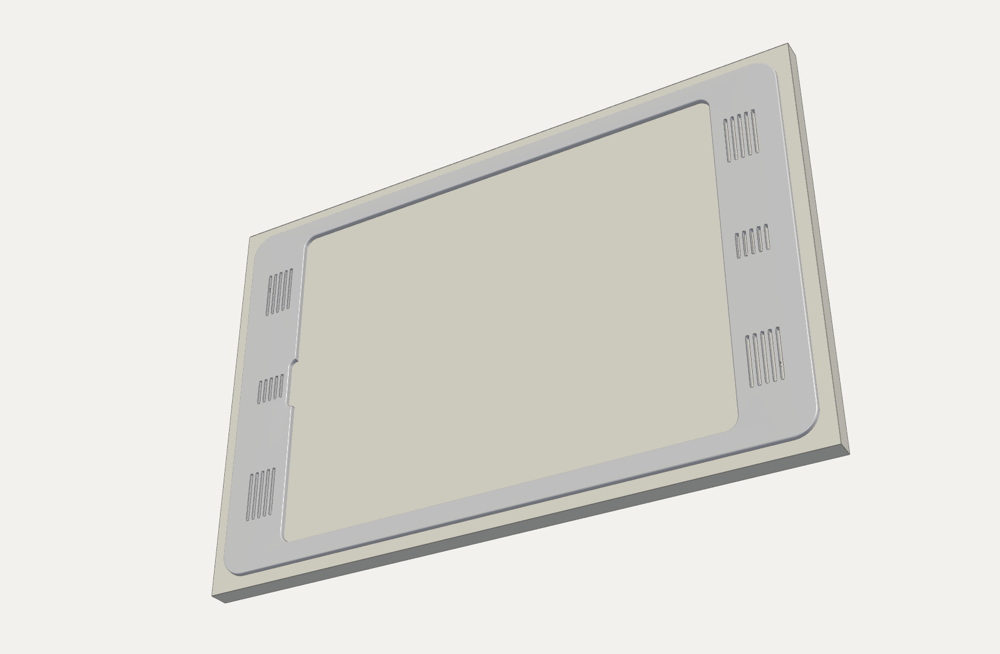

1. Flip it onto two Ø3 pins set in the spoilboard, using the pin holes from op 1.
2. Cut the window through: inner corners R7.5, Face ID stadium with R4.2 ends (6 mm end mill).
3. Cut the grille slots with a 2 mm end mill: climb, light passes.
4. Profile the outside with tabs, then a 0.8 mm radius on the front outer edge.

> [!TIP]
> **Finish:** fine glass bead blast, then clear or black anodise. Press in the 2 dowel pins after anodising.

---

## 01 · BENCH ASSEMBLY

Ten steps on the bench. You finish with a complete in-wall unit (sleeve, deck, back plate, PoE adapter and arms) and a trim ready to fit.

---

### ARM INSERTS

BENCH ASSEMBLY · STEP 1 OF 10

**You need:** 4 × M4 heat-set inserts · iron with M4 tip

---

### SLEEVE INSERTS

BENCH ASSEMBLY · STEP 2 OF 10

**You need:** 8 × M3 heat-set inserts · iron with M3 tip

---

### GLUE THE SLEEVE

BENCH ASSEMBLY · STEP 3 OF 10

**You need:** 2-part epoxy · flat surface · masking tape

---

### GLUE THE DECK

BENCH ASSEMBLY · STEP 4 OF 10

**You need:** 2-part epoxy · flat surface · fine sandpaper

---

### SORT THE MAGNET POLARITY

BENCH ASSEMBLY · STEP 5 OF 10

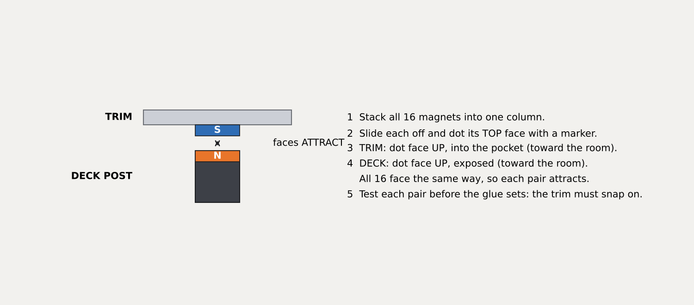

> [!WARNING]
> **Get this right before any glue comes out.** One reversed magnet and the trim pushes off on that corner. Every magnet goes in dot face toward the room.

---

### DECK MAGNETS

BENCH ASSEMBLY · STEP 6 OF 10

**You need:** 8 × N52 magnets 10 × 1.5 mm · epoxy

---

### TRIM MAGNETS, PINS AND TAPE

BENCH ASSEMBLY · STEP 7 OF 10

**You need:** 8 magnets · 2 × Ø3 × 6 pins · epoxy · PORON tape

---

### PoE ADAPTER ON THE BACK PLATE

BENCH ASSEMBLY · STEP 8 OF 10

**You need:** PoE adapter · 2 zip ties · USB-C cable

---

### FIT THE BACK PLATE

BENCH ASSEMBLY · STEP 9 OF 10

**You need:** 8 × M3 × 8 countersunk · 2 mm hex key

---

### DECK AND ARMS IN

BENCH ASSEMBLY · STEP 10 OF 10

**You need:** 4 × M4 × 30 pan-head · 4 arms · screwdriver

---

## 02 · WALL INSTALLATION

Seven steps at the wall. Measure twice: the cut-out is the only step you can’t undo.

---

### FIND THE STUDS, PLACE THE TEMPLATE

WALL INSTALLATION · STEP 1 OF 7

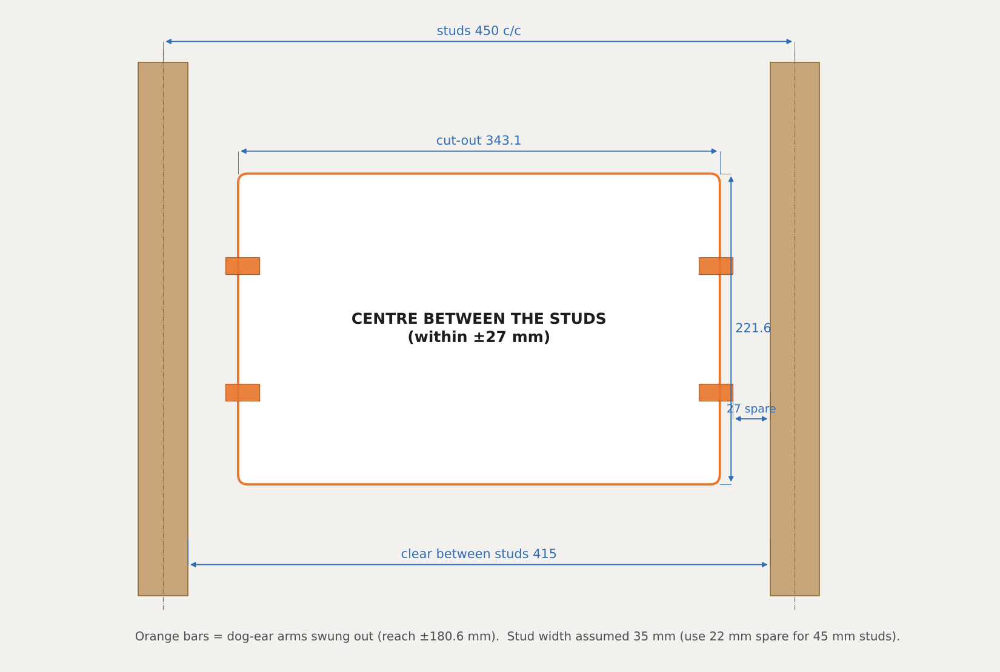

Mark both studs. Tape the **A3 TEMPLATE** up, level, **centred between them**.

The arms swing out sideways, so stay within 27 mm of the bay’s centre (less with 45 mm studs). TOP ↑ on the template goes up.

> [!WARNING]
> Drill a small test hole in the middle first and look inside with a torch. Check for cables, pipes and noggings.

> [!TIP]
> Print the template at 100% on A3. Its scale bar must measure exactly 100 mm.

---

### CUT THE HOLE

WALL INSTALLATION · STEP 2 OF 7

**You need:** 14 mm bit · plasterboard saw · dust mask

---

### CONNECT THE CAT6

WALL INSTALLATION · STEP 3 OF 7

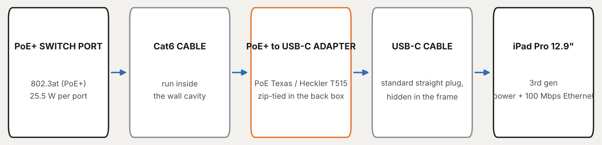

Fish the Cat6 out through the hole. Lift the DECK out: undo the 4 M4s and catch the ARMS as they come free.

Push the Cat6 in through the back plate’s entry hole and plug it into the PoE ADAPTER. Refit the deck, screws and arms as in bench step 10.

> [!WARNING]
> Test now. Plug the iPad into the USB-C lead: it should charge and show Ethernet before the unit goes in the wall.

---

### PUT THE UNIT IN THE WALL

WALL INSTALLATION · STEP 4 OF 7

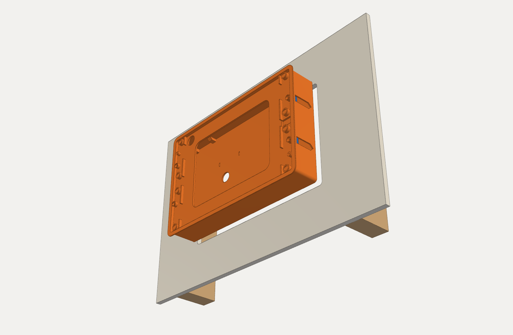

Turn all 4 ARMS to point into the box. Feed the Cat6 slack back into the wall, then push the unit straight in **until the flange sits on the wall**.

Keep the Cat6 entry on the side the template marks. The sleeve has 1 mm of clearance each side.

> [!WARNING]
> Don’t force it. If it binds, shave the cut edge where it rubs.

---

### CLAMP IT

WALL INSTALLATION · STEP 5 OF 7

**You need:** Hand screwdriver, not a drill

---

### FIT THE iPAD

WALL INSTALLATION · STEP 6 OF 7

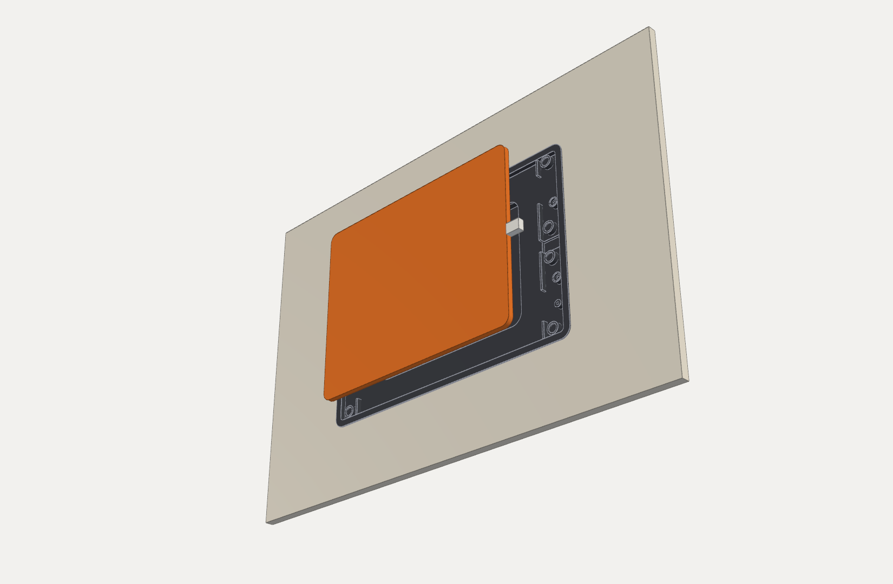

Plug the USB-C into the iPad. Lay it **screen out** on the DECK, plug end toward the cable gap.

The end ribs locate it side to side. Tuck the cable bend down into the box end.

> [!TIP]
> Clean the glass now. Once the trim is on, the edges are hard to reach.

---

### FIT THE TRIM

WALL INSTALLATION · STEP 7 OF 7

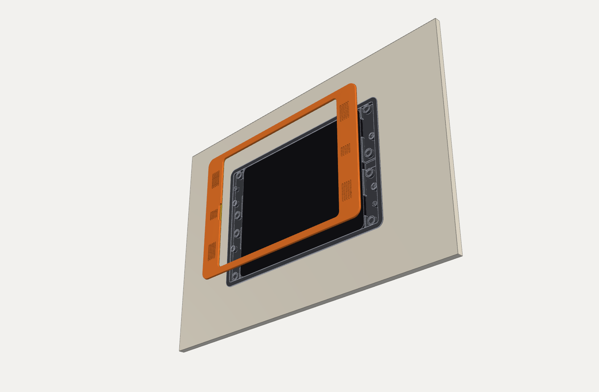

Line up the 2 PINS with their holes and offer the TRIM up. **The magnets pull it home.**

The pins also fit with the trim upside down, so check the Face ID cut-out sits over the camera first. The PORON lip rests on the glass edge.

> [!TIP]
> Keep fingers clear of the edges as it snaps on. Eight N52 pairs close hard.

---

### REMOVING THE iPAD

SERVICE

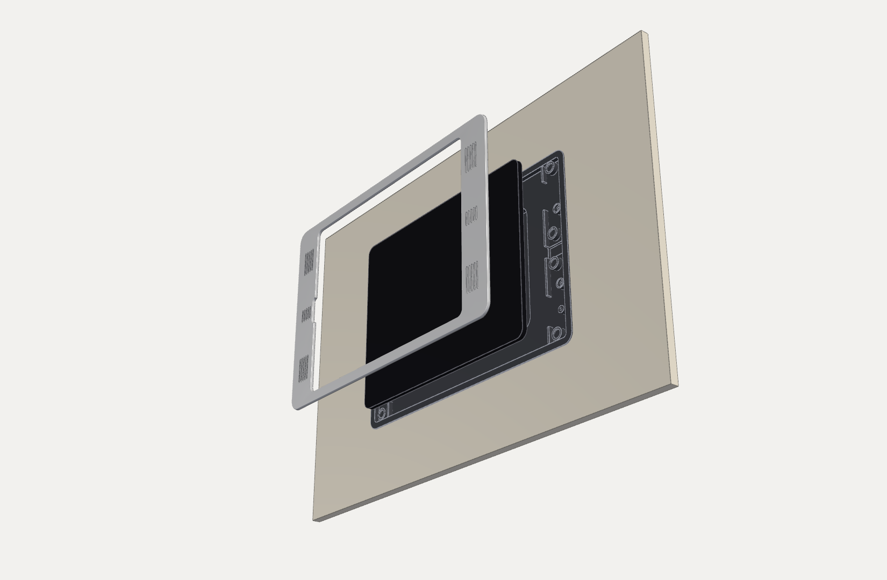

Grip the TRIM by its wide ends and **pull straight out**. Lift the iPad off the deck and unplug it.

The deck stays put: the M4 screw heads hold it down.

> [!WARNING]
> **Taking the unit out?** Back each M4 out a few turns until its arm swings in. Don’t remove the screws fully, or the arm drops into the wall.

---

### iPAD SETUP FOR A WALL PANEL

SETUP

#### KEEP THE SCREEN ON

Settings › Display & Brightness › Auto-Lock › Never. Dim it at night with a Shortcut or Home Assistant automation.

#### LOCK TO ONE APP

Settings › Accessibility › Guided Access. Start it in Home or your dashboard app.

#### BUTTONS ARE COVERED

Turn on Settings › Accessibility › Touch › AssistiveTouch for lock, volume and restart. Siri works too.

#### MIND THE HEAT

The iPad vents into a closed box. Panel duty is fine; hours of video or games are not.

---

### FINAL CHECKLIST

FINISHING BUILD

- [ ] Flange tight to the wall; unit doesn’t move
- [ ] iPad shows it is charging
- [ ] Trim sits flat, no gap at any corner
- [ ] Ethernet appears in Settings
- [ ] Face ID unlocks first time
- [ ] No cracked plaster round the cut-out
- [ ] Speakers clear through the grilles
- [ ] Guided Access and Auto-Lock set

> [!WARNING]
> **Something off?** Every size lives in flush51.py. Measure the problem, change the parameter, re-run it, and reprint only the part that changed.

---

## ENJOY YOUR FLUSH MOUNT

Feature positions on the iPad (buttons, cameras, speakers) are close approximations. Fit the printed parts and the iPad before you cut the wall or machine the trim.

Also available: Float Mount v4.1, the surface-mounted version.

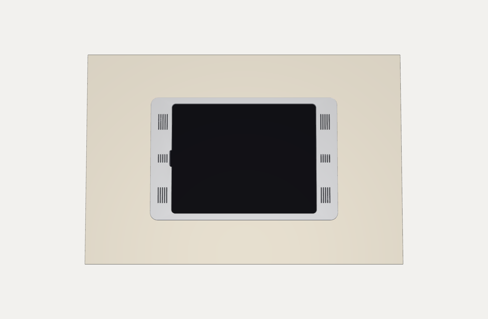
