# Float Mount v6 Flush · Build Manual

> **PDF version (print-ready, one step per page): [Float_Mount_v6_Flush_Build_Manual.pdf](Float_Mount_v6_Flush_Build_Manual.pdf)** · [Back to the repository](../../README.md)

In-wall PoE mount for iPad Pro 12.9″ (3rd gen), iPad Pro 13″ and 11″ (M5) and iPad mini (A17 Pro)

A 3 mm 6061 trim (or printed) on magnets over a printed in-wall box. The glass sits 1.2 mm off the wall.

*Colour code in every step: **orange** = the part you are working on now, **blue** = screws, inserts, magnets and other hardware, grey = parts already fitted.*

## Contents

  - [CHOOSE YOUR iPAD](#choose-your-ipad)
  - [WHAT’S NEW IN V6](#whats-new-in-v6)
  - [GENERAL DATA](#general-data)
  - [SIZES BY MODEL](#sizes-by-model)
  - [DESIGN FEATURES](#design-features)
  - [EXPLODED VIEW](#exploded-view)
  - [HOW IT SITS IN THE WALL](#how-it-sits-in-the-wall)
  - [HOW IT CLAMPS](#how-it-clamps)
  - [BUTTON RELIEFS](#button-reliefs)
  - [ROOM FOR THE CABLE LOOP](#room-for-the-cable-loop)
  - [RECOMMENDED EQUIPMENT](#recommended-equipment)
  - [REQUIRED HARDWARE](#required-hardware)
  - [HARDWARE IN THE STEP FILE](#hardware-in-the-step-file)
  - [TOOLS](#tools)
  - [PRINT SETTINGS](#print-settings)
  - [PARTS LIST](#parts-list)
  - [FILES](#files)
  - [SLEEVE HALVES](#sleeve-halves)
  - [DECK HALVES](#deck-halves)
  - [BACK PLATE AND DOG-EAR ARMS](#back-plate-and-dog-ear-arms)
  - [PRINTED TRIM](#printed-trim)
  - [TRIM: BACK SIDE UP](#trim-back-side-up)
  - [TRIM: FRONT SIDE UP](#trim-front-side-up)
- [01 · BENCH ASSEMBLY](#01--bench-assembly)
  - [ARM INSERTS](#arm-inserts)
  - [SLEEVE INSERTS](#sleeve-inserts)
  - [GLUE THE SLEEVE](#glue-the-sleeve)
  - [GLUE THE DECK](#glue-the-deck)
  - [SORT THE MAGNET POLARITY](#sort-the-magnet-polarity)
  - [DECK MAGNETS](#deck-magnets)
  - [TRIM MAGNETS, PINS AND TAPE](#trim-magnets-pins-and-tape)
  - [PoE ADAPTER ON THE BACK PLATE](#poe-adapter-on-the-back-plate)
  - [FIT THE BACK PLATE](#fit-the-back-plate)
  - [DECK AND ARMS IN](#deck-and-arms-in)
- [02 · WALL INSTALLATION](#02--wall-installation)
  - [FIND THE STUDS, PLACE THE TEMPLATE](#find-the-studs-place-the-template)
  - [CUT THE HOLE](#cut-the-hole)
  - [CONNECT THE CAT6](#connect-the-cat6)
  - [PUT THE UNIT IN THE WALL](#put-the-unit-in-the-wall)
  - [CLAMP IT](#clamp-it)
  - [FIT THE iPAD](#fit-the-ipad)
  - [FIT THE TRIM](#fit-the-trim)
  - [REMOVING THE iPAD](#removing-the-ipad)
  - [iPAD SETUP FOR A WALL PANEL](#ipad-setup-for-a-wall-panel)
  - [FINAL CHECKLIST](#final-checklist)
- [ENJOY YOUR FLUSH MOUNT](#enjoy-your-flush-mount)

---

### CHOOSE YOUR iPAD

START HERE

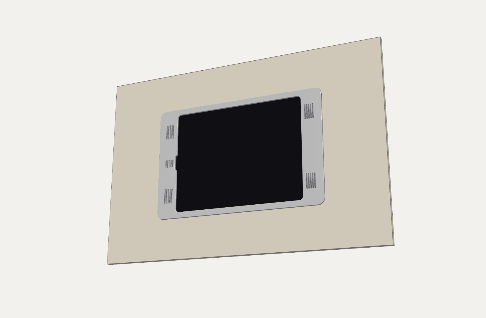

#### PRO 12.9″ (3RD GEN)

A1876 · A1895 · A2014 · A1983 **ipad_pro_12_9_gen3** Button positions are estimated: measure yours first (page 11).

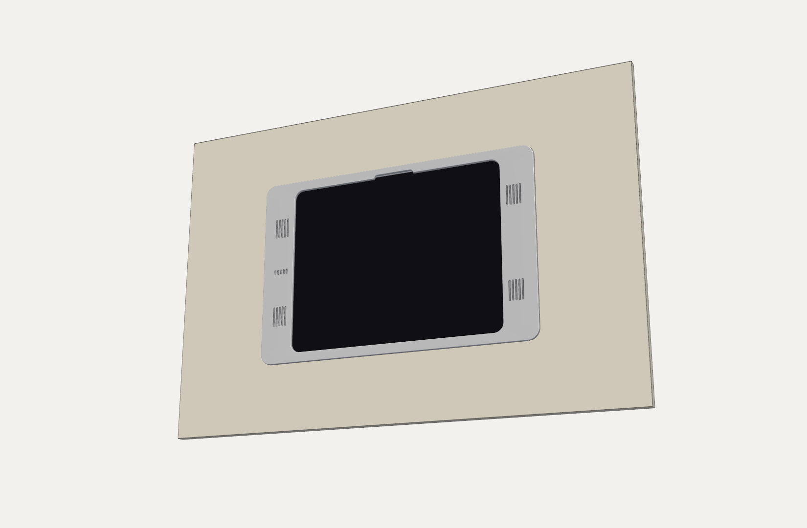

#### PRO 13″ (M5)

2025, from Apple’s drawings **ipad_pro_13_m5** Camera notch in the top of the trim.

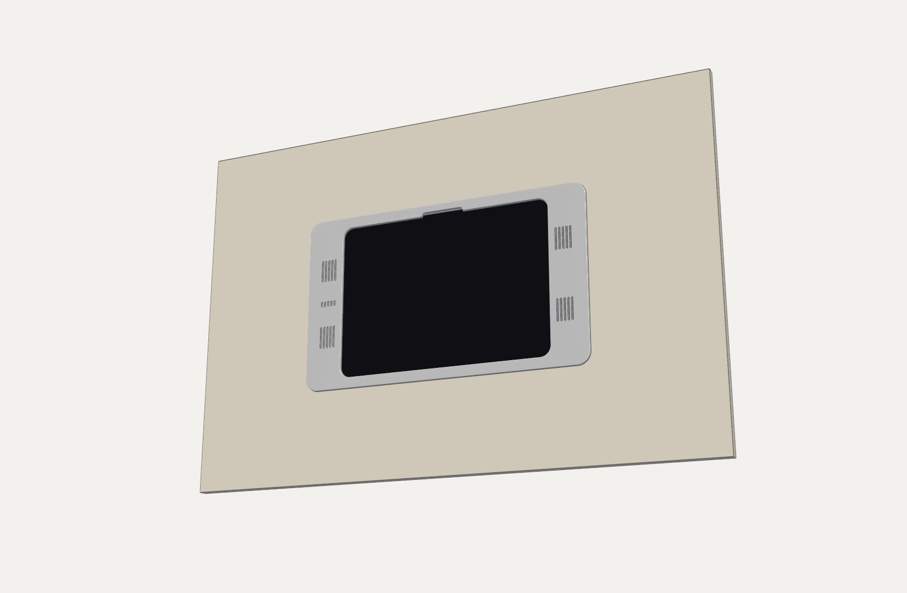

#### PRO 11″ (M5)

2025, from Apple’s drawings **ipad_pro_11_m5** Camera notch in the top; 4 magnet pairs.

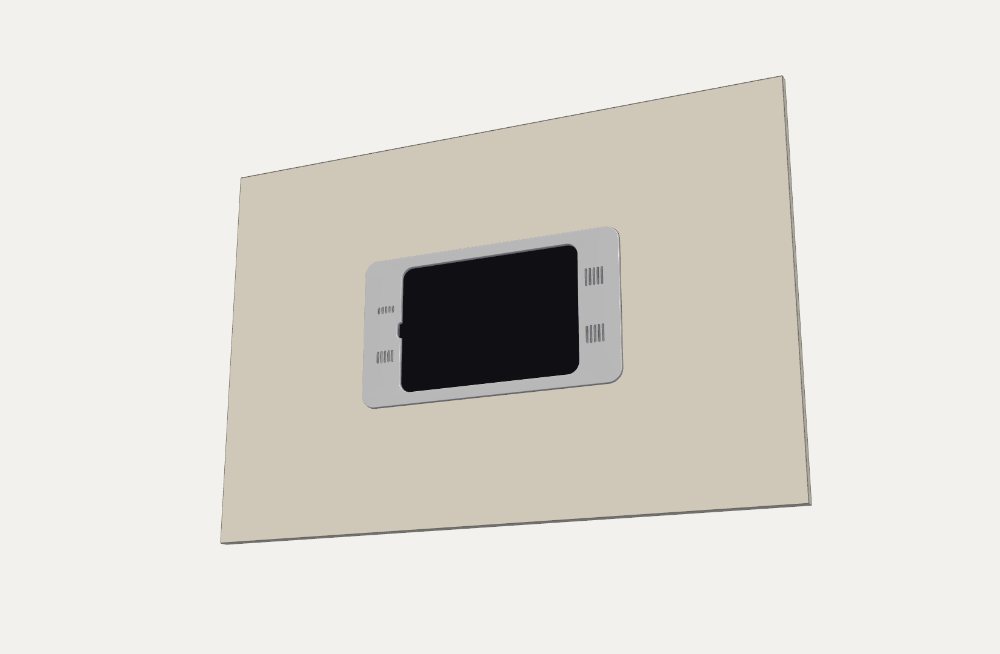

#### MINI (A17 PRO)

2024, from Apple’s drawings **ipad_mini_a17_pro** 4 magnet pairs; the most room between studs.

Each iPad has its own folder at the top of the repository, with the machined and the fully printed build kept apart. The steps in this manual are the same for all four.

---

### WHAT’S NEW IN V6

OVERVIEW

#### BUTTONS LEFT ALONE

A 1.2 mm relief in the sleeve wall and deck ribs at every button, with a 45° roof so it prints.

#### ROOM FOR THE LOOP

Each box end is 2 mm longer, so the cable bends back round the plug. The cut-out grows 4 mm.

#### FOUR iPADS

tablets.py holds each iPad’s size, camera, speakers, mics and buttons. One source builds them all.

#### EVERYTHING PLACED

Magnets, pins and clamp arms move to clear each iPad’s speaker and mic openings.

#### A TEMPLATE EACH

Every iPad has its own full-size A3 cut-out template with a 100 mm check bar.

#### EVERY PART IN THE STEP

Magnets, pins, screws and inserts are all in the assembly STEP, each where it goes.

---

### GENERAL DATA

OVERVIEW

| Item (mm) | Pro 12.9″ (3rd gen) | Pro 13″ (M5) | Pro 11″ (M5) | mini (A17 Pro) |
| --- | --- | --- | --- | --- |
| Trim size (3 mm) | 359.1 × 233.6 | 360.1 × 234.2 | 328.2 × 196.2 | 273.9 × 153.4 |
| Trim mass (6061) | 196 g | 199 g | 169 g | 135 g |
| Wall cut-out (R7) | 347.1 × 221.6 | 348.1 × 222.2 | 316.2 × 184.2 | 261.9 × 141.4 |
| Max off-centre in the bay | 19 | 19 | 35 | 62 |
| Magnet pairs | 8 | 8 | 4 | 4 |
| Front camera notch | left end | top edge | top edge | left end |

**Same on every model:** trim 4.5 mm proud, glass 1.2 mm off the wall · trim ends 36.5 mm, top and bottom 9.3 mm · 57.5 mm deep from the wall face · 10 mm plasterboard, studs at 450 c/c · PoE+ over one Cat6 · 4 dog-ear arms clamp the board · prints on a 256 mm bed.

---

### SIZES BY MODEL

OVERVIEW

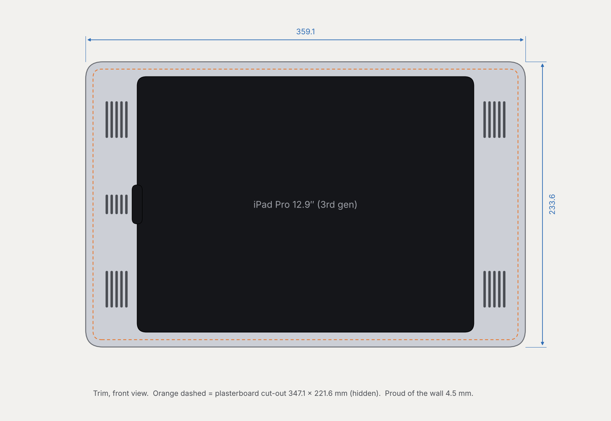

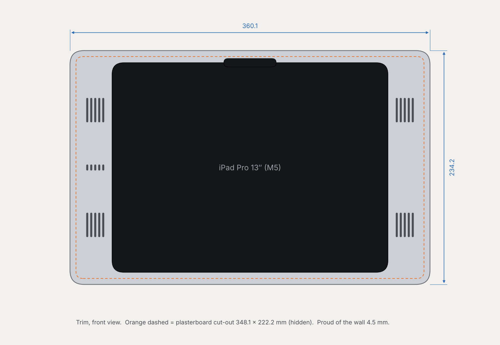

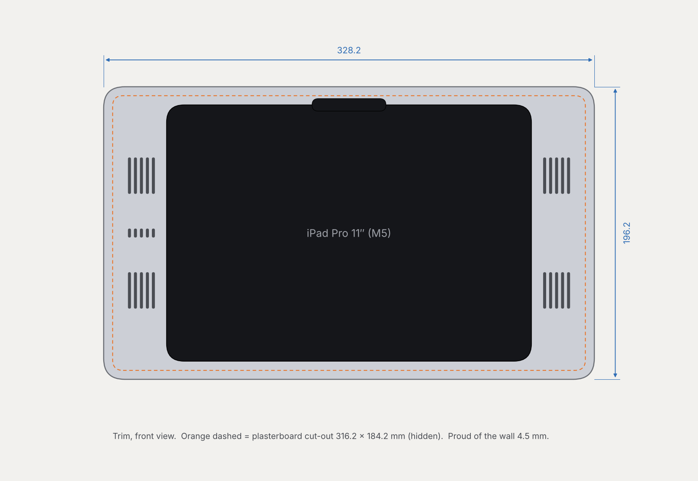

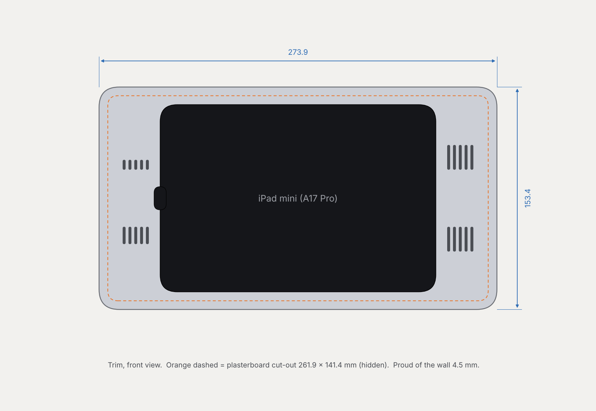

---

### DESIGN FEATURES

OVERVIEW

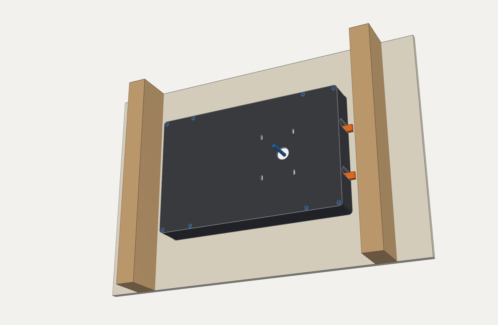

#### FLUSH GLASS

Only the 3 mm trim stands proud. The glass is 1.2 mm off the wall.

#### NO STUD WORK

Fits between studs in existing plasterboard. No noggings, no patching.

#### MAGNETIC TRIM

Magnet pairs and 2 pins. No screws on the face at all.

#### DOG-EAR CLAMP

4 arms swing out behind the board. The screws also lock the deck.

#### PoE IN THE BOX

The adapter rides on the back plate. One Cat6 in, nothing else.

#### NO SUPPORTS

Every printed part prints flat, with 45° ledges and roofs instead of overhangs.

---

### EXPLODED VIEW

OVERVIEW

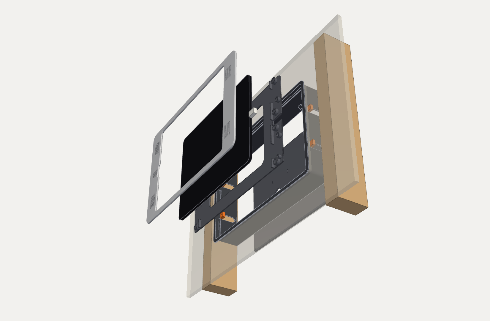

1

**TRIM** · 6061 or printed, magnets + pins

2

**iPAD** + straight USB-C

3

**DECK** L + R · carries the iPad

4

**SLEEVE** L + R · box and flange

5

**DOG-EAR ARMS** × 4

6

**BACK PLATE** L + R, carrying the PoE adapter

---

### HOW IT SITS IN THE WALL

OVERVIEW

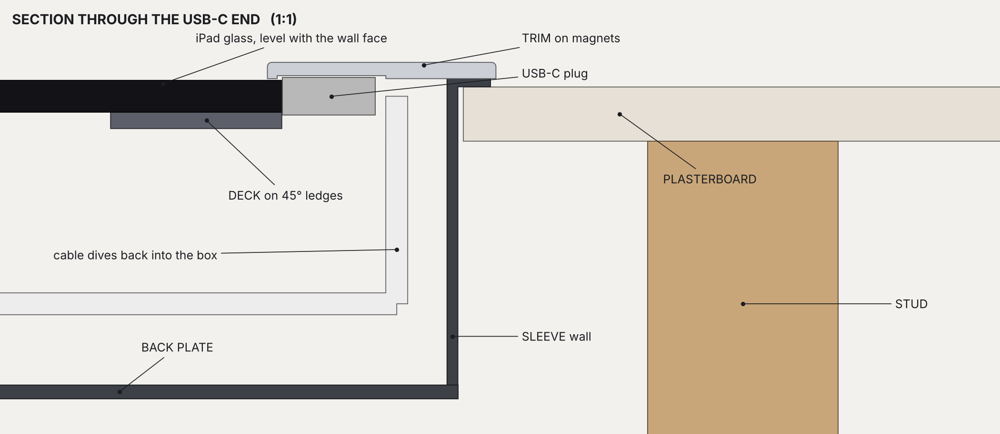

A true 1:1 cut through the USB-C end. The trim lip holds the glass through 0.3 mm PORON tape. The plug and its loop live inside the box end, under the wide part of the trim, and the cable drops to the PoE adapter on the back plate.

---

### HOW IT CLAMPS

OVERVIEW

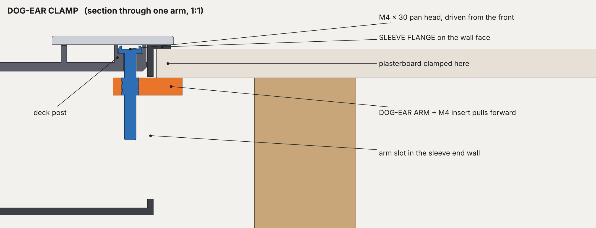

Each **M4 × 30** runs from the DECK POST down the inside of the sleeve wall into an insert in a DOG-EAR ARM, which reaches out through a slot in the wall. Tighten it and the arm pulls up behind the plasterboard, squeezing the board between the arm and the 6 mm FLANGE. The screw head also holds the deck down on its ledges.

---

### BUTTON RELIEFS

V6 CHANGES · 1 OF 2

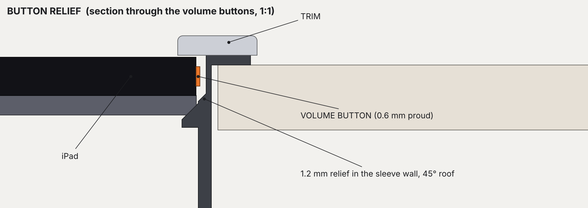

Buttons on the top edge get a **1.2 mm pocket** in the sleeve wall, with a 45° roof so it prints without support. Buttons on the end get a gap in the deck’s end rib. Nothing presses them.

Use AssistiveTouch for the buttons once it’s in the wall (page 46).

BY MODEL (from the top-left corner, USB-C on the right)

**12.9″:** volume 8–48 mm along the top edge, top button 8–36 mm down the left end. Estimated: measure yours first. **13″ / 11″ M5:** volume 12–39 mm along the top, top button 12–28 mm down the left end. **mini:** both on the left end: volume 11–37 mm from the top, top button 11–31.5 mm from the bottom.

---

### ROOM FOR THE CABLE LOOP

V6 CHANGES · 2 OF 2

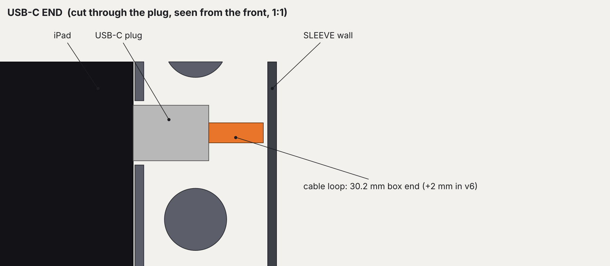

The box end is **2 mm longer** than in v5.1: 30.2 mm from the iPad edge to the sleeve wall. The cable has room to loop back round the plug and drop into the box.

Both ends grow so the trim stays symmetric. The cut-out is 4 mm longer than v5.1’s: 347.1 mm on the 12.9″.

> [!WARNING]
> Building a 12.9″ in a hole cut for v5.1? Widen the hole by 2 mm at each end first, using the v6 template.

---

### RECOMMENDED EQUIPMENT

BEFORE YOU START

| Item | Notes |
| --- | --- |
| PoE+ switch port | 802.3at (PoE+). One port per panel. |
| PoE+ to USB-C adapter | PoE Texas / Heckler T515, 25 W. Lives inside the box. |
| USB-C cable | Standard straight plug, short. Box end sized for a 17 × 12.5 × 7 mm overmold. |
| Cat6 cable | From the switch into the stud bay, with about 300 mm spare at the hole |
| Filament | PETG or ASA. Not PLA: the iPad warms a closed box. |
| Aluminium | 6061 plate, 3 mm (or 4 mm faced down). At least 375 × 250 (12.9″, 13″), 344 × 212 (11″), 290 × 170 mm (mini). |
| Magnets | N52 discs, 10 × 1.5 mm: 16 for the 12.9″ and 13″, 8 for the 11″ and mini |
| PORON tape | 0.3 mm thick, about 1 m, for the trim lip that touches the glass |

---

### REQUIRED HARDWARE

BEFORE YOU START

| Item | Qty | Where it goes |
| --- | ---: | --- |
| N52 magnet 10 × 1.5 mm | 16 / 8 | Half in the trim pockets, half in the deck posts |
| Dowel pin Ø3 × 6 mm (ISO 8734) | 2 | Pressed into the trim, locate in the deck |
| M4 × 30 pan-head screw | 4 | Deck posts down to the dog-ear arms |
| M4 heat-set insert (Ø5.6 hole) | 4 | One in each dog-ear arm |
| M3 × 8 countersunk (ISO 10642) | 8 | Back plate to the sleeve |
| M3 heat-set insert, short (5.7 mm) | 8 | Bosses on the sleeve’s back edge |
| 2-part epoxy | 1 | Sleeve seam, deck seam and magnets |
| Zip ties, small | 2 | PoE adapter to the back plate |
| PORON tape 0.3 mm | 1 m | Underside of the trim lip |

BY MODEL

**16 magnets** (8 pairs) on the 12.9″ and 13″. **8 magnets** (4 pairs) on the 11″ and mini, whose speakers leave room for one pair near each corner. Everything else is the same.

---

### HARDWARE IN THE STEP FILE

BEFORE YOU START

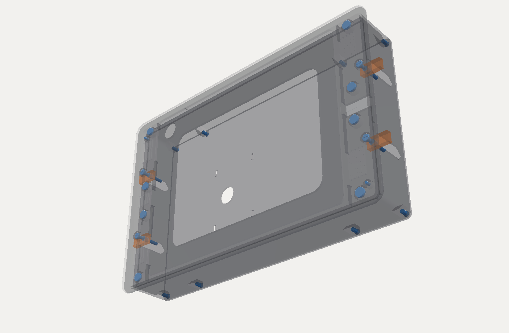

Every assembly STEP carries **all the hardware**, each in its place: magnets, dowel pins, the M4 clamp screws and their inserts, and the back-plate screws and inserts. 42 parts on the 12.9″ and 13″, 34 on the 11″ and mini.

- Named by size and standard, e.g. **hw_M4x30_pan_ISO7045_2**
- assembly_flush6.step (machined) and assembly_flush6_printed.step
- hardware.txt beside each one is the bill of materials

> [!TIP]
> The model checks itself: no magnet, pin or head touches a part it shouldn’t, and every insert bites into its own part.

---

### TOOLS

BEFORE YOU START

#### BENCH

- Soldering iron + M3/M4 heat-set tips
- Flat surface (glass or MDF)
- Spring clamps, masking tape
- Screwdriver for the M4 pan heads
- 2 mm hex key (M3 countersunk)
- Isopropyl alcohol + cloth

#### MACHINING

- CNC router (StrongHold)
- 6 mm and 2 mm end mills
- 3 mm drill
- Vacuum table or double-sided tape on a spoilboard
- Deburring tool

#### WALL

- Stud finder + spirit level
- Your iPad’s A3 cut-out template
- 14 mm drill bit
- Plasterboard saw
- Torch + inspection mirror
- Draw wire for the Cat6

---

### PRINT SETTINGS

PRINTING

| Setting | Value |
| --- | --- |
| Material | PETG or ASA |
| Layer height | 0.2 mm (0.4 mm nozzle) |
| Walls | 4 (6 on the dog-ear arms) |
| Infill: sleeve | 15% gyroid |
| Infill: deck, back plate | 20% gyroid |
| Infill: dog-ear arms | 100% |
| Infill: printed trim | 20% gyroid, 4 bottom layers |
| Supports | None needed |
| Bed | Textured PEI |

> [!WARNING]
> **No supports.** Every v6 part, for every iPad, was checked for overhangs in its print orientation. The few square millimetres left are first-layer countersink edges.

> [!TIP]
> **The arms take the clamp load.** Print them solid.

> [!TIP]
> **Bambu Studio?** Each iPad’s flush/printed folder has a 3MF with every plate and setting ready.

---

### PARTS LIST

PRINTING

| Part (size in mm) | Qty | 12.9″ | 13″ M5 | 11″ M5 | mini |
| --- | ---: | --- | --- | --- | --- |
| SLEEVE L / R (56.5 deep) | 1 each | 178.6 × 231.6 | 179.0 × 232.2 | 163.1 × 194.2 | 136.0 × 151.5 |
| DECK L / R | 1 each | 170.3 × 215.0 | 170.8 × 215.7 | 154.8 × 177.6 | 127.7 × 134.9 |
| BACK PLATE L | 1 | 232.6 × 219.6 | 233.0 × 220.2 | 217.1 × 182.2 | 190.0 × 139.5 |
| BACK PLATE R | 1 | 112.6 × 219.6 | 113.0 × 220.2 | 97.1 × 182.2 | 70.0 × 139.5 |
| DOG-EAR ARM | 4 | 24 × 12 × 6 | 24 × 12 × 6 | 24 × 12 × 6 | 24 × 12 × 6 |
| TRIM, 6061 (3 mm) | 1 | 359.1 × 233.6 | 360.1 × 234.2 | 328.2 × 196.2 | 273.9 × 153.4 |
| TRIM, PRINTED L / R | 1 each | 184.6 / 179.6 | 214.3 / 150.8 | 196.8 / 136.4 | 142.0 / 137.0 |
| One-piece sleeve / deck | option | 357.1 / 340.5 | 358.1 / 341.5 | 326.2 / 309.6 | 271.9 / 255.4 |

The back plate is split off-centre on purpose: its joint sits 60 mm from the sleeve seam, so the plate bridges and stiffens that seam. One-piece versions of the sleeve, deck, back plate and trim are in print/one_piece/; the mini’s deck fits a 256 mm bed in one piece.

---

### FILES

PRINTING

#### ‹iPad›/flush/machined/

- machine/trim_6061.step for CAM
- print/ sleeve, deck, back plate halves and dog_ear_arm_x4
- print/one_piece/
- CUTOUT_TEMPLATE_A3.pdf
- assembly_flush6.step · hardware.txt

#### ‹iPad›/flush/printed/

- Float_Mount_v6_‹iPad›_Flush_Printed.3mf
- print/ trim_print_L · _R and every hidden part
- print/one_piece/
- CUTOUT_TEMPLATE_A3.pdf
- assembly_flush6_printed.step · hardware.txt

#### src/ (the sources)

- tablets.py: the four iPads
- flush6.py · template6.py
- printed6.py · make3mf6.py
- hardware6.py: magnets, pins, screws, inserts

‹iPad› is **ipad_pro_12_9_gen3**, **ipad_pro_13_m5**, **ipad_pro_11_m5** or **ipad_mini_a17_pro**. Every size comes from flush6.py and tablets.py. If you change one that moves the cut-out, print a new template with template6.py.

---

### SLEEVE HALVES

PARTS ORIENTATION · 1 OF 4

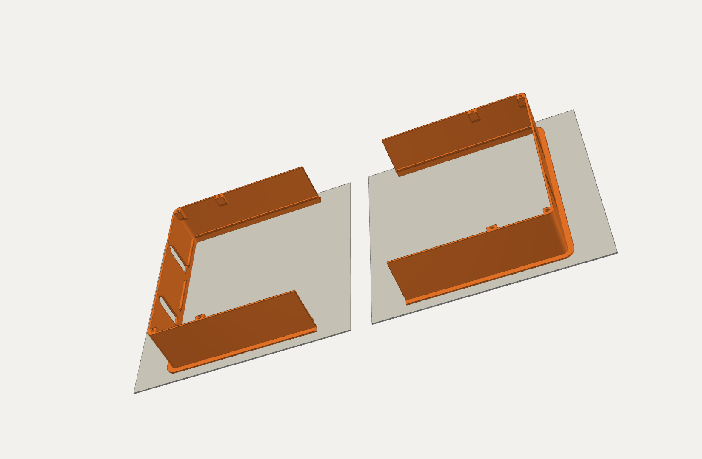

**Face down**, as exported. One half per plate.

The flange face goes on the bed, so the surface that sits against the wall comes out dead flat.

The ledges inside are 45°, and the arm slots and button pockets have 45° roofs, so nothing needs support.

> [!TIP]
> 15% gyroid · 4 walls. The largest half (13″) is 179.0 × 232.2 mm: a 256 mm bed with room for a brim.

---

### DECK HALVES

PARTS ORIENTATION · 2 OF 4

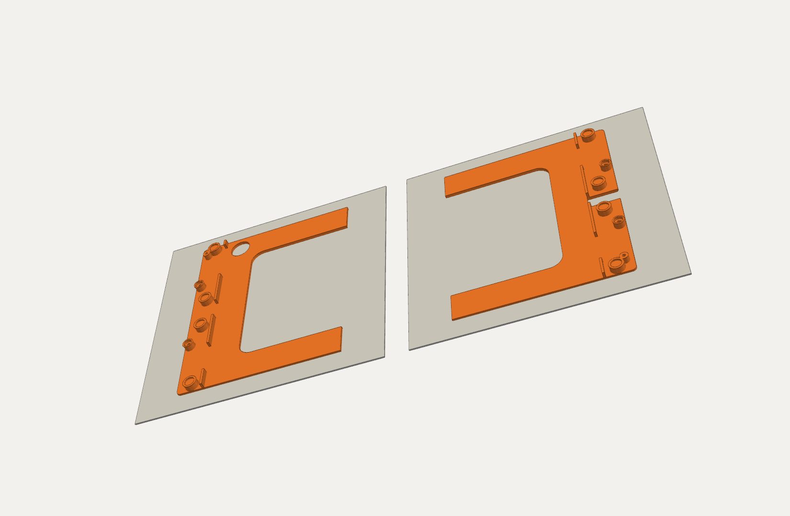

**Bottom down**, as exported. 20% gyroid · 4 walls.

The bevelled back edges print as 45° chamfers. Those are what seat on the sleeve ledges and centre the deck.

> [!WARNING]
> Keep elephant’s foot down on these edges. A fat first layer stops the deck seating fully.

---

### BACK PLATE AND DOG-EAR ARMS

PARTS ORIENTATION · 3 OF 4

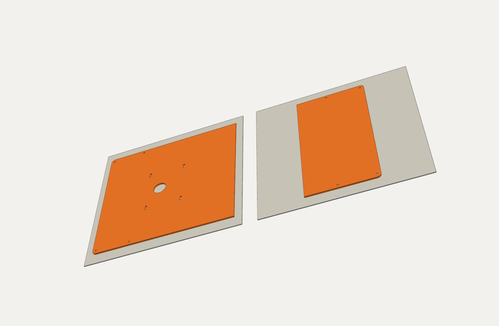

**BACK PLATE L + R:** flat, countersinks down. 20% gyroid.

**DOG-EAR ARMS × 4:** flat. Solid infill, 6 walls. The same arms for every iPad.

---

### PRINTED TRIM

PARTS ORIENTATION · 4 OF 4 · OPTIONAL

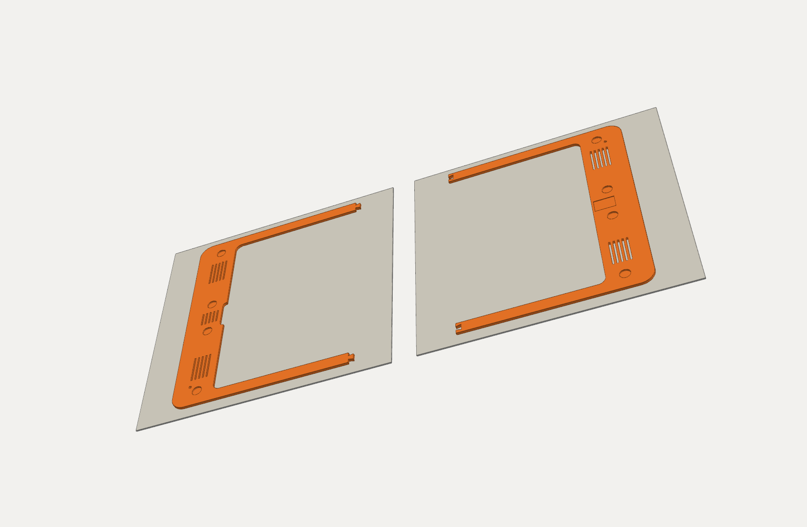

No CNC? Print the trim instead, in the colour you like.

- **Two halves** on 256 mm beds: glue the dovetails with CA or epoxy.
- **One piece** (print/one_piece/trim_print_full) on a big bed.
- Always **face down** on textured PEI: the bed gives the face its finish.

> [!TIP]
> The magnet pockets and pin holes are printed in. The 0.8 mm front round becomes a 0.8 mm chamfer.

BY MODEL

12.9″ and mini: seam on the centreline. 13″ and 11″ M5: seam 3 mm right of the camera notch.

---

### TRIM: BACK SIDE UP

MACHINING · OP 1 OF 2

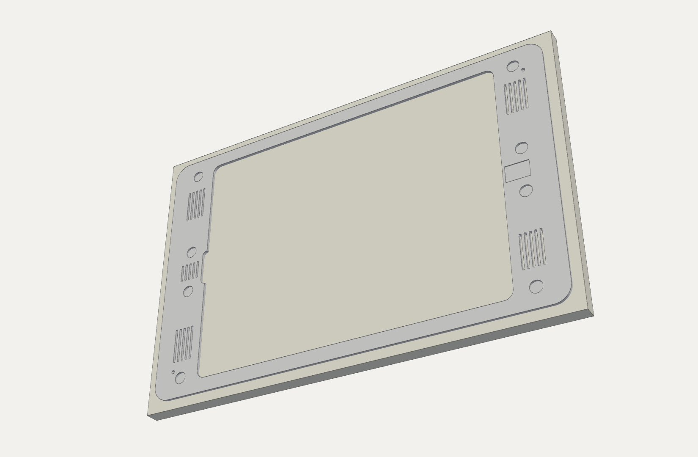

1. Hold 3 mm 6061 flat on a vacuum table or double-sided tape on a spoilboard.
2. Pocket the Ø10.2 magnet seats, 1.6 mm deep, with a 6 mm end mill.
3. Drill 2 × Ø3 pin holes, 2 mm deep.
4. Cut the plug relief at the USB-C end.

| By model | 12.9″ | 13″ | 11″ | mini |
| --- | --- | --- | --- | --- |
| Magnet seats | 8 | 8 | 4 | 4 |
| Plug relief | 0.55 | 0.94 | 0.86 | 0.34 |

> [!WARNING]
> **1.6 mm is the limit.** It leaves a 1.4 mm skin under the front face.

---

### TRIM: FRONT SIDE UP

MACHINING · OP 2 OF 2

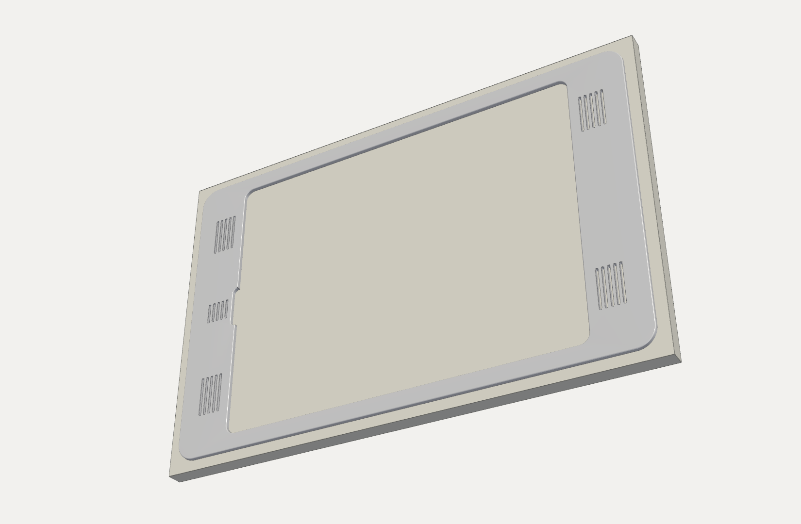

1. Flip it onto two Ø3 pins set in the spoilboard, using the pin holes from op 1.
2. Cut the window and camera slot through (6 mm end mill).
3. Cut the grille slots with a 2 mm end mill: climb, light passes.
4. Profile the outside with tabs, then a 0.8 mm radius on the front outer edge.

BY MODEL: WINDOW, SLOT, GRILLES

**12.9″:** R7.5 corners, slot 32 × 8.4 on the left end. **13″ / 11″:** R11.7, slot 52.5 / 49.5 × 8.4 in the top edge. **mini:** R11.7, slot 16 × 8.4 on the left end. Grilles sit over each model’s own speakers and mics.

> [!TIP]
> **Finish:** fine glass bead blast, then clear or black anodise. Press in the 2 dowel pins after anodising.

---

## 01 · BENCH ASSEMBLY

Ten steps on the bench, the same for every iPad. You finish with a complete in-wall unit (sleeve, deck, back plate, PoE adapter and arms) and a trim ready to fit.

---

### ARM INSERTS

BENCH ASSEMBLY · STEP 1 OF 10

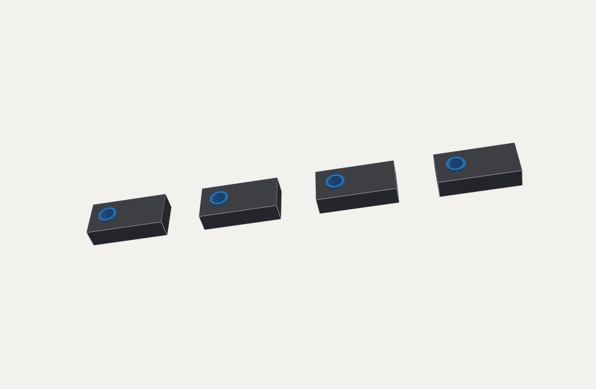

Press one M4 insert into each DOG-EAR ARM, from the top face.

Lay the arm flat on the bench so it can’t tilt. Push straight down and stop when flush.

> [!WARNING]
> A crooked insert makes the arm swing out at an angle. Check each with a screw before it cools.

**You need:** 4 × M4 heat-set inserts · iron with M4 tip

---

### SLEEVE INSERTS

BENCH ASSEMBLY · STEP 2 OF 10

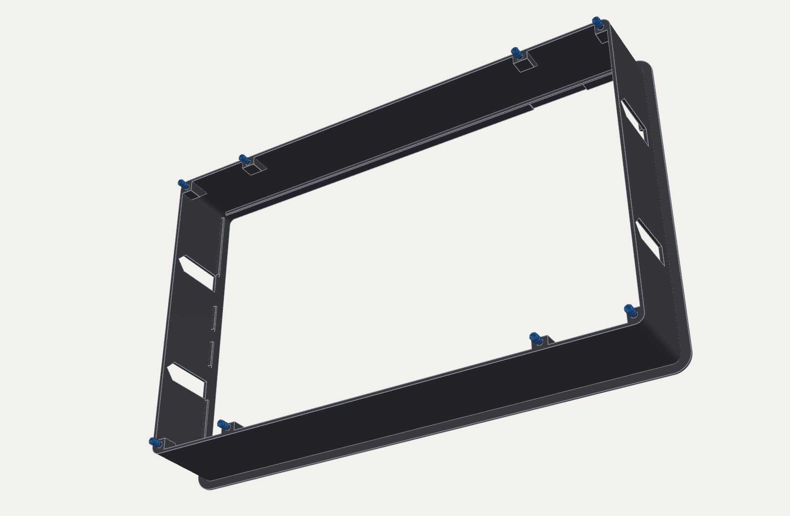

Press 8 M3 inserts into the bosses on the back edge of the SLEEVE halves: 4 in each.

Do this before gluing. Each half sits flat on its flange, so you can press straight down.

> [!WARNING]
> Stop each insert flush or 0.1 mm below. Proud inserts hold the back plate off its seat.

**You need:** 8 × M3 heat-set inserts · iron with M3 tip

---

### GLUE THE SLEEVE

BENCH ASSEMBLY · STEP 3 OF 10

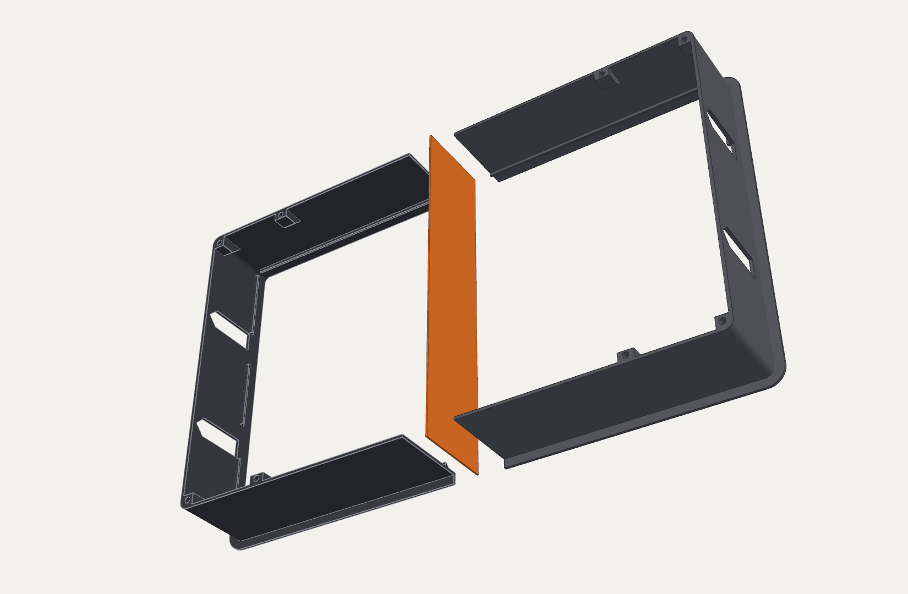

Lay both SLEEVE halves face down on a flat surface. Epoxy the centre seam and push them together.

Keep the flanges pressed flat while it cures. Tape across the seam, inside and out, holds it closed.

> [!WARNING]
> Wipe squeeze-out off the ledges. A blob there stops the deck seating.

**You need:** 2-part epoxy · flat surface · masking tape

---

### GLUE THE DECK

BENCH ASSEMBLY · STEP 4 OF 10

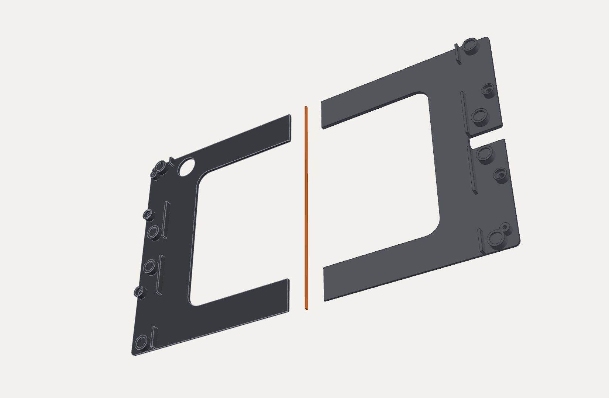

Epoxy the centre seam of the two DECK halves, flat on the same surface, and push them together.

Once the sleeve and deck have both cured, dry-fit: the deck should drop onto the sleeve ledges and sit level with the flange.

> [!WARNING]
> The iPad lies on this face. Sand any ridge at the seam flat, or it will press on the iPad’s back.

**You need:** 2-part epoxy · flat surface · fine sandpaper

---

### SORT THE MAGNET POLARITY

BENCH ASSEMBLY · STEP 5 OF 10

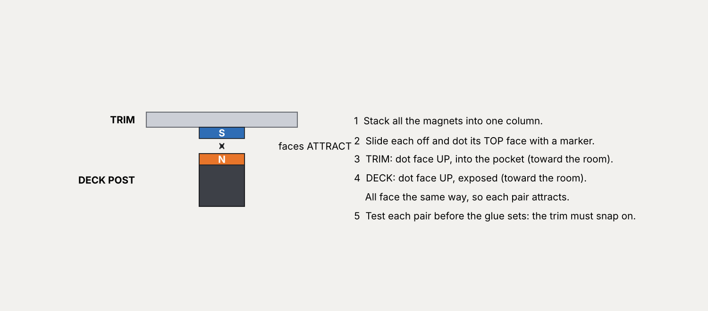

> [!WARNING]
> **Get this right before any glue comes out.** One reversed magnet and the trim pushes off on that corner. Every magnet goes in dot face toward the room.

> [!TIP]
> **By model:** 16 magnets on the 12.9″ and 13″, 8 on the 11″ and mini. The rule is the same.

---

### DECK MAGNETS

BENCH ASSEMBLY · STEP 6 OF 10

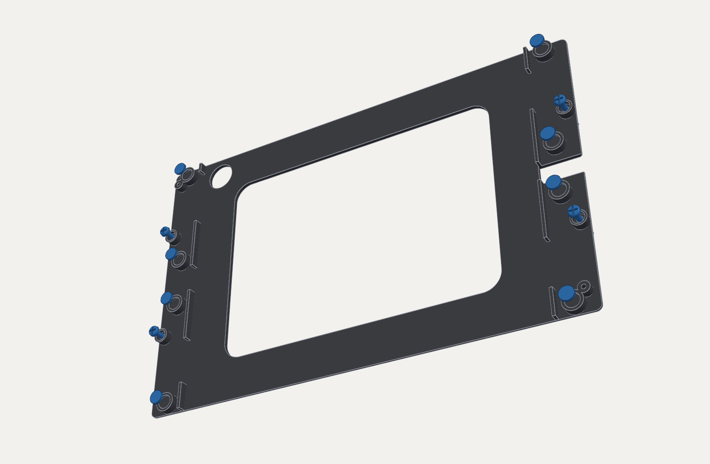

Glue a magnet into each MAGNET POST at the deck ends, **dot face up**.

A small dab of epoxy in each seat. Press each magnet flush with a flat stick, then wipe off any excess.

> [!WARNING]
> Fit them one at a time, well apart. Loose magnets jump to each other and to your tools.

**You need:** 8 N52 magnets 10 × 1.5 mm (4 on the 11″ and mini) · epoxy

---

### TRIM MAGNETS, PINS AND TAPE

BENCH ASSEMBLY · STEP 7 OF 10

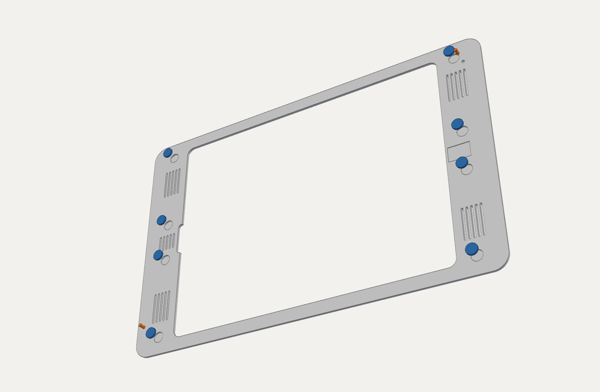

Trim face down on a towel. Glue a magnet into each pocket, **dot face into the pocket**. Press in the 2 dowel pins.

Then run PORON tape around the underside of the lip, where it will touch the glass.

> [!WARNING]
> Before the glue sets, hold the trim over the deck. Every corner must pull in, not push away.

**You need:** 8 magnets (4 on the 11″ and mini) · 2 × Ø3 × 6 pins · epoxy · PORON tape

---

### PoE ADAPTER ON THE BACK PLATE

BENCH ASSEMBLY · STEP 8 OF 10

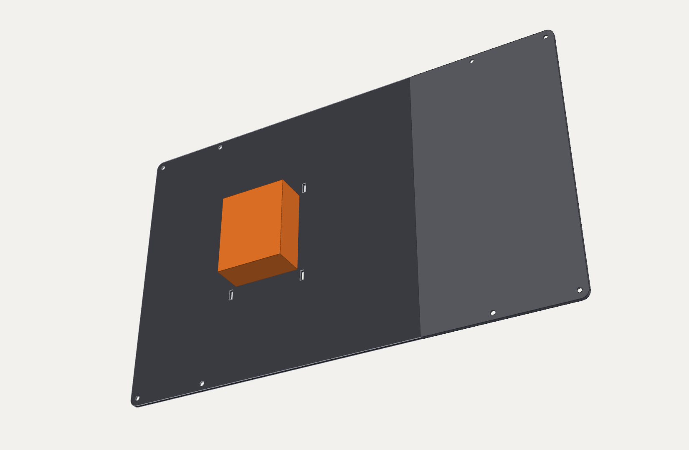

Zip-tie the PoE ADAPTER to the inside face of the BACK PLATE through the slots. Plug in the USB-C cable.

Point the adapter’s Ethernet socket at the Cat6 entry hole. Leave the USB-C cable loose for now.

> [!TIP]
> Snip the zip-tie tails flush so they don’t foul the deck.

**You need:** PoE adapter · 2 zip ties · USB-C cable

---

### FIT THE BACK PLATE

BENCH ASSEMBLY · STEP 9 OF 10

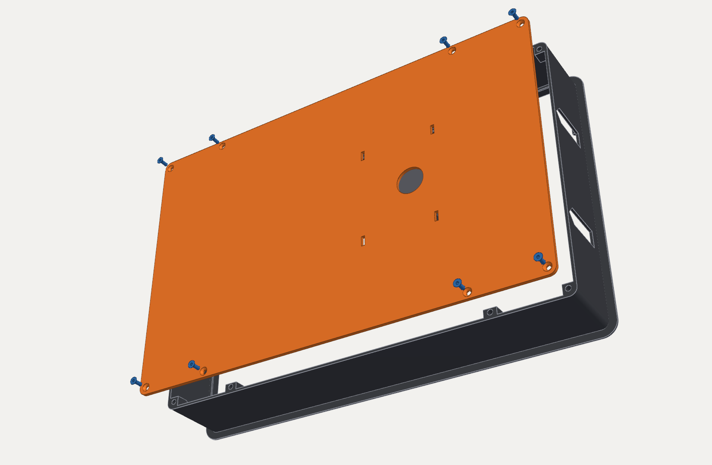

Set both BACK PLATE pieces onto the sleeve’s back edge, adapter inside. Fit 8 × M3 × 8 countersunk screws into the inserts.

Feed the USB-C plug up to the front of the box first, at the USB-C end.

> [!TIP]
> The long piece crosses the sleeve seam. Snug the screws either side of the seam first.

**You need:** 8 × M3 × 8 countersunk · 2 mm hex key

---

### DECK AND ARMS IN

BENCH ASSEMBLY · STEP 10 OF 10

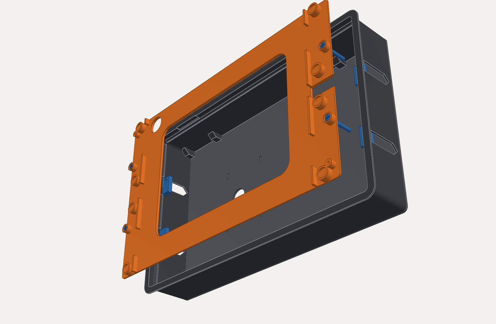

Bring the USB-C plug up through the gap in the ledge at the USB-C end, then drop the DECK onto its ledges.

Drive an M4 × 30 down through each deck post and thread an ARM onto it inside its slot. Then back each screw out about 5 mm so the arms hang low.

> [!TIP]
> This is a trial fit. At the wall you lift the deck out once more to plug in the Cat6 (wall step 3).

**You need:** 4 × M4 × 30 pan-head · 4 arms · screwdriver

---

## 02 · WALL INSTALLATION

Seven steps at the wall. Measure twice: the cut-out is the only step you can’t undo.

---

### FIND THE STUDS, PLACE THE TEMPLATE

WALL INSTALLATION · STEP 1 OF 7

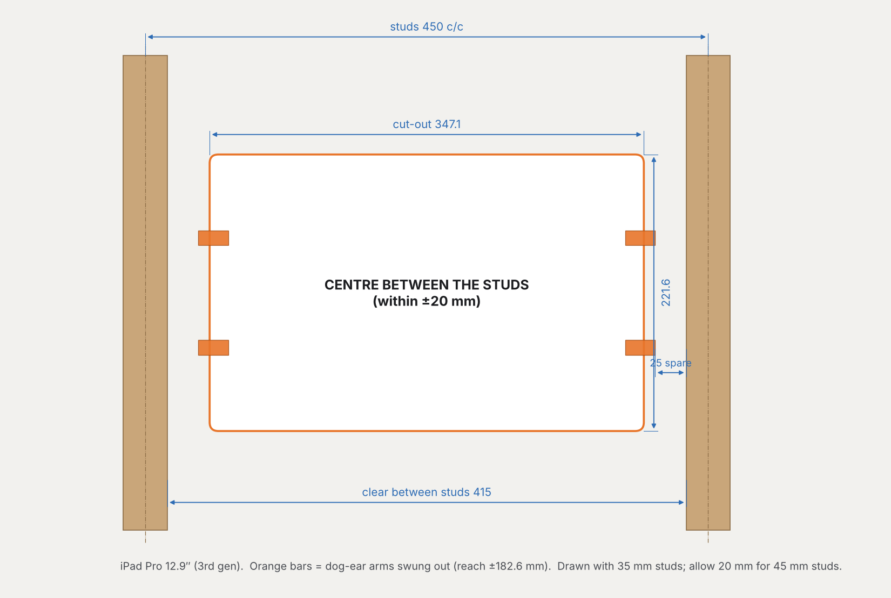

Mark both studs. Tape your iPad’s **A3 TEMPLATE** up, level, **centred between them**. TOP ↑ goes up.

The arms swing out sideways, so stay close to the bay’s centre.

| Max off-centre | 45 mm studs |
| --- | --- |
| 12.9″ · 13″ | 19 mm |
| 11″ | 35 mm |
| mini | 62 mm |

> [!WARNING]
> Drill a small test hole in the middle first and look inside with a torch: cables, pipes, noggings.

> [!TIP]
> Print the template at 100% on A3. Its scale bar must measure exactly 100 mm.

---

### CUT THE HOLE

WALL INSTALLATION · STEP 2 OF 7

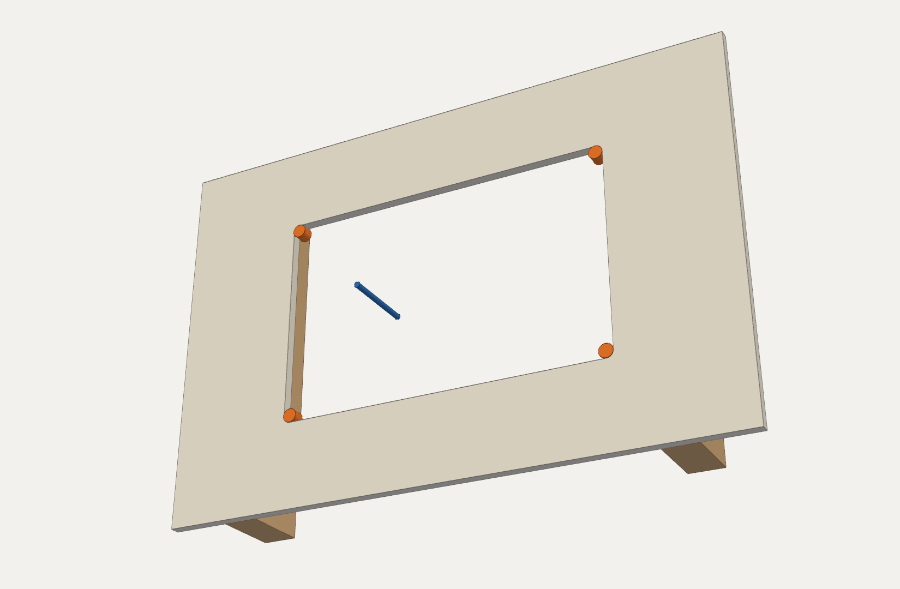

Drill Ø14 at the 4 corner crosses. That gives the R7 corners.

Saw the straight edges from hole to hole, on the solid line. Keep the saw square to the wall face.

> [!WARNING]
> Err on the small side. The trim covers the cut edge by about 6 mm, so you can shave to fit but can’t add back.

**You need:** 14 mm bit · plasterboard saw · dust mask

---

### CONNECT THE CAT6

WALL INSTALLATION · STEP 3 OF 7

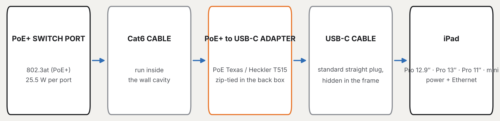

Fish the Cat6 out through the hole. Lift the DECK out: undo the 4 M4s and catch the ARMS as they come free.

Push the Cat6 in through the back plate’s entry hole and plug it into the PoE ADAPTER. Refit the deck, screws and arms as in bench step 10.

> [!WARNING]
> **Test now.** Plug the iPad into the USB-C lead: it should charge and show Ethernet before the unit goes in the wall.

> [!WARNING]
> **Use a PoE+ (802.3at) port.** Plain 802.3af PoE can’t supply the 25 W adapter.

---

### PUT THE UNIT IN THE WALL

WALL INSTALLATION · STEP 4 OF 7

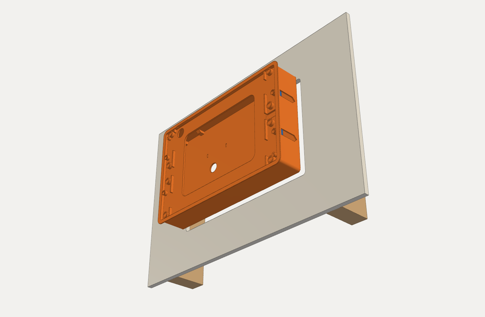

Turn all 4 ARMS to point into the box. Feed the Cat6 slack back into the wall, then push the unit straight in **until the flange sits on the wall**.

Keep the Cat6 entry on the side the template marks. The sleeve has 1 mm of clearance each side.

> [!WARNING]
> Don’t force it. If it binds, shave the cut edge where it rubs.

---

### CLAMP IT

WALL INSTALLATION · STEP 5 OF 7

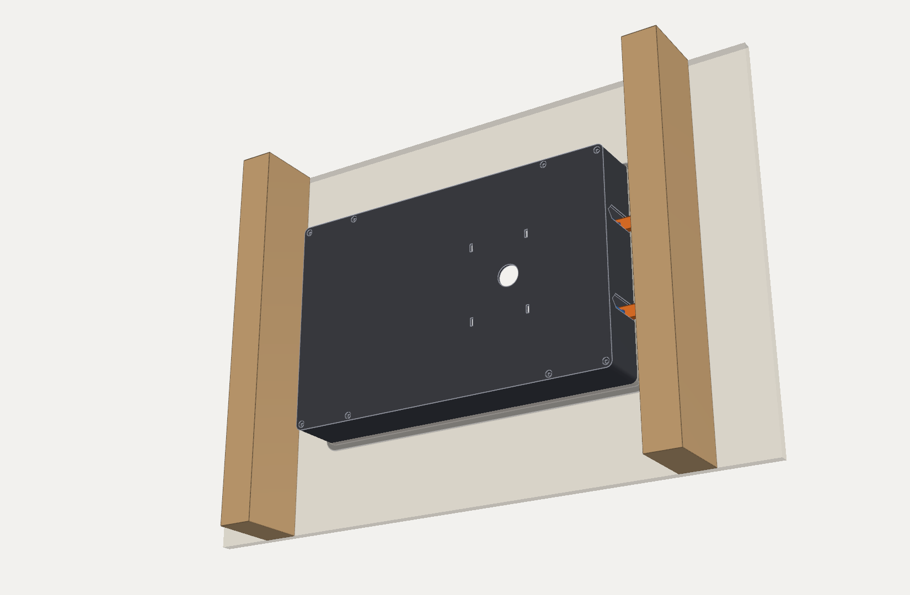

Hold the flange flat on the wall and turn each M4 clockwise. The ARM swings out through its slot, stops, then pulls up behind the board.

Tighten in diagonal pairs, a turn at a time, until the flange is snug all round.

> [!WARNING]
> Hand tight only. Plasterboard crushes. Stop when the unit no longer moves.

**You need:** Hand screwdriver, not a drill

---

### FIT THE iPAD

WALL INSTALLATION · STEP 6 OF 7

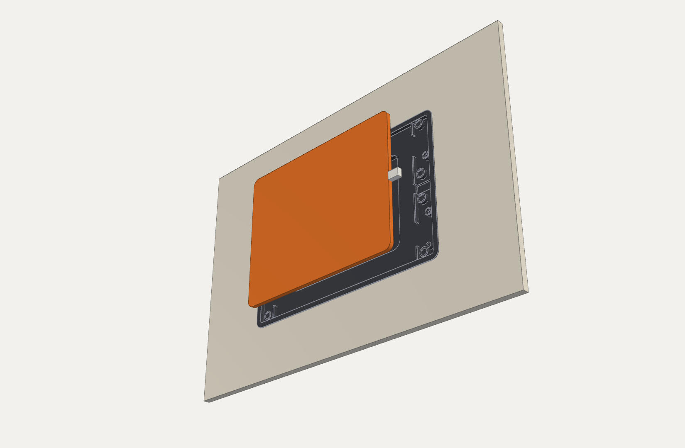

Plug the USB-C into the iPad. Lay it **screen out** on the DECK, USB-C to the right.

The end ribs locate it side to side. Tuck the cable loop down into the box end.

> [!TIP]
> Clean the glass now. Once the trim is on, the edges are hard to reach.

---

### FIT THE TRIM

WALL INSTALLATION · STEP 7 OF 7

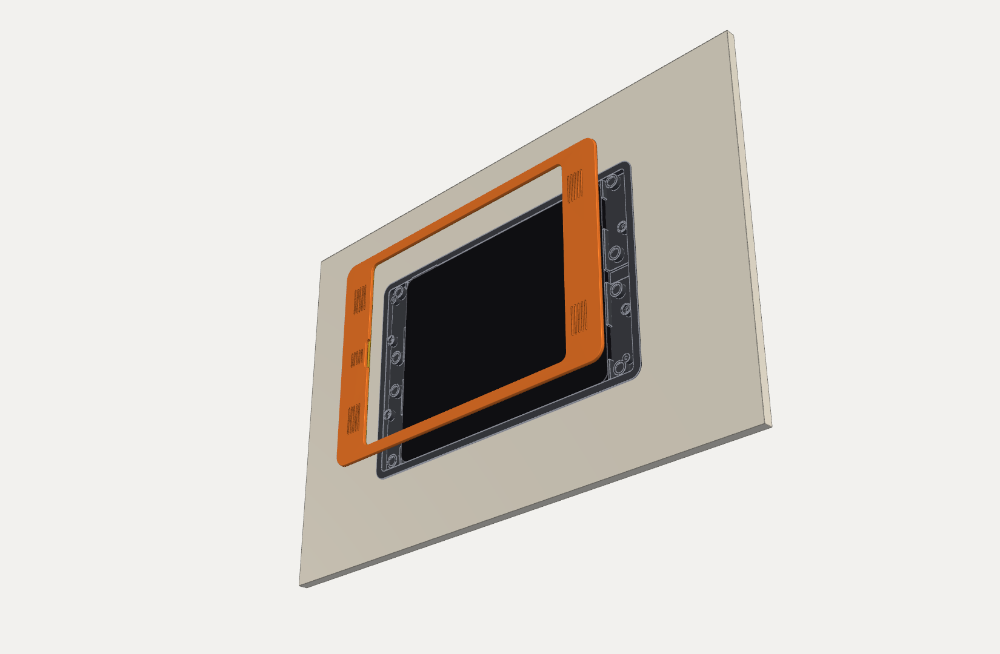

Line up the 2 PINS with their holes and offer the TRIM up. **The magnets pull it home.**

The pins also fit with the trim upside down, so check the camera notch sits over the camera first. The PORON lip rests on the glass edge.

> [!TIP]
> Keep fingers clear of the edges as it snaps on. N52 pairs close hard.

---

### REMOVING THE iPAD

SERVICE

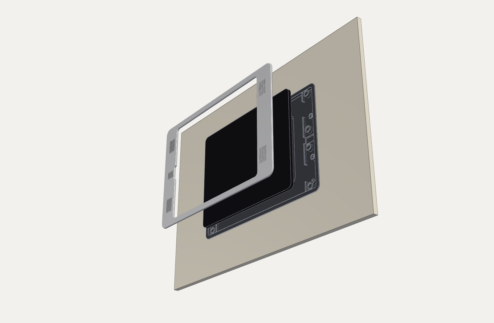

Grip the TRIM by its wide ends and **pull straight out**. Lift the iPad off the deck and unplug it.

The deck stays put: the M4 screw heads hold it down.

> [!WARNING]
> **Taking the unit out?** Back each M4 out a few turns until its arm swings in. Don’t remove the screws fully, or the arm drops into the wall.

---

### iPAD SETUP FOR A WALL PANEL

SETUP

#### KEEP THE SCREEN ON

Settings › Display & Brightness › Auto-Lock › Never. Dim it at night with a Shortcut or Home Assistant automation.

#### LOCK TO ONE APP

Settings › Accessibility › Guided Access. Start it in Home or your dashboard app.

#### BUTTONS ARE COVERED

Turn on Settings › Accessibility › Touch › AssistiveTouch for lock, volume and restart. On the mini the Touch ID button is covered too: use the passcode.

#### MIND THE HEAT

The iPad vents into a closed box. Panel duty is fine; hours of video or games are not.

---

### FINAL CHECKLIST

FINISHING BUILD

- [ ] Flange tight to the wall; unit doesn’t move

- [ ] iPad shows it is charging

- [ ] Trim sits flat, no gap at any corner

- [ ] Ethernet appears in Settings

- [ ] Volume doesn’t change by itself

- [ ] No cracked plaster round the cut-out

- [ ] Face ID unlocks first time (Pro)

- [ ] Speakers clear through the grilles

- [ ] Cable loop not pressing the iPad

- [ ] Guided Access and Auto-Lock set

> [!WARNING]
> **Something off?** Every size lives in flush6.py and tablets.py. Measure the problem, change the parameter, re-run it, and reprint only the part that changed.

---

## ENJOY YOUR FLUSH MOUNT

The M5 and mini features come from Apple’s drawings; the 12.9″’s are close estimates. Fit the printed parts and the iPad before you cut the wall or machine the trim.

Also available: Float Mount v6, the surface-mounted version, for the same four iPads.

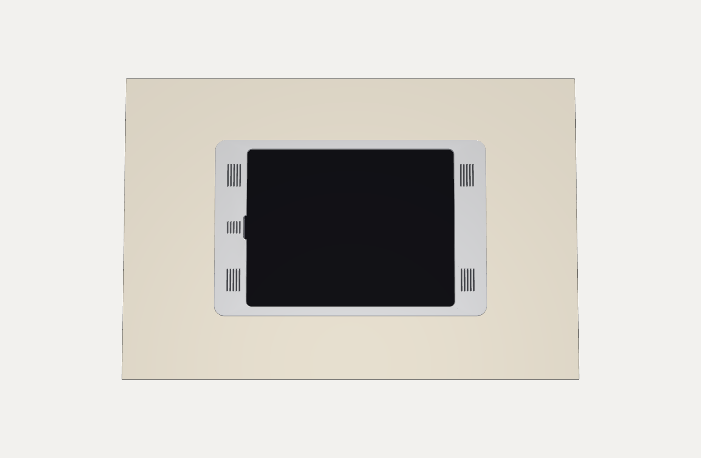
