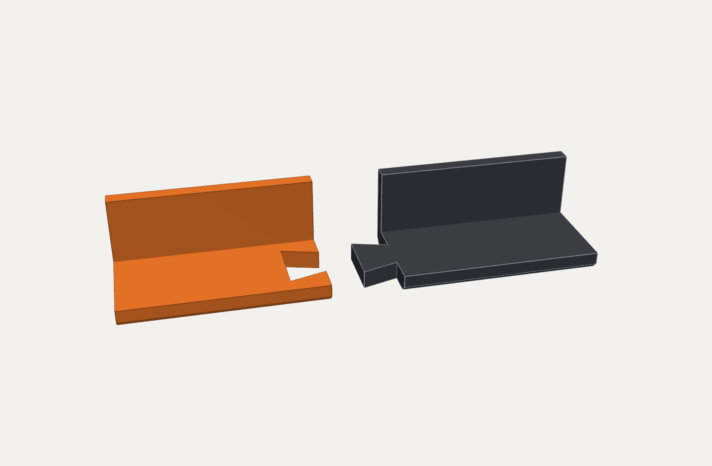
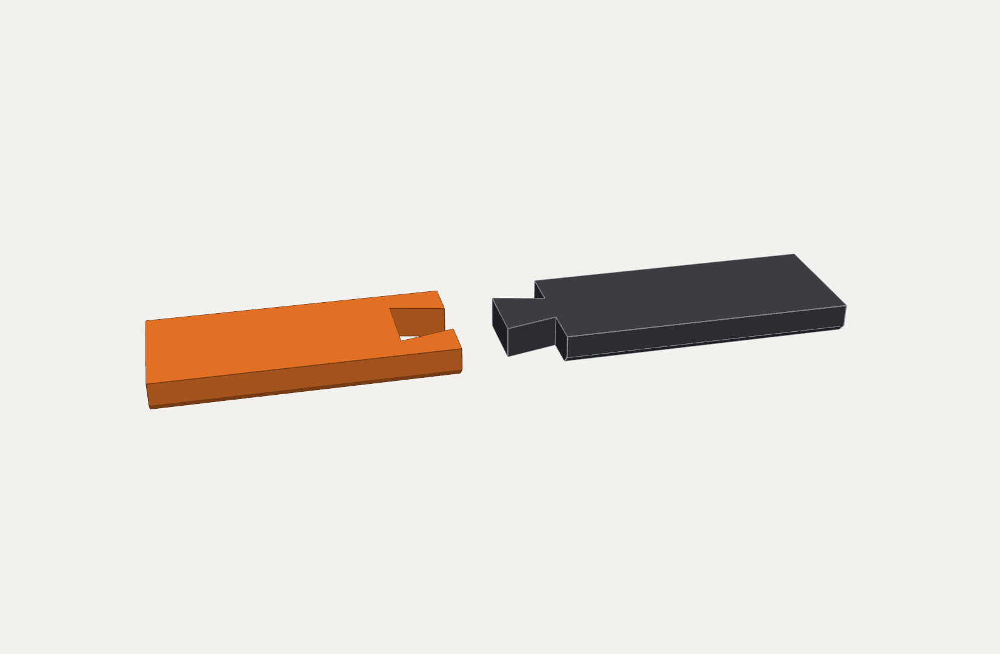
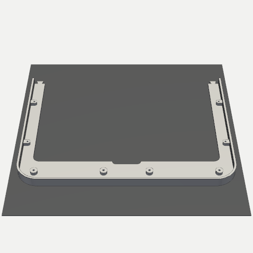
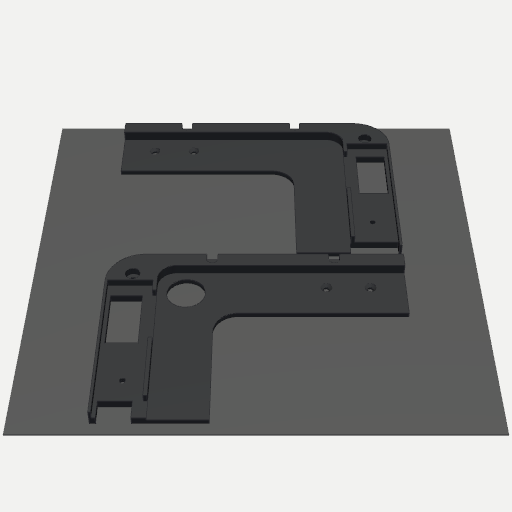
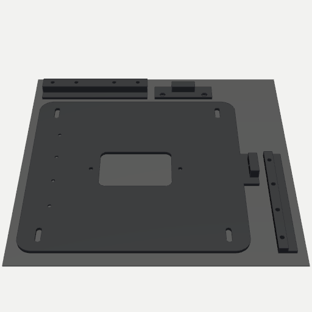
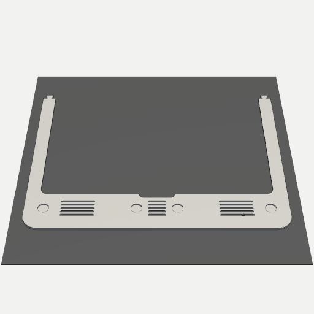
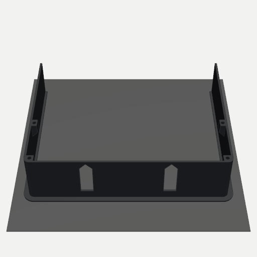
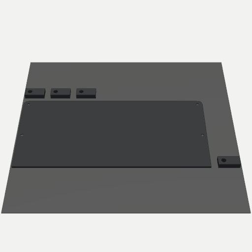

# Fully printed versions

> **v4.2:** [`float-v4.2-printed/`](float-v4.2-printed/) has the same printed shell halves plus **one-piece** versions of the shell (344.1 × 238.9 mm) and carrier (339.6 × 234.4 mm) in `print/one_piece/` for large-bed printers, and a v4.2 3MF. Use M3 × 5 / M2.5 × 5 screws with it, and follow the [v4.2 build manual](../float-v4.2/Float_Mount_v4.2_Build_Manual.pdf).

No machining needed: the aluminium face of each mount (the v4.1 **shell** and the v5.1 **trim**) is replaced by a 3D-printed face. Everything else is the same printed parts as the milled builds, so the assembly steps in the main build manuals still apply.

| | Float v4.1, printed | Flush v5.1, printed |
|---|---|---|
| Bambu Studio project | [Float_Mount_v4.1_Printed.3mf](float-v4.1-printed/Float_Mount_v4.1_Printed.3mf) | [Float_Mount_v5.1_Flush_Printed.3mf](flush-v5.1-printed/Float_Mount_v5.1_Flush_Printed.3mf) |
| Plates | 5 | 8 |
| Face | 2 halves, 177 × 239 × 11.7 mm and 172 × 239 × 11.7 mm | 2 halves, 183 × 234 × 3 mm and 178 × 234 × 3 mm |
| Build manual | [v4.1 manual (PDF)](../float-v4.1/Float_Mount_v4.1_Build_Manual.pdf) + the changes below | [v5.1 manual (PDF)](../flush-v5.1/Float_Mount_v5.1_Flush_Build_Manual.pdf) + the changes below |


## Why the face is in two halves

Neither face fits on a bed in one piece: the v4.1 shell is 344.1 mm long and the v5.1 trim 355.1 mm. That's too big for a P1S/X1 (256 mm), and also for an H2S (340 × 320 mm) or H2D (325 × 320 mm single-nozzle). Rotating the part doesn't help, because both faces are also about 235 mm tall. So each face splits at the centreline. Each half fits a 256 mm plate, and the seam only crosses the slim top and bottom bars.

A **dovetail key** across each bar aligns the halves and locks them together. The left half carries the keys and the right half the sockets, with 0.15 mm of clearance per flank.

| v4.1 key (through the 2.5 mm face plate) | v5.1 key (through the 3 mm trim) |
|---|---|
|  |  |

## What changes from the milled build

**Both versions**
- The face prints **face-down**, so the visible side takes the build plate's texture. A textured PEI plate gives an even satin finish that hides layer lines.
- The 0.8 mm rounded front edge of the aluminium part becomes a **0.8 mm 45° chamfer**, which prints crisply face-down.
- **Gluing the halves:** dry-fit first, then glue the dovetails and seam faces with medium CA or 2-part epoxy. Clamp them flat on the glass or the build plate while the glue cures.

**Float v4.1**
- Replaces machining ops 1 and 2 of the v4.1 manual.
- The tapped holes become **self-tapping pilot holes** (Ø2.5 for the M3 end bosses, Ø2.1 for the M2.5 top/bottom bosses). The same M3 × 6 and M2.5 × 6 cap screws thread straight in, so don't drill or tap. Snug them by hand; PETG strips if you lean on it.
- The face skin over each hole is **1.6 mm** (1.2 mm on the aluminium part), so screw tips can't show through to the face.
- The carrier, hanger and lock boss also tie the two halves together once they're screwed in.

**Flush v5.1**
- Replaces machining ops 1 and 2 of the v5.1 manual.
- The magnet pockets (Ø10.4 × 1.6 mm, 1.4 mm skin) and the Ø3 pin holes are printed in. Glue the magnets as in bench step 7 of the v5.1 manual, using the same polarity rule: **dot face toward the room**. Glue the dowel pins in too.
- Each half carries 4 magnets and 1 pin, so the halves locate on their own. Glue them together anyway for a one-piece trim that comes off in a single pull.

## The 3MF projects

They open in Bambu Studio with every part named, placed and grouped onto plates:

| v4.1 plate 1: shell half, face-down | plate 3: carrier quarters | plate 5: bracket, hanger, lock, rail |
|---|---|---|
|  |  |  |

| v5.1 plate 1: trim half, face-down | plate 3: sleeve half | plate 8: back plate + 4 arms |
|---|---|---|
|  |  |  |

- **Filament 1:** all the hidden parts. **Filament 2:** the two face halves, so you can choose the colour of the visible part. PETG or ASA for everything (not PLA: the iPad warms the parts).
- **Per-part settings are built in:**

  | Parts | Walls | Infill |
  |---|---|---|
  | Faces | 4 walls, 4 bottom layers | 20% gyroid |
  | v4.1 carrier, v5.1 sleeve | 4 | 15% gyroid |
  | Decks, back plates | 4 | 20% gyroid |
  | Wall bracket | 4 | 25% gyroid |
  | Hanger, lock boss, catch rail | 5 | 40% gyroid |
  | Dog-ear arms | 6 | 100% |

- **No supports** on any part.
- **Opens on Bambu's standard presets** (P1S 0.4 mm, 0.20 mm Standard, Bambu PETG Basic in both slots, Textured PEI plate), unmodified, so the file changes none of your machine's G-code or limits. If you have a different printer or filament, select yours after opening; the plates and per-part settings stay.
- The STLs are in each `print/` folder if you use another slicer.

### Uploading to MakerWorld

MakerWorld print profiles must be Bambu Studio 3MFs, and each profile needs at least one photo of a real print. To publish:

1. Open the 3MF in Bambu Studio and choose the printer, filaments and plate type as above.
2. **Slice all** plates and check them.
3. Use **File › Save Project**. This writes your presets into the file, which MakerWorld's cloud slicing uses.
4. Upload it with **Upload › Add Print Profile**, or with the **Publish** button in Bambu Studio. Then add your build photos and choose a licence. This repo is GPL-3.0; MakerWorld offers Creative Commons licences.

## Regenerating

```bash
pip install cadquery trimesh vtk
python printed.py out                     # face halves → out/*/print/*.stl|step (imports ../float-v4.1 and ../flush-v5.1)
python make3mf.py out ../float-v4.1/print ../flush-v5.1/print   # → out/*/…_Printed.3mf
```

`printed.py` builds the faces from the same parameters as the aluminium versions, so a change to `hybrid.py` or `flush51.py` (a different USB-C plug, say) carries through to the printed faces as well.
