# Float Mount v6 · Build Manual

> **PDF version (print-ready, one step per page): [Float_Mount_v6_Build_Manual.pdf](Float_Mount_v6_Build_Manual.pdf)**

PoE wall mount for iPad Pro 12.9″ (3rd gen), iPad Pro 13″ and 11″ (M5) and iPad mini (A17 Pro)

Machined 6061 aluminium shell (or fully printed) with a 3D-printed carrier. Surface-mounted, floating on a 14 mm shadow gap.

*Colour code in every step: **orange** = the part you are working on now, **blue** = screws, inserts, magnets and other hardware, grey = parts already fitted.*

## Contents

  - [CHOOSE YOUR iPAD](#choose-your-ipad)
  - [WHAT’S NEW IN V6](#whats-new-in-v6)
  - [GENERAL DATA](#general-data)
  - [SIZES BY MODEL](#sizes-by-model)
  - [DESIGN FEATURES](#design-features)
  - [EXPLODED VIEW](#exploded-view)
  - [HOW IT FITS TOGETHER](#how-it-fits-together)
  - [BUTTON RELIEFS](#button-reliefs)
  - [ROOM FOR THE CABLE LOOP](#room-for-the-cable-loop)
  - [LATERAL STOPS ON THE RAIL](#lateral-stops-on-the-rail)
  - [POWER AND DATA PATH](#power-and-data-path)
  - [RECOMMENDED EQUIPMENT](#recommended-equipment)
  - [REQUIRED HARDWARE](#required-hardware)
  - [HARDWARE IN THE STEP FILE](#hardware-in-the-step-file)
  - [TOOLS](#tools)
  - [PRINT SETTINGS](#print-settings)
  - [PARTS LIST](#parts-list)
  - [FILES](#files)
  - [CARRIER](#carrier)
  - [HANGER, LOCK BOSS, CATCH RAIL](#hanger-lock-boss-catch-rail)
  - [WALL BRACKET](#wall-bracket)
  - [PRINTED SHELL](#printed-shell)
  - [SHELL: BACK SIDE UP](#shell-back-side-up)
  - [SHELL: FRONT SIDE UP](#shell-front-side-up)
  - [ORDERING THE SHELL (JLCCNC)](#ordering-the-shell-jlccnc)
- [01 · BENCH ASSEMBLY](#01--bench-assembly)
  - [HEAT-SET INSERTS](#heat-set-inserts)
  - [CATCH RAIL TO THE BRACKET](#catch-rail-to-the-bracket)
  - [HANGER TO THE TOP QUARTERS](#hanger-to-the-top-quarters)
  - [LOCK BOSS TO THE BOTTOM QUARTERS](#lock-boss-to-the-bottom-quarters)
  - [PORON TAPE ON THE LIP](#poron-tape-on-the-lip)
  - [iPAD INTO THE SHELL](#ipad-into-the-shell)
  - [CARRIER INTO THE SHELL](#carrier-into-the-shell)
  - [SCREW THE CARRIER TO THE SHELL](#screw-the-carrier-to-the-shell)
  - [CHECK THE BACK](#check-the-back)
- [02 · WALL INSTALLATION](#02--wall-installation)
  - [PLAN THE POSITION](#plan-the-position)
  - [FIX THE BRACKET](#fix-the-bracket)
  - [CONNECT THE PoE ADAPTER](#connect-the-poe-adapter)
  - [HANG THE PANEL](#hang-the-panel)
  - [FIT THE LOCK SCREW](#fit-the-lock-screw)
  - [iPAD SETUP FOR A WALL PANEL](#ipad-setup-for-a-wall-panel)
  - [FINAL CHECKLIST](#final-checklist)
- [ENJOY YOUR FLOAT MOUNT](#enjoy-your-float-mount)

---

### CHOOSE YOUR iPAD

START HERE

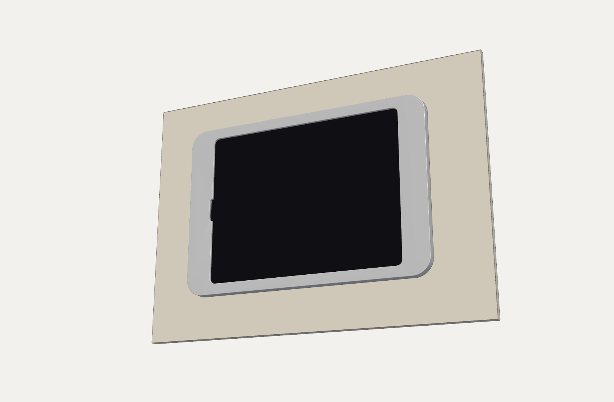

#### PRO 12.9″ (3RD GEN)

A1876 · A1895 · A2014 · A1983 **ipad_pro_12_9_gen3** Button positions are estimated: measure yours first (page 10).

#### PRO 13″ (M5)

2025, from Apple’s drawings **ipad_pro_13_m5** Camera slot in the top edge; button-head shell screws.

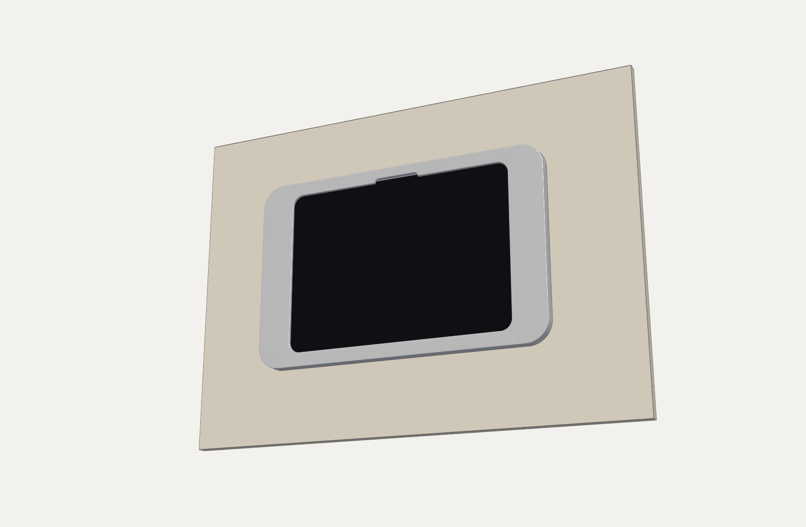

#### PRO 11″ (M5)

2025, from Apple’s drawings **ipad_pro_11_m5** Camera slot in the top edge; button-head shell screws.

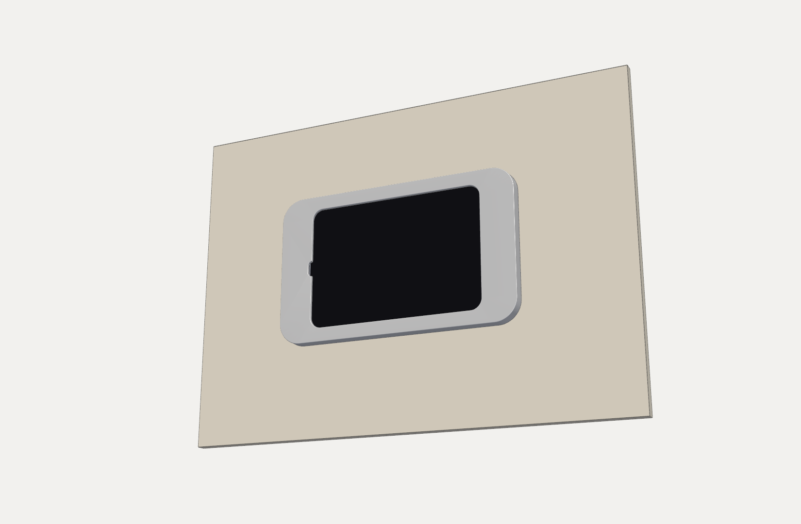

#### MINI (A17 PRO)

2024, from Apple’s drawings **ipad_mini_a17_pro** 15 mm plate; bracket fixes with anchors only.

Each iPad has its own folder in the repository’s v6/ directory, with the machined and the fully printed build kept apart. The steps in this manual are the same for all four.

---

### WHAT’S NEW IN V6

OVERVIEW

#### BUTTONS LEFT ALONE

A 1.2 mm relief in the carrier wall at every button. v4.2 pressed the 12.9″’s volume buttons.

#### ROOM FOR THE LOOP

Each end cavity is 2 mm longer, so the cable bends back round the plug. The panel grows 4 mm.

#### NO SIDEWAYS SLIDE

End stops on the catch rail hold the hanger with 0.4 mm each side.

#### FOUR iPADS

One source file per mount. tablets.py holds each iPad’s size, camera, speakers, mics and buttons.

#### SAFE THREADS ON ALL

Boss height follows the iPad’s thickness, so every drill point leaves 1.45 mm of metal under the face.

#### EVERY SCREW IN THE STEP

The assembly STEP carries all 42 screws, inserts and nuts, each where it goes.

---

### GENERAL DATA

OVERVIEW

| Item (mm) | Pro 12.9″ (3rd gen) | Pro 13″ (M5) | Pro 11″ (M5) | mini (A17 Pro) |
| --- | --- | --- | --- | --- |
| Overall size | 348.1 × 238.9 | 349.1 × 239.5 | 317.2 × 201.5 | 262.9 × 158.8 |
| Depth off the wall | 25.7 | 24.9 | 25.1 | 26.1 |
| Shell thickness, mass | 11.7 · 231 g | 10.9 · 227 g | 11.1 · 196 g | 12.1 · 161 g |
| Front camera slot | left end | top edge | top edge | left end |
| Wall bracket | 200 × 200, AU plate | 200 × 200.6, AU plate | 200 × 162.6, AU plate | 200 × 119.8, anchors |
| Shell screw heads | socket cap | button head | button head | socket cap |

**Same on every model:** frame ends 33.8 mm, top and bottom 12.0 mm · 14 mm shadow gap · PoE+ (802.3at) over one Cat6 · standard straight USB-C, hidden · bracket + hook + one hidden M3 lock screw · prints on a 256 mm bed (one-piece parts need a bigger one).

---

### SIZES BY MODEL

OVERVIEW

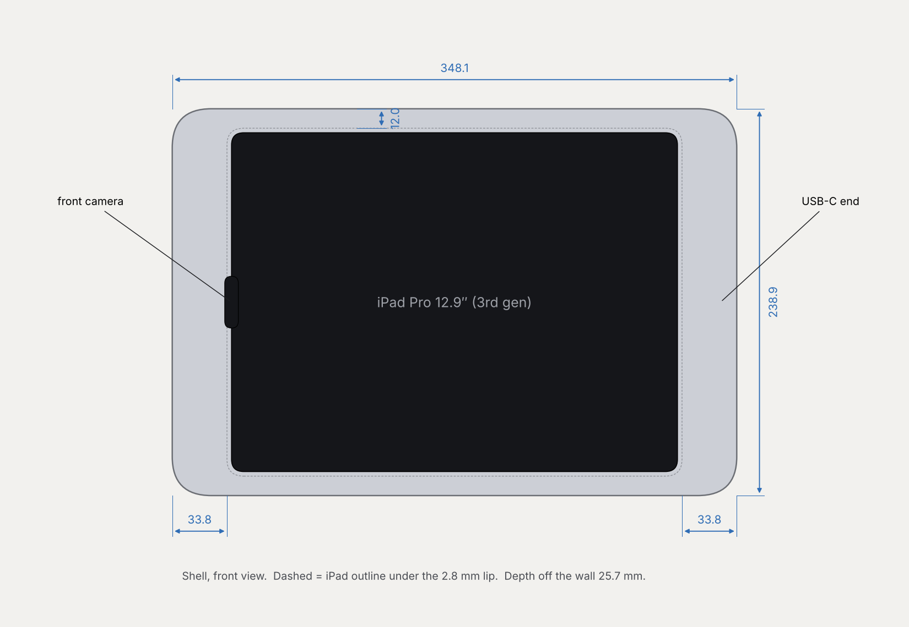

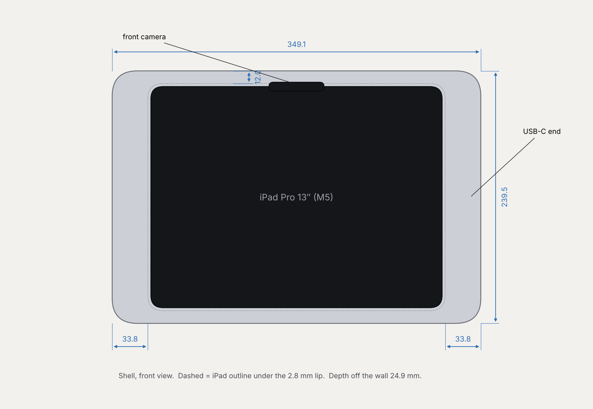

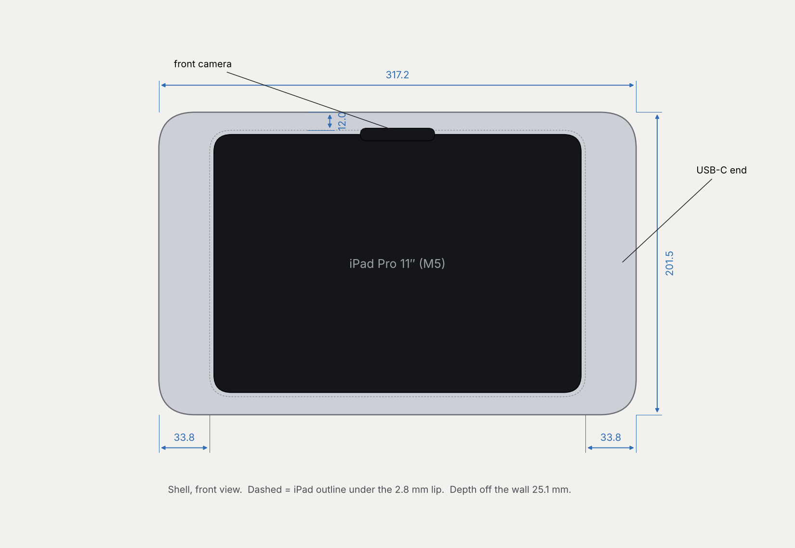

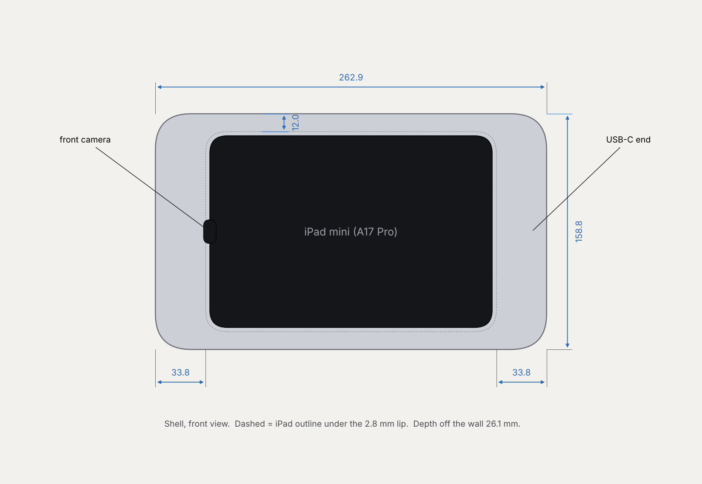

---

### DESIGN FEATURES

OVERVIEW

#### FLOATING LOOK

The panel stands 14 mm off the wall. Nothing that holds it can be seen.

#### NO VISIBLE SCREWS

The carrier screws into 16 blind bosses in the shell from behind.

#### HIDDEN CABLE

A normal straight USB-C plug and its loop live inside the frame end.

#### SOUND STILL WORKS

Speakers and mics fire into open chambers that vent into the shadow gap.

#### PRINT THE HIDDEN PARTS

Only the shell is aluminium, and it can be printed too. Nothing needs supports.

#### ONE-SCREW LOCK

It hangs on a rail between two end stops. One M3 screw from below stops it lifting off.

---

### EXPLODED VIEW

OVERVIEW

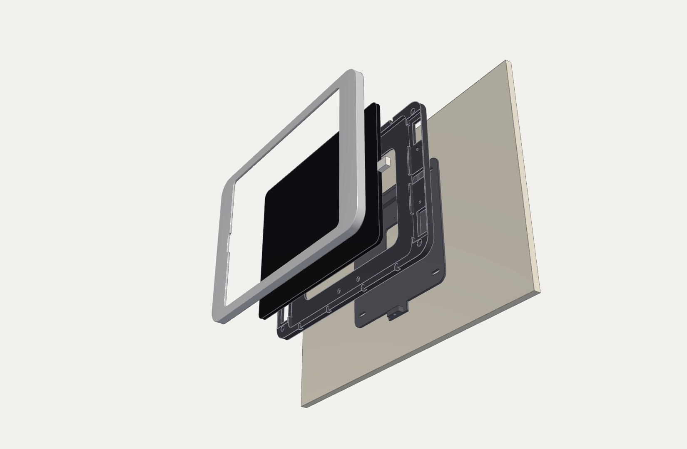

1

**Wall bracket** with the catch rail, its two end stops and the lock block

2

**Printed carrier**, four quarters, with the hanger and lock boss

3

**iPad** and its straight USB-C plug

4

**6061 aluminium shell** (or printed), the only part you see

---

### HOW IT FITS TOGETHER

OVERVIEW

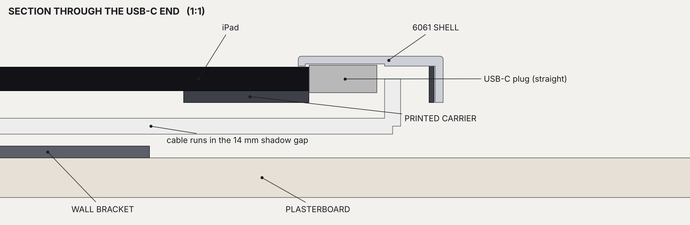

A true 1:1 cut through the USB-C end. The aluminium lip retains the glass, the plug sits in a pocket inside the frame end, and the cable turns straight back into the 14 mm shadow gap and runs to the bracket cut-out.

---

### BUTTON RELIEFS

V6 CHANGES · 1 OF 3

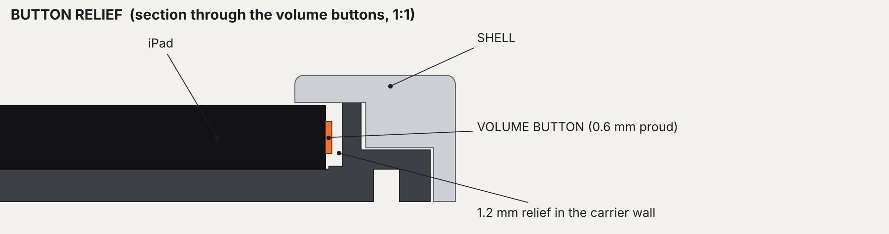

The carrier wall now steps back **1.2 mm** along every button, plus a margin at each end. Nothing touches the buttons, so the iPad can’t turn its volume up or lock itself.

Use AssistiveTouch for the buttons once it’s on the wall (page 44).

BY MODEL (from the top-left corner, USB-C on the right)

**12.9″:** volume 8–48 mm along the top edge, top button 8–36 mm down the left end. Estimated: measure yours first. **13″ / 11″ M5:** volume 12–39 mm along the top, top button 12–28 mm down the left end. **mini:** both on the left end: volume 11–37 mm from the top, top button 11–31.5 mm from the bottom.

---

### ROOM FOR THE CABLE LOOP

V6 CHANGES · 2 OF 3

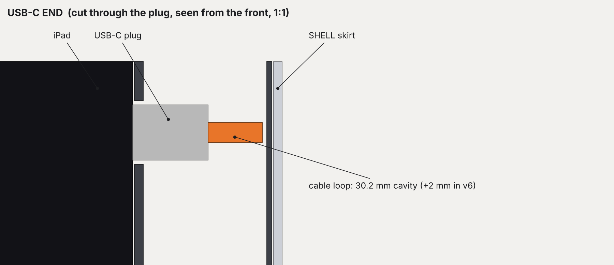

The plug cavity is **2 mm longer** than in v4.2: 30.2 mm from the iPad edge. The cable now has room to loop back round the plug instead of being forced against the wall.

Both ends grow so the frame stays symmetric: each end is 33.8 mm and the panel is 4 mm longer overall.

> [!TIP]
> Sized for a straight plug with a 17 × 12.5 × 7 mm overmold. A bigger plug? Change PLUG_L / PLUG_W / PLUG_H in float6.py and re-run it.

---

### LATERAL STOPS ON THE RAIL

V6 CHANGES · 3 OF 3

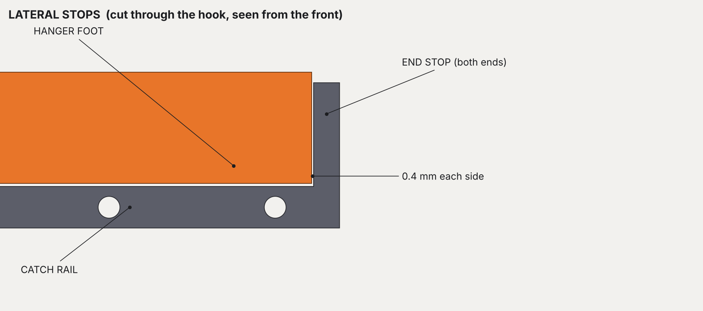

The CATCH RAIL now has an **end stop at each side**, 5 mm thick and rising 12 mm above the lip.

The 110 mm HANGER drops between them with 0.4 mm each side, so the panel can’t slide left or right on the wall. The hook still drops straight down: nothing changes when you hang it.

> [!TIP]
> The rail is the same on all four models: 120.8 mm long, printed flange down.

---

### POWER AND DATA PATH

OVERVIEW

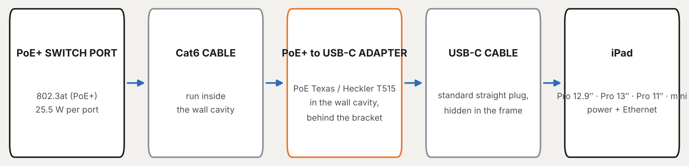

> [!WARNING]
> **Use a PoE+ (802.3at) port.** Plain 802.3af PoE cannot supply the 25 W adapter.

> [!TIP]
> **Run the Cat6 first.** It ends behind the bracket, where the adapter lives in the wall cavity.

---

### RECOMMENDED EQUIPMENT

BEFORE YOU START

| Item | Notes |
| --- | --- |
| PoE+ switch port | 802.3at (PoE+). One port per panel. |
| PoE+ to USB-C adapter | PoE Texas / Heckler T515, 25 W, power + 100 Mbps Ethernet |
| USB-C cable | Standard straight plug. Frame sized for a 17 × 12.5 × 7 mm overmold. |
| Cat6 cable | From the switch to the bracket position, inside the wall |
| Filament | PETG or ASA. Not PLA: a charging iPad on a warm wall softens it. |
| Aluminium | 6061 plate, 12 mm (mini: 15 or 12.7 mm). At least 364 × 255 (12.9″), 365 × 256 (13″), 333 × 218 (11″), 279 × 175 mm (mini). |
| PORON tape | 0.3 mm thick, about 1 m, for the lip that touches the glass |
| Mounting bracket (optional) | AU plasterboard wall-plate bracket, 84 mm screw centres. Not on the mini: its bracket is too short. |

---

### REQUIRED HARDWARE

BEFORE YOU START

| Item | Qty | Where it goes |
| --- | ---: | --- |
| **M3 × 5** screw (head: see below) | 8 | Carrier to shell, end bosses (not × 6: it bottoms out) |
| **M2.5 × 5** screw (head: see below) | 8 | Carrier to shell, top and bottom bosses |
| M3 × 8 countersunk (ISO 10642) | 10 | Hanger 4 · lock boss 2 · catch rail 4 |
| M3 heat-set insert, short (5.7 mm) | 9 | Hanger 4 · lock boss 1 · catch rail 4 |
| M3 nut (ISO 4032) | 2 | Lock boss hex pockets |
| M3 × 12 socket cap | 1 | Lock screw, driven up from below |
| Wall anchors (5 mm slot) | 4 | Bracket slots, or 2 screws into a wall-plate bracket |
| PORON tape 0.3 mm | 1 m | Underside of the shell lip |

BY MODEL: THE 16 SHELL SCREWS

**12.9″ and mini:** socket cap heads (ISO 4762). **13″ and 11″ M5:** button heads (ISO 7380, 1.65 mm). The thinner iPads leave only 2.2–2.4 mm for the head, so a 3 mm cap head would stand proud and rock the panel on the bracket.

---

### HARDWARE IN THE STEP FILE

BEFORE YOU START

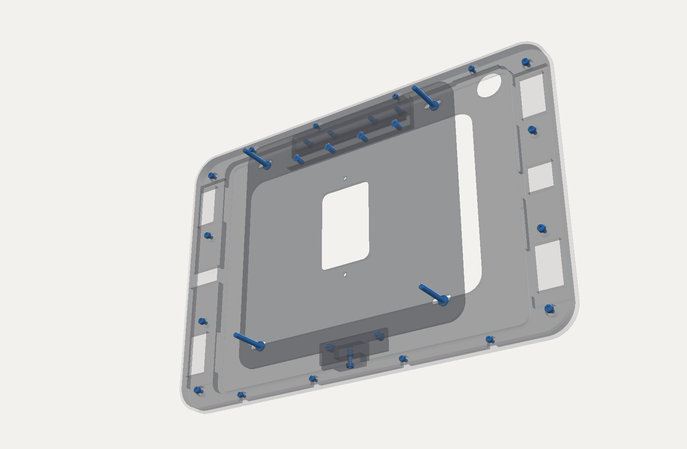

Every assembly STEP carries **all 42 pieces of hardware**, each in its hole: 16 shell screws, 9 heat-set inserts, 10 countersunk screws, 2 nuts, the lock screw and 4 wall screws.

- Named by size and standard, e.g. **hw_M3x5_cap_ISO4762_3**
- assembly_float6.step (machined) and assembly_float6_printed.step
- hardware.txt beside each one is the bill of materials

> [!TIP]
> The model checks itself: no head or nut touches a part it shouldn’t, and every screw and insert bites into its own part.

---

### TOOLS

BEFORE YOU START

#### BENCH

- Soldering iron + heat-set tip
- Hex keys 1.5, 2 and 2.5 mm
- Flat screwdriver
- Isopropyl alcohol + cloth
- Soft towel

#### MACHINING

- CNC router (StrongHold)
- 6 mm and 2 mm end mills
- 2.05 and 2.5 mm drills
- M2.5 and M3 taps
- Deburring tool

#### WALL

- Stud finder
- Spirit level
- Plasterboard saw
- Drill / driver
- Pencil + tape measure

The 1.5 mm and 2 mm keys drive the button-head screws on the 13″ and 11″ M5. No CNC? Skip the machining column and print the shell (page 24).

---

### PRINT SETTINGS

PRINTING

| Setting | Value |
| --- | --- |
| Material | PETG or ASA |
| Layer height | 0.2 mm (0.4 mm nozzle) |
| Walls | 4 (5 on hanger, lock boss, rail) |
| Infill: carrier | 15% gyroid |
| Infill: wall bracket | 25% gyroid |
| Infill: hanger, lock boss, rail | 40% gyroid |
| Infill: printed shell | 20% gyroid, 4 bottom layers |
| Supports | None needed |
| Bed | Textured PEI |

> [!WARNING]
> **No supports.** Every v6 part, for every iPad, was checked for overhangs in its print orientation. The only bridges are the carrier’s Ø6 screw counterbores.

> [!TIP]
> **One-piece parts** use the same settings as the split ones. Add a brim on very large plates.

> [!TIP]
> **Bambu Studio?** Each iPad’s float/printed folder has a 3MF with every plate and setting ready.

---

### PARTS LIST

PRINTING

| Part (size in mm) | Qty | 12.9″ | 13″ M5 | 11″ M5 | mini |
| --- | ---: | --- | --- | --- | --- |
| CARRIER TL / TR / BL / BR | 1 each | 171.8 × 117.2 | 172.2 × 117.5 | 156.3 × 98.5 | 129.2 × 77.1 |
| CARRIER, ONE PIECE (option) | 1 | 343.5 × 234.3 | 344.5 × 234.9 | 312.6 × 196.9 | 258.3 × 154.2 |
| HANGER | 1 | 110.0 × 21.4 | 110.0 × 21.4 | 110.0 × 21.4 | 110.0 × 21.4 |
| LOCK BOSS | 1 | 60.0 × 17.5 | 60.0 × 17.5 | 60.0 × 17.5 | 60.0 × 17.5 |
| CATCH RAIL | 1 | 120.8 × 28.0 | 120.8 × 28.0 | 120.8 × 28.0 | 120.8 × 28.0 |
| WALL BRACKET | 1 | 200.0 × 214.5 | 200.0 × 215.1 | 200.0 × 177.1 | 200.0 × 134.3 |
| SHELL, 6061 | 1 | 348.1 × 238.9 | 349.1 × 239.5 | 317.2 × 201.5 | 262.9 × 158.8 |
| SHELL, PRINTED L / R | 1 each | 179.1 / 174.1 | 208.8 / 145.3 | 191.3 / 130.9 | 136.5 / 131.5 |
| SHELL, PRINTED ONE PIECE | 1 | 348.1 × 238.9 | 349.1 × 239.6 | 317.2 × 201.5 | 263.0 × 158.8 |

Pick one carrier (four quarters or one piece) and one shell (aluminium, two printed halves, or one printed piece). The printed halves are all 238.9 mm or less tall, so each fits a 256 mm bed.

---

### FILES

PRINTING

#### ‹iPad›/float/machined/

- machine/shell_6061.step
- machine/shell_6061_drawing.pdf
- print/ carrier quarters, hanger, lock_boss, catch_rail, wall_bracket
- print/one_piece/carrier_full
- assembly_float6.step · hardware.txt

#### ‹iPad›/float/printed/

- Float_Mount_v6_‹iPad›_Float_Printed.3mf
- print/ shell_print_L · _R and every hidden part
- print/one_piece/ shell and carrier
- assembly_float6_printed.step · hardware.txt

#### v6/ (the sources)

- tablets.py: the four iPads
- float6.py · drawing6.py
- printed6.py · make3mf6.py
- hardware6.py: screws, inserts, nuts

‹iPad› is **ipad_pro_12_9_gen3**, **ipad_pro_13_m5**, **ipad_pro_11_m5** or **ipad_mini_a17_pro**. Every size in this manual comes from float6.py and tablets.py: set V6_TABLET to the iPad, change a parameter, re-run, and every file and the drawing regenerate.

---

### CARRIER

PARTS ORIENTATION · 1 OF 4

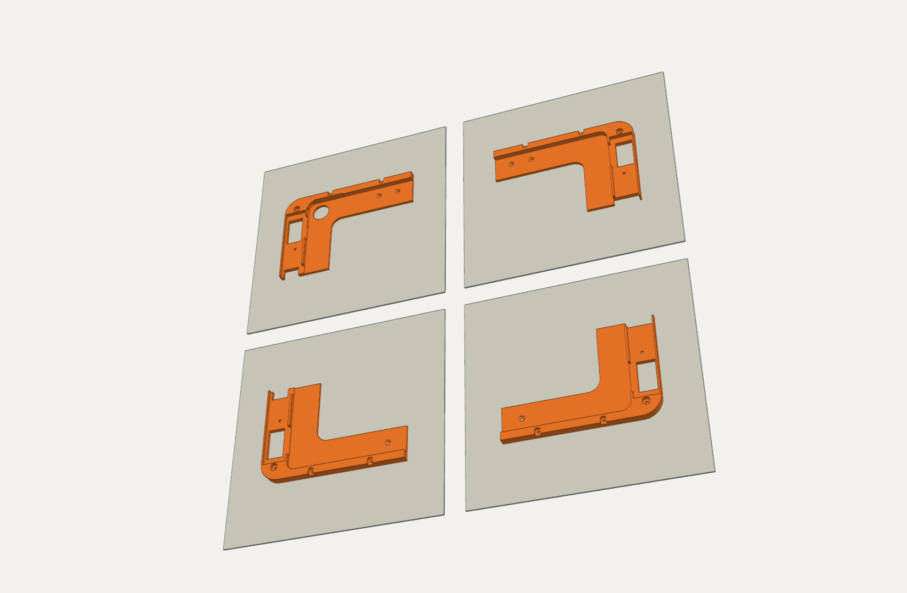

Print each quarter **back face down**, exactly as exported. One quarter per plate.

15% gyroid · 4 walls · no supports

> [!TIP]
> **Big bed?** print/one_piece/carrier_full is the whole carrier, back face down. The 12.9″ and 13″ need a 350 mm bed; the 11″ fits an H2S or H2D; the mini’s 258 mm just misses a 256 mm bed.

> [!WARNING]
> Quarters look alike: mark each TL, TR, BL or BR as it comes off.

---

### HANGER, LOCK BOSS, CATCH RAIL

PARTS ORIENTATION · 2 OF 4

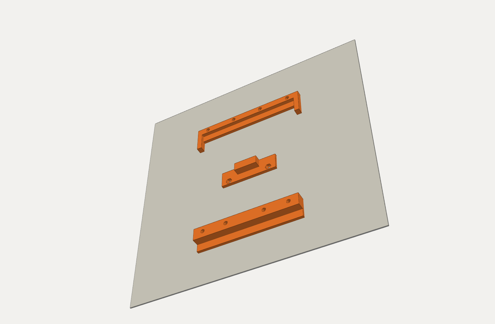

All three fit on one plate, and they are the same parts for every iPad.

- **HANGER:** foot down
- **LOCK BOSS:** pad down
- **CATCH RAIL:** flange down, end stops up

40% gyroid · 5 walls · no supports. These carry the weight, so don’t go lighter.

---

### WALL BRACKET

PARTS ORIENTATION · 3 OF 4

Print the plate **flat side down**. The lock block stands up at the bottom edge.

25% gyroid · 4 walls · no supports

> [!TIP]
> The bed side becomes the wall side, so the countersinks for the rail screws come out on the face that touches the wall.

BY MODEL

The bracket is always 200 mm wide and scales in height with the panel. The mini’s is too short for the 84 mm wall-plate holes: fix it with the 4 slots.

---

### PRINTED SHELL

PARTS ORIENTATION · 4 OF 4 · OPTIONAL

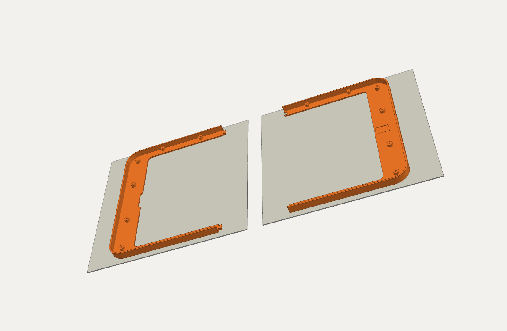

No CNC? Print the shell instead. Use it for real, or as a test before you order metal.

- **Two halves** on 256 mm beds: glue the dovetails with CA or epoxy.
- **One piece**: 350 mm bed for the 12.9″ and 13″; H2S or H2D for the 11″ and mini.
- Always **face down** on textured PEI.

> [!TIP]
> The bosses have pilot holes: the same M3 × 5 and M2.5 × 5 screws thread straight in. Don’t tap them.

BY MODEL

12.9″ and mini: seam on the centreline. 13″ and 11″ M5: seam 3 mm right of the camera notch.

---

### SHELL: BACK SIDE UP

MACHINING · OP 1 OF 2

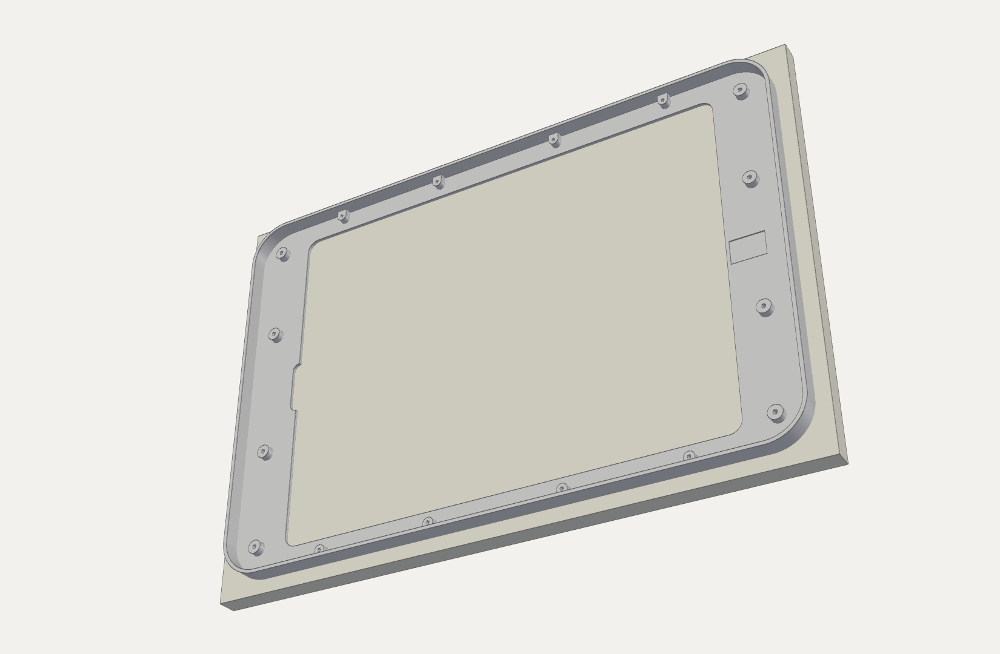

1. Face the plate to the shell thickness (table).
2. Pocket to the depth in the table with a 6 mm flat end mill. Leave the bosses **4.2 mm proud**: 8 × Ø8 on the ends, 8 × Ø6 top/bottom, merged into the skirt.
3. Cut the plug relief at the USB-C end.
4. From each boss tip, drill **4.5 mm** (to full diameter): Ø2.5 on the ends, Ø2.05 top/bottom. Tap **3.0 mm**: M3×0.5 and M2.5×0.45.

| mm | 12.9″ | 13″ | 11″ | mini |
| --- | --- | --- | --- | --- |
| Face to | 11.7 | 10.9 | 11.1 | 12.1 |
| Pocket | 9.2 | 8.4 | 8.6 | 9.6 |
| Plug relief | 0.55 | 0.94 | 0.86 | 0.34 |

> [!WARNING]
> **4.5 mm is the limit** on every model: the drill point then leaves 1.45 mm under the face.

---

### SHELL: FRONT SIDE UP

MACHINING · OP 2 OF 2

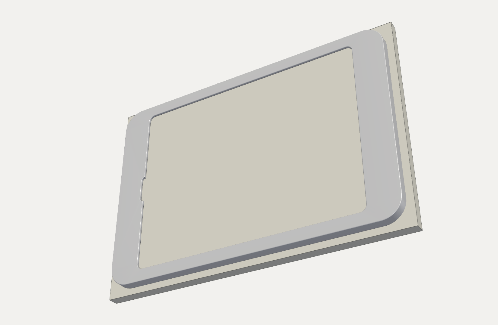

1. Locate off the pocket walls, or soft pins in two boss holes.
2. Cut the window through, with the camera slot (a stadium with R4.2 ends).
3. Profile the outside with tabs.
4. Put a 0.8 mm radius on the front outer edge. Deburr the window.

BY MODEL: WINDOW AND SLOT

**12.9″:** corners R7.5, slot 32 × 8.4 on the left end. **13″ M5:** R11.7, slot 52.5 × 8.4 centred on the top edge. **11″ M5:** R11.7, slot 49.5 × 8.4 centred on the top edge. **mini:** R11.7, slot 16 × 8.4 on the left end.

> [!TIP]
> **Finish:** fine glass bead blast, then clear or black anodise.

---

### ORDERING THE SHELL (JLCCNC)

MACHINING · OR ORDER IT

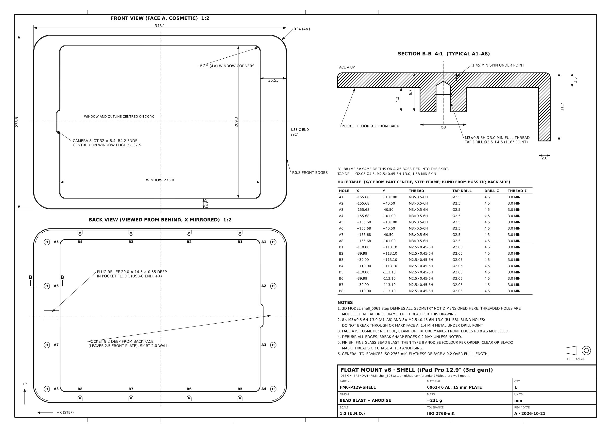

Upload your iPad’s **shell_6061.step** and **shell_6061_drawing.pdf** together, from float/machined/machine/. The drawing tells the shop which holes to tap.

- Material: **6061-T6**
- Threads per drawing: 8 × M3×0.5-6H and 8 × M2.5×0.45-6H, 3.0 deep
- Finish: bead blast + anodise, threads masked
- Face A (the front) is cosmetic

BY MODEL

Each drawing carries its own part number (FM6-P129, -P13, -P11, -MINI) and hole positions. The mini’s calls for 15 mm plate.

> [!WARNING]
> If the quote rejects M2.5, ask before switching to M3: it thins the Ø6 bosses.

---

## 01 · BENCH ASSEMBLY

Nine steps on the bench, the same for every iPad. You finish with a complete panel: shell, iPad and carrier, ready to hang.

---

### HEAT-SET INSERTS

BENCH ASSEMBLY · STEP 1 OF 9

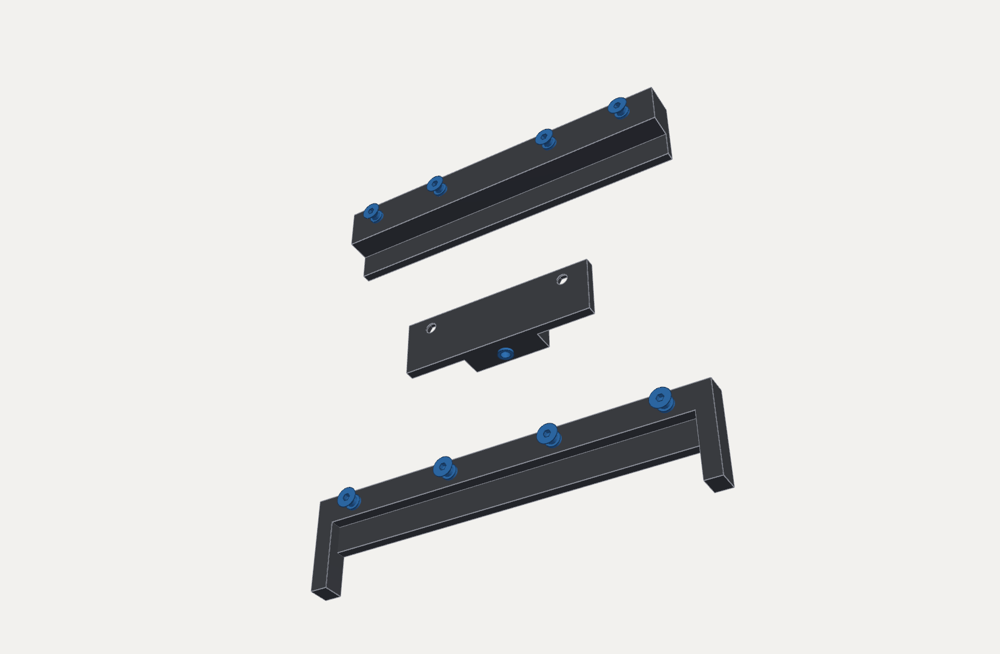

Press the inserts in with the iron: **4 in the HANGER** (top face), **1 in the LOCK BOSS** (end-on, along its length) and **4 in the CATCH RAIL** (flat face).

Push straight, stop when flush, and let each one cool before you touch it. The holes are Ø4.2 for short M3 inserts (5.7 mm long).

**You need:** 9 × M3 heat-set inserts · soldering iron with insert tip

---

### CATCH RAIL TO THE BRACKET

BENCH ASSEMBLY · STEP 2 OF 9

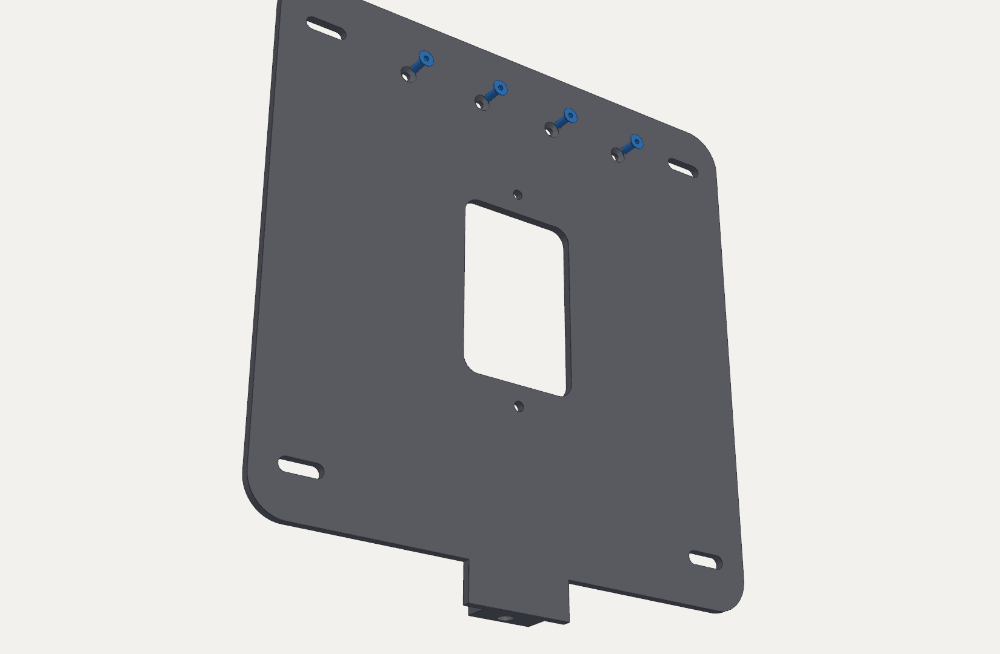

Fix the CATCH RAIL near the top of the WALL BRACKET with four countersunk screws, driven from the wall side of the plate into the rail’s inserts.

The rail’s lip points up, and its two end stops stand up at each end. The slot between them opens toward the top of the bracket.

> [!WARNING]
> Heads must sit flush or below the plate, or the bracket will rock on the wall.

**You need:** 4 × M3 × 8 countersunk screws · 2 mm hex key

---

### HANGER TO THE TOP QUARTERS

BENCH ASSEMBLY · STEP 3 OF 9

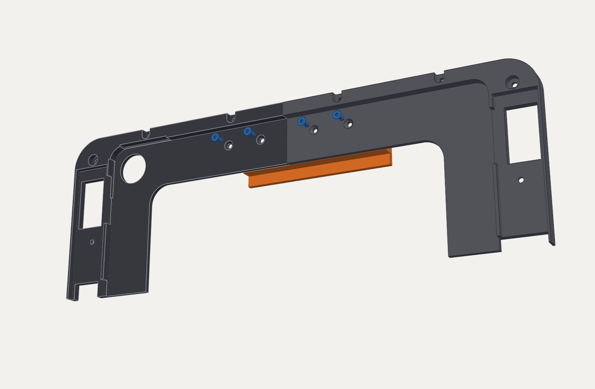

Lay CARRIER TL and TR side by side, pocket side up, with the centre seam butted tight. Hold the HANGER under the seam.

Drive 4 countersunk screws down from the pocket side into the hanger’s inserts. The hanger now splices the two quarters.

> [!WARNING]
> Heads must sit flush: the iPad lies on top of them.

**You need:** CARRIER TL + TR · HANGER · 4 × M3 × 8 countersunk

---

### LOCK BOSS TO THE BOTTOM QUARTERS

BENCH ASSEMBLY · STEP 4 OF 9

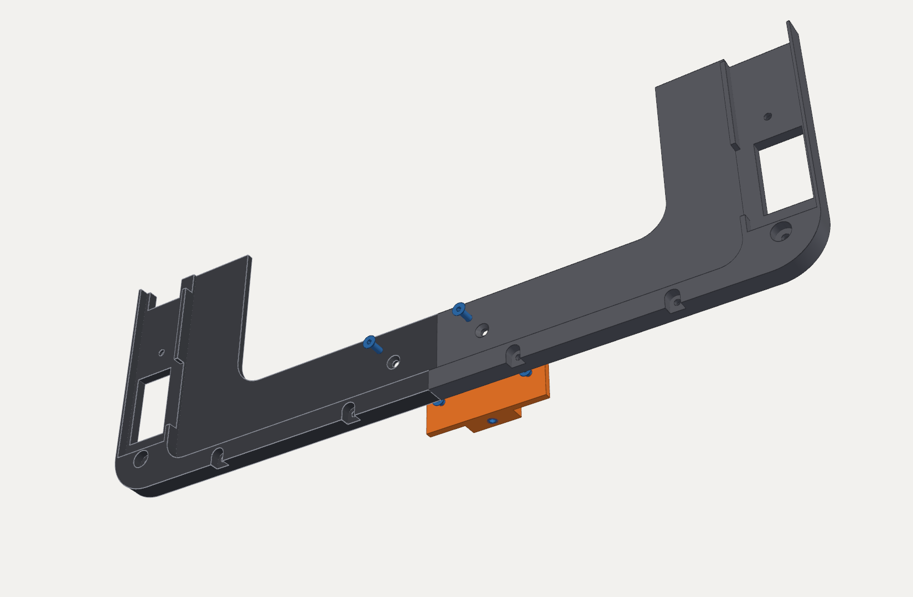

Drop two M3 nuts into the hex pockets on the LOCK BOSS. Lay CARRIER BL and BR pocket side up, seam butted.

Hold the lock boss under the seam and drive 2 countersunk screws down into the nuts.

> [!WARNING]
> The insert you fitted in step 1 must face down toward the bottom edge.

**You need:** CARRIER BL + BR · LOCK BOSS · 2 × M3 × 8 countersunk · 2 × M3 nuts

---

### PORON TAPE ON THE LIP

BENCH ASSEMBLY · STEP 5 OF 9

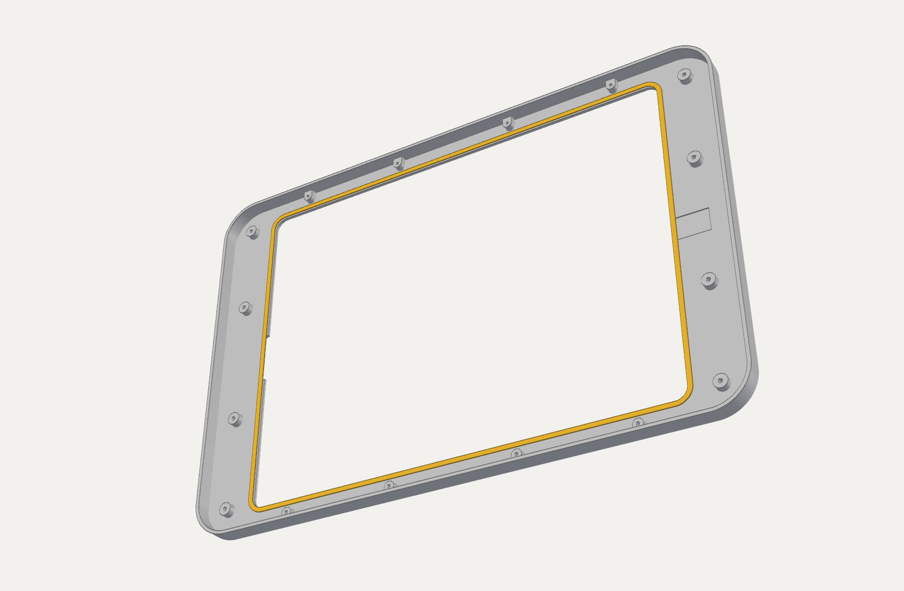

Lay the SHELL face down on a soft towel. Clean the lip with isopropyl alcohol.

Run the 0.3 mm PORON tape around the underside of the lip, where the glass will sit. Butt the ends; don’t overlap them.

> [!TIP]
> The tape takes up the 0.3 mm gap so the iPad can’t rattle. Keep it clear of the camera slot, whichever edge it is on.

**You need:** SHELL · about 1 m of 0.3 mm PORON tape · isopropyl alcohol

---

### iPAD INTO THE SHELL

BENCH ASSEMBLY · STEP 6 OF 9

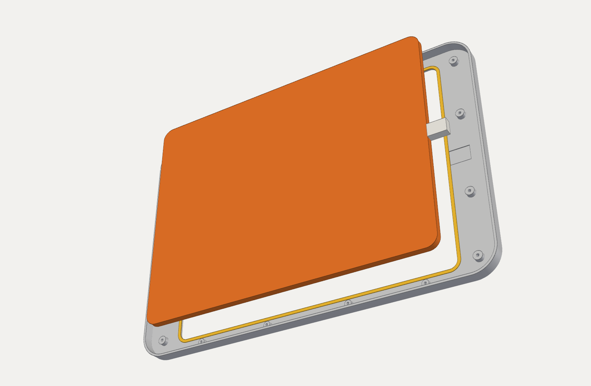

Plug the USB-C cable into the iPad first. Then lower the iPad face down into the shell, **USB-C at the right-hand end** (seen from the front).

Let the glass settle evenly onto the tape. Check the screen edge is centred in the window before you go on.

BY MODEL

**12.9″ and mini:** front camera at the slot in the left end. **13″ and 11″ M5:** front camera at the slot in the top edge.

**You need:** Your iPad · straight USB-C cable

---

### CARRIER INTO THE SHELL

BENCH ASSEMBLY · STEP 7 OF 9

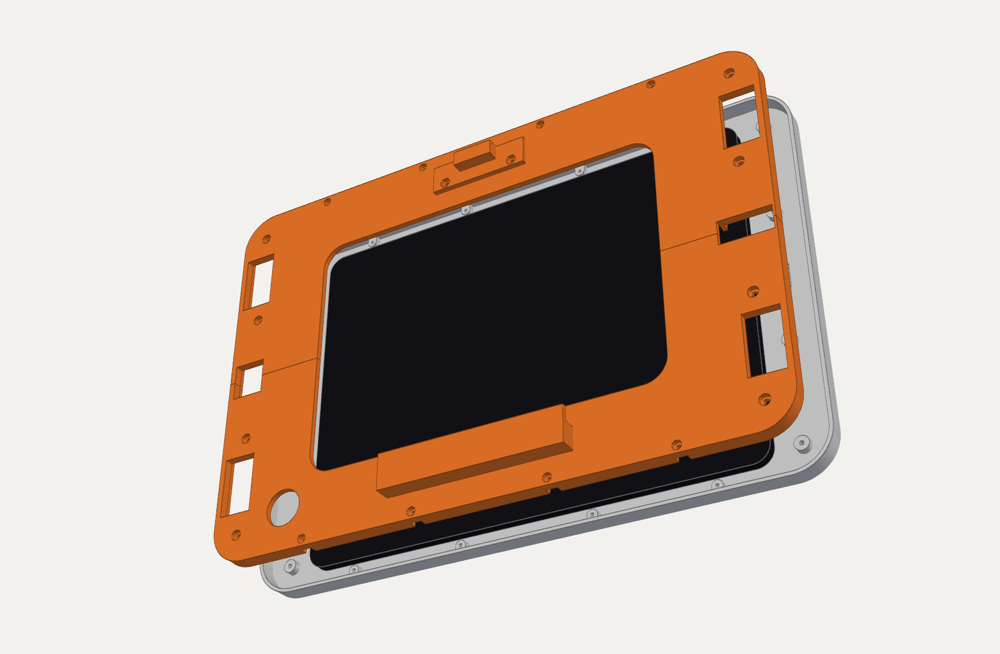

Lower both carrier pairs over the iPad. The **HANGER goes to the panel’s top edge**, the LOCK BOSS to the bottom.

Guide the plug into its pocket at the USB-C end and feed the cable out through the opening in the back. The shell’s skirt lines the quarters up for you.

> [!WARNING]
> Don’t force it. If a quarter won’t sit flat, the cable is trapped.

> [!TIP]
> Look along the edges: the button reliefs should sit over the buttons, with a clear gap.

---

### SCREW THE CARRIER TO THE SHELL

BENCH ASSEMBLY · STEP 8 OF 9

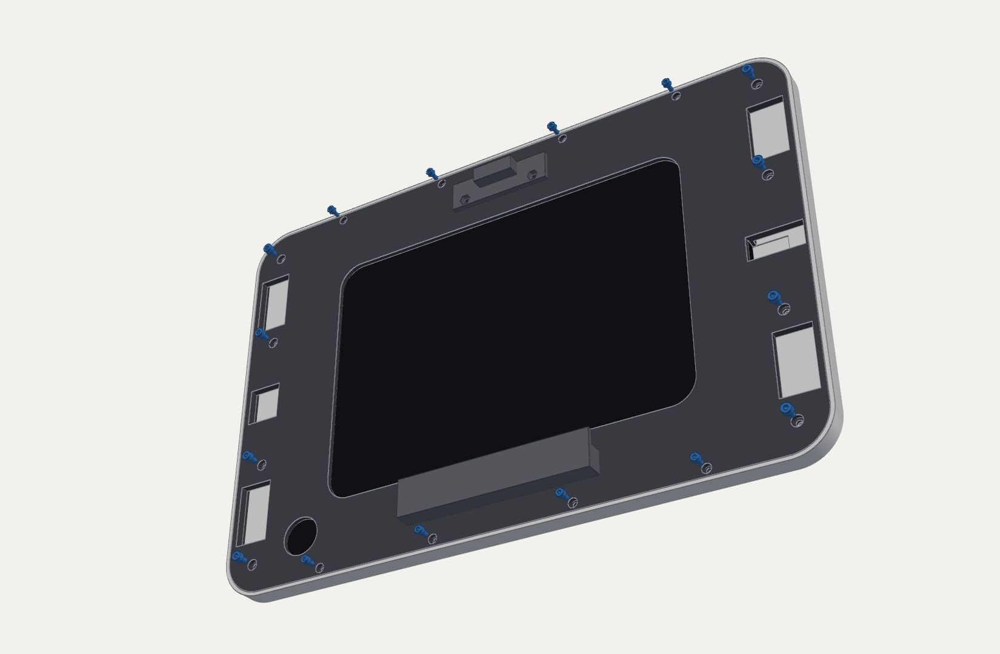

Fit **8 × M3 × 5** in the end bosses and **8 × M2.5 × 5** along the top and bottom.

Start them all by hand, then tighten in a criss-cross order. Snug only: 3 mm of thread in aluminium, or plastic on a printed shell.

> [!WARNING]
> **Use × 5, not × 6.** A 6 mm screw bottoms out in the thread before it clamps.

BY MODEL

**12.9″, mini:** socket cap heads, 2 / 2.5 mm keys. **13″, 11″ M5:** button heads, 1.5 / 2 mm keys. Every head sits flush with, or just below, the carrier back.

---

### CHECK THE BACK

BENCH ASSEMBLY · STEP 9 OF 9

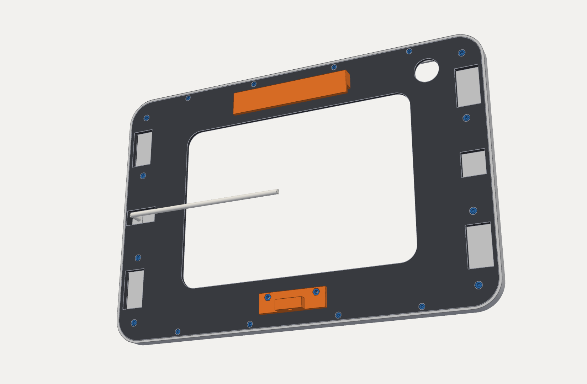

Turn the panel over and check:

- The cable leaves the USB-C end cleanly and isn’t pinched.
- The sound vents at both ends are open.
- The HANGER is at the top, the LOCK BOSS at the bottom.
- No screw heads stand proud.

> [!TIP]
> Leave enough cable to reach the bracket’s cut-out with slack to plug in.

---

## 02 · WALL INSTALLATION

Five steps: plan the position, fix the bracket, connect power, hang the panel, lock it.

---

### PLAN THE POSITION

WALL INSTALLATION · STEP 1 OF 5

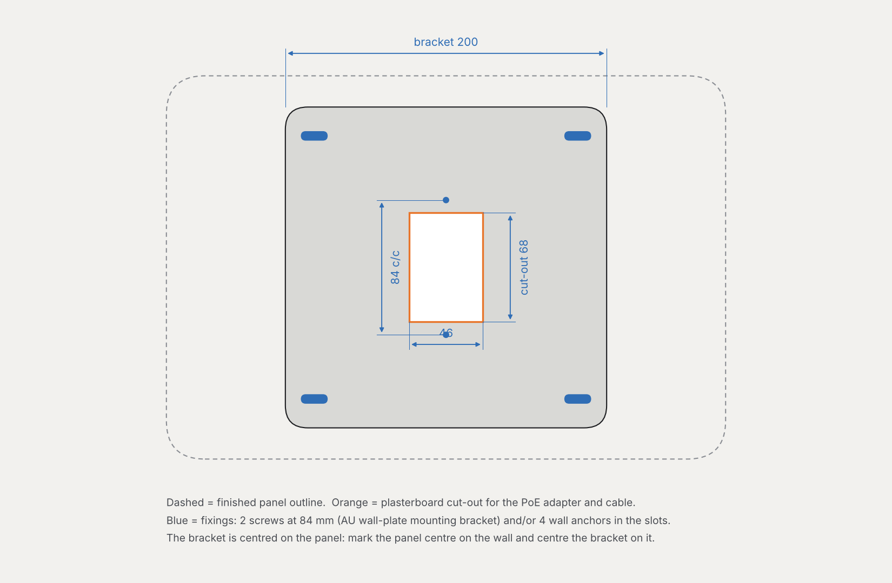

Mark the panel’s centre on the wall. The bracket centres on the same point.

- A screen centre around 1400–1500 mm from the floor is a common choice.
- Check for cables and pipes before you cut.
- The Cat6 must reach the cut-out.

> [!TIP]
> A stud under a bracket slot? Use a wood screw there instead of an anchor.

BY MODEL

Drawn for the 12.9″. The mini’s cut-out is 46 × 56 mm; the others are 46 × 68.

---

### FIX THE BRACKET

WALL INSTALLATION · STEP 2 OF 5

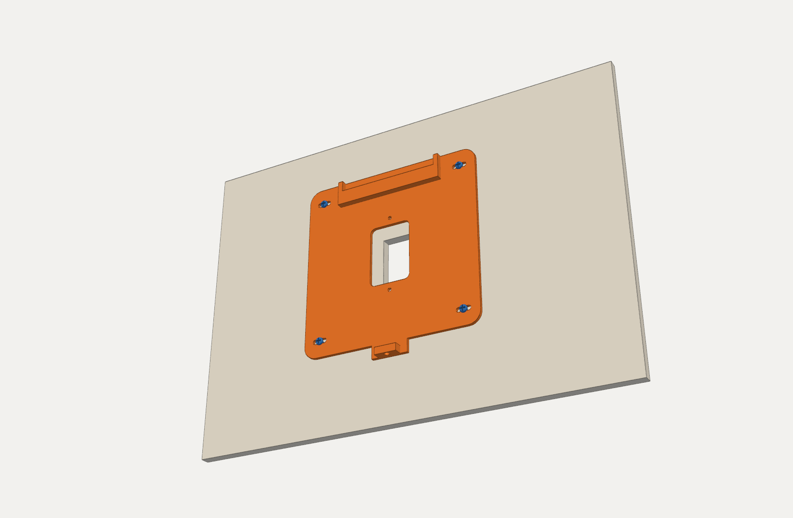

Cut a plasterboard opening that suits your PoE adapter, kept inside the bracket’s footprint.

Level the WALL BRACKET, catch rail at the top, and fix it with 4 anchors through the slots. Or use 2 screws into an AU wall-plate bracket at 84 mm centres (not on the mini).

> [!WARNING]
> Get it level now. The slots allow a little rotation.

**You need:** WALL BRACKET · 4 anchors · spirit level · plasterboard saw

---

### CONNECT THE PoE ADAPTER

WALL INSTALLATION · STEP 3 OF 5

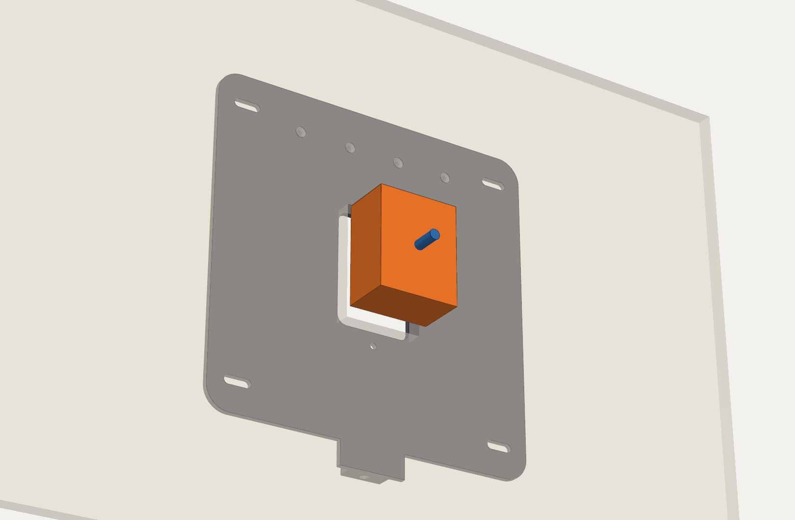

Pull the Cat6 out through the cut-out and plug it into the adapter.

Hold the panel near the wall and plug its USB-C cable into the adapter. Push the adapter back into the cavity and leave the slack loose behind the bracket.

> [!WARNING]
> Check the iPad charges before you hang it.

---

### HANG THE PANEL

WALL INSTALLATION · STEP 4 OF 5

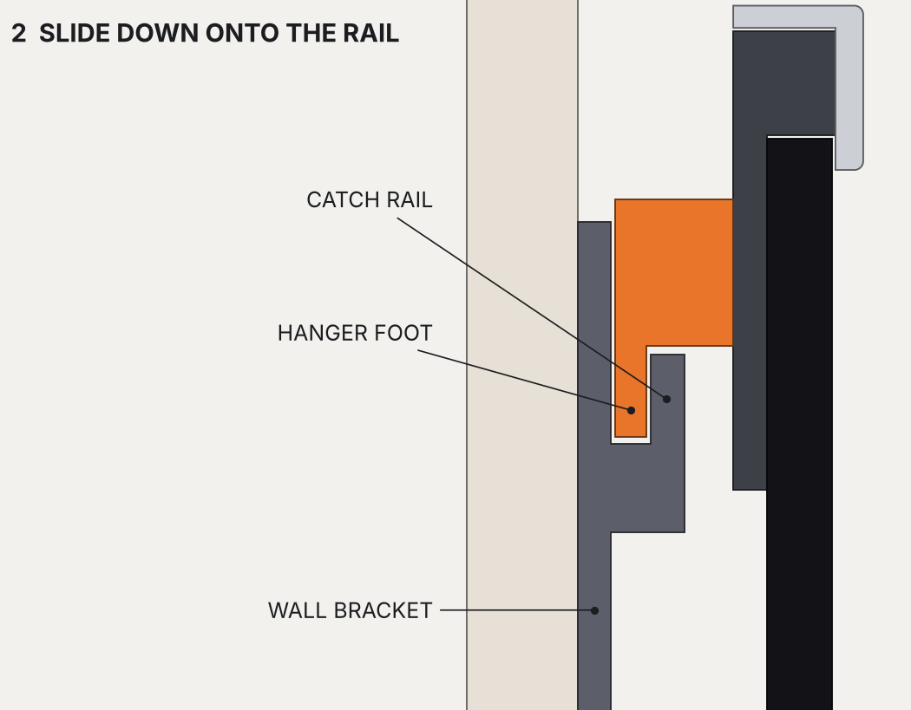

Hold the panel about **10 mm higher** than its final position and push it flat to the bracket.

Slide it straight down. The HANGER foot drops between the end stops, under the CATCH RAIL lip, and stops.

> [!TIP]
> Centre it side to side as it goes down: the stops leave 0.4 mm each way.

> [!TIP]
> Feed the slack cable into the cavity as it goes down.

---

### FIT THE LOCK SCREW

WALL INSTALLATION · STEP 5 OF 5

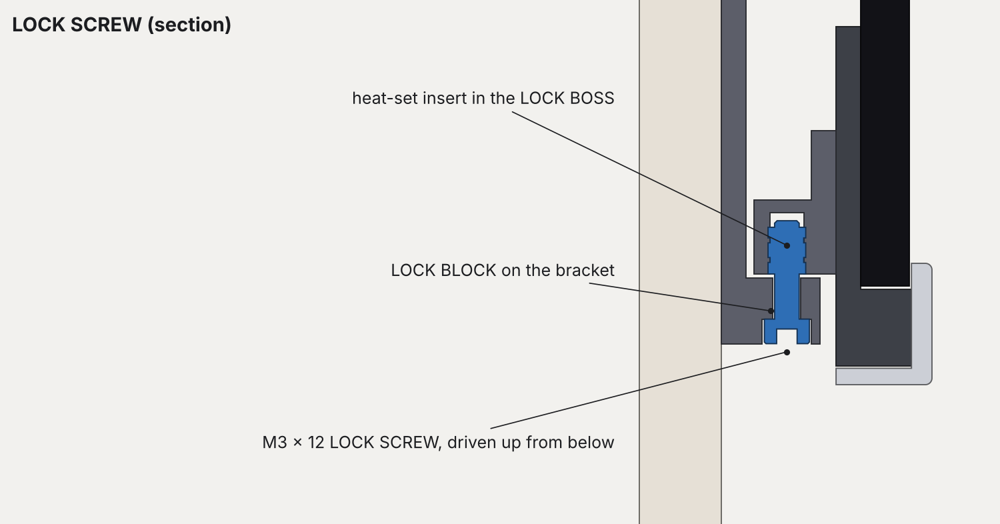

From underneath the panel, reach into the shadow gap and drive the **M3 × 12** up through the LOCK BLOCK into the insert in the LOCK BOSS.

Snug is enough. It only stops the panel lifting off the rail.

> [!TIP]
> A ball-end hex key makes this easy at an angle.

**You need:** 1 × M3 × 12 socket cap · 2.5 mm hex key

---

### iPAD SETUP FOR A WALL PANEL

SETUP

#### KEEP THE SCREEN ON

Settings › Display & Brightness › Auto-Lock › Never. Dim it at night with a Shortcut or Home Assistant automation.

#### LOCK TO ONE APP

Settings › Accessibility › Guided Access. Start it in Home or your dashboard app.

#### BUTTONS ARE COVERED

Turn on Settings › Accessibility › Touch › AssistiveTouch for lock, volume and restart. On the mini the Touch ID button is covered too: use the passcode.

#### CHECK ETHERNET

With the adapter connected, an Ethernet entry appears in Settings. Wi-Fi can stay on as a backup.

---

### FINAL CHECKLIST

FINISHING BUILD

- [ ] Panel sits level and doesn’t rattle

- [ ] iPad shows it is charging

- [ ] No sideways play on the rail

- [ ] Ethernet appears in Settings

- [ ] Volume doesn’t change by itself

- [ ] Lock screw in; panel can’t lift off

- [ ] Face ID unlocks first time (Pro)

- [ ] Speakers clear; Siri hears you

- [ ] Screen edges clear of the lip all round

- [ ] Guided Access and Auto-Lock set

> [!WARNING]
> **Something off?** Every size lives in float6.py and tablets.py. Measure the problem, change the parameter, re-run it, and reprint only the part that changed.

---

## ENJOY YOUR FLOAT MOUNT

The M5 and mini features come from Apple’s drawings; the 12.9″’s are close estimates. Build it with a printed shell first and check the fit before you order metal.

Also available: Float Mount v6 Flush, the in-wall version, for the same four iPads.

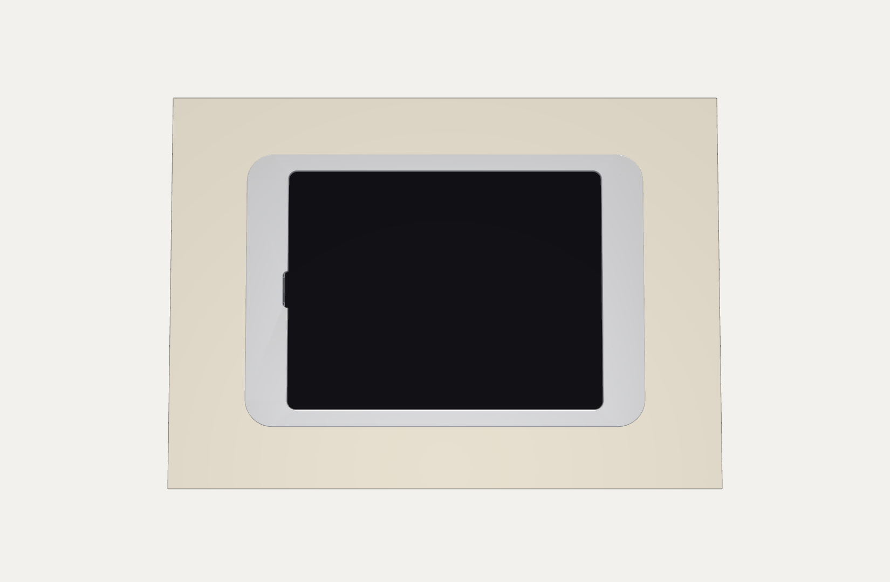
